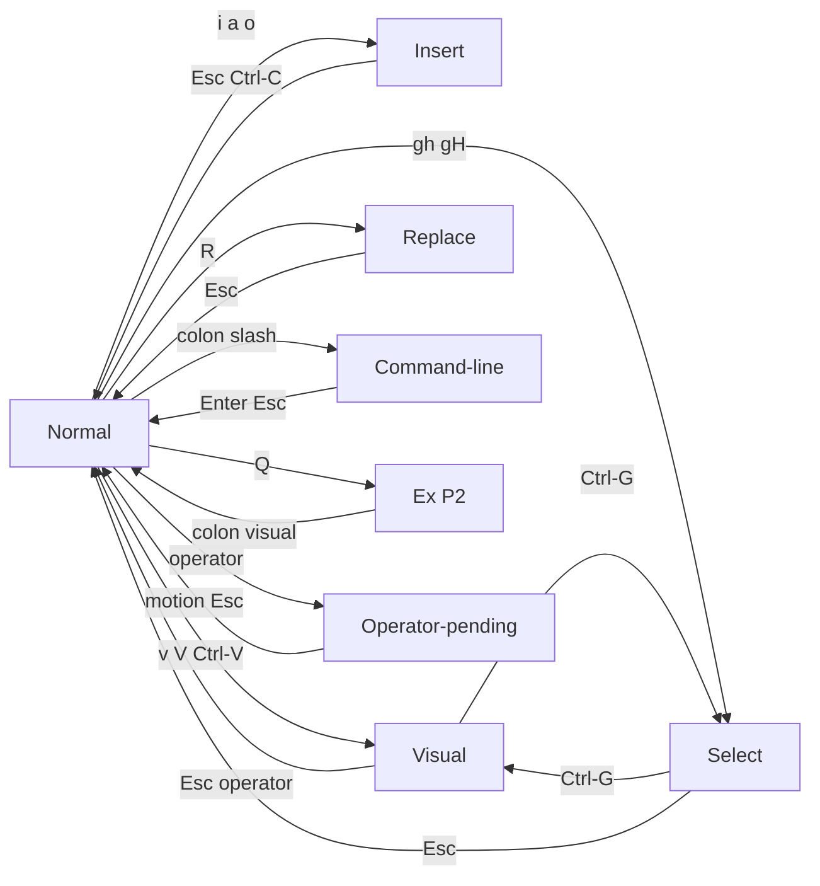
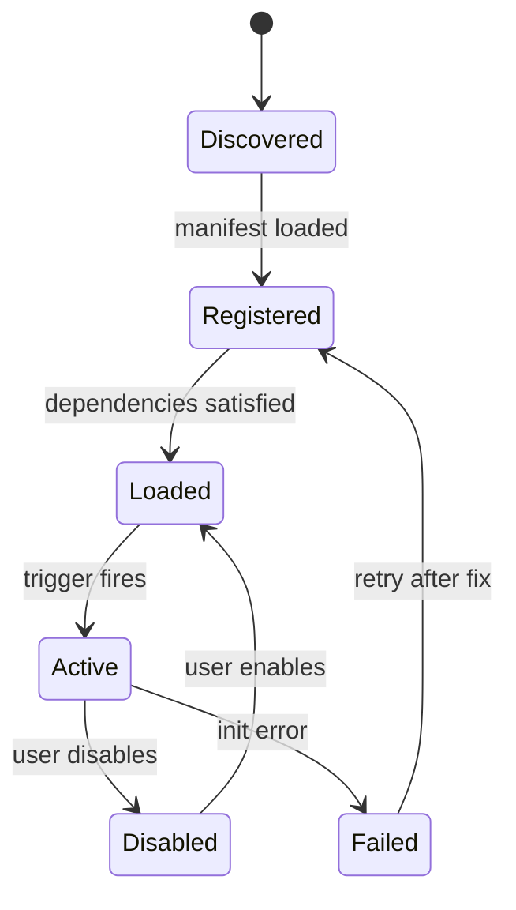
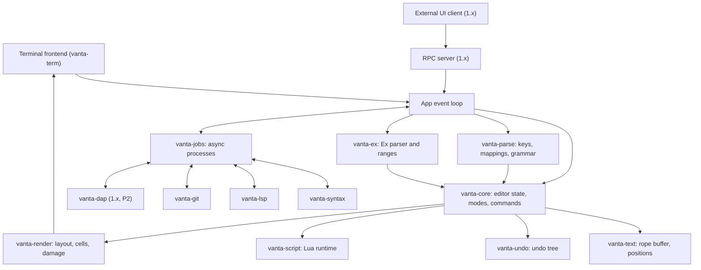

# Vanta — Technical Product Specification!!!

> **TL;DR:** Vanta is an independent, native editor implementing Vim's editing language with modern ergonomics; it does NOT run Vimscript and does NOT provide runtime compatibility for existing Vim or Neovim plugins.

| Field | Value |
|---|---|
| Document | `PROJECT_SPEC.md` |
| Product | Vanta |
| Version | 1.0 (Draft) |
| Status | Approved for implementation; normative for the 1.0 release |
| Date | 2026-10-31 |
| Audience | Implementers, maintainers, reviewers, AI coding agents |
| Companion document | [[AGENTS\|AGENTS.md]] — mandatory working rules for agents |
| Supersedes | None |

> Vanta is a terminal-first modal text editor that reproduces Vim's editing model with a modern systems implementation, ships the most useful Vim/Neovim plugin functionality as curated first-party modules, and remains fast, small and scriptable.

This document defines **what Vanta must become and why**. It does not prescribe day-to-day engineering process; that is the role of [[AGENTS|AGENTS.md]]. Where the two documents overlap, this specification is authoritative for behavior and the agent guide is authoritative for workflow.

## Document control

### Normative language

Release scope is expressed with four priorities. A requirement is normative only when it carries a requirement ID in one of the tables in this document. Priority is scope, not defect severity: a defect inherits release-blocking status from the requirement it violates.

| Priority | Meaning for Vanta | Release |
|---|---|---|
| **P0** | Blocker and core stability. Essential for 1.0; prevents data loss, crashes, corruption or memory-safety failure. Includes atomic save, basic modal editing, undo integrity, terminal restoration and memory safety. | 1.0 |
| **P1** | 1.0 mandatory. Core daily-development scope: tree-sitter syntax, LSP client, picker, Git signs, async jobs, completion, windows, search and the supporting platform work. | 1.0 |
| **P2** | Nice-to-have and 1.x scope. Deferred or optional features delivered in post-1.0 point releases, such as the full DAP client, interactive Ex-mode loop (`Q`/`gQ`), dashboard, bufferbar, spell checking, bidi support or Markdown conceal rendering. | 1.x |
| **P3** | Out of scope and non-goal. Deliberately excluded from the product: Vimscript interpretation, Neovim plugin binary/API compatibility, a 1.0 GUI, an AI assistant and a package manager. | Never |

P0 and P1 requirements are mandatory for 1.0. A P2 requirement must be designed for, but its user-visible feature is absent or explicitly disabled in 1.0. A P3 item must not be partially implemented or exposed behind a hidden flag.

### Requirement IDs

Every normative requirement has a stable identifier of the form `PREFIX-NNN`. IDs are never reused or renumbered. Requirements may be referenced from code, tests, commit messages, ADRs and [[AGENTS|AGENTS.md]].

| Prefix | Area | Section |
|---|---|---|
| `MODE` | Modal editing | [[#3A Modal editing\|§3A]] |
| `KEY` | Keyboard controls and command grammar | [[#3B Keyboard controls\|§3B]] |
| `TXT` | Text manipulation | [[#3C Text manipulation\|§3C]] |
| `BUF` | Files, buffers and persistence | [[#3D Files and buffers\|§3D]] |
| `WIN` | Windows, tabs and workspaces | [[#3E Windows and workspaces\|§3E]] |
| `TERM` | Terminal interface | [[#3F Terminal interface\|§3F]] |
| `OBS` | Observability and diagnostics | [[#9. Observability and diagnostics\|§9]] |
| `DEV` | Development functionality | [[#3G Development functionality\|§3G]] |
| `ARCH` | Neovim-inspired architecture | [[#3H Neovim-inspired architecture\|§3H]] |
| `MOD` | First-party modules | [[#4. First-party modules\|§4]] |
| `PERF` | Performance | [[#6. Performance requirements\|§6]] |
| `PLAT` | Cross-platform behavior | [[#7. Cross-platform support\|§7]] |
| `SEC` | Security and reliability | [[#8. Security and reliability\|§8]] |
| `DIFF` | Intentional difference register (documentation identifier, not a requirement) | [[#11.2 Difference register\|§11.2]] |

### Compatibility statement

Vanta targets **behavioral compatibility with Vim's editing language**, not binary, script or plugin compatibility. An experienced Vim/Neovim user must be able to sit down and edit without relearning modal editing, motions, operators, text objects, registers, macros, marks, windows or Ex commands. Vanta does **not** run Vimscript, does **not** implement Neovim's Lua API, and does **not** claim that reimplementing a plugin's functionality makes that plugin work unmodified. Intentional differences are enumerated in [[#11. Compatibility and intentional differences|§11]] and must be documented as they are discovered, not after release.

### How to read this document

1. Read [[#1. Vision and scope|§1]] and [[#2. Implementation language decision|§2]] for product intent and the language decision.
2. Read [[#3. Requirements|§3]] for behavior. Each subsection contains requirement tables that are the acceptance contract.
3. Read [[#4. First-party modules|§4]] before adding user-facing functionality: it decides what ships built in, what is optional and what stays external.
4. Read [[#5. Architecture|§5]] and [[#6. Performance requirements|§6]] before writing code: they define module boundaries and budgets.
5. Read [[#10. Roadmap|§10]] for sequencing. Do not start a later milestone early; every milestone has entry criteria and an exit gate.
6. Read [[#11. Compatibility and intentional differences|§11]] before claiming compatibility.

## Table of contents

- [[#1. Vision and scope|1. Vision and scope]]
  - [[#1.1 Product definition|1.1 Product definition]]
  - [[#1.2 Target users|1.2 Target users]]
  - [[#1.3 Design principles|1.3 Design principles]]
  - [[#1.4 Positioning|1.4 Positioning]]
  - [[#1.5 Success criteria|1.5 Success criteria]]
  - [[#1.6 Distribution and licensing|1.6 Distribution and licensing]]
  - [[#1.7 Non-goals|1.7 Non-goals]]
- [[#2. Implementation language decision|2. Implementation language decision]]
- [[#3. Requirements|3. Requirements]]
  - [[#3A Modal editing|3A Modal editing]]
  - [[#3B Keyboard controls|3B Keyboard controls]]
  - [[#3C Text manipulation|3C Text manipulation]]
  - [[#3D Files and buffers|3D Files and buffers]]
  - [[#3E Windows and workspaces|3E Windows and workspaces]]
  - [[#3F Terminal interface|3F Terminal interface]]
  - [[#3G Development functionality|3G Development functionality]]
  - [[#3H Neovim-inspired architecture|3H Neovim-inspired architecture]]
- [[#4. First-party modules|4. First-party modules]]
- [[#5. Architecture|5. Architecture]]
- [[#6. Performance requirements|6. Performance requirements]]
- [[#7. Cross-platform support|7. Cross-platform support]]
- [[#8. Security and reliability|8. Security and reliability]]
- [[#9. Observability and diagnostics|9. Observability and diagnostics]]
- [[#10. Roadmap|10. Roadmap]]
- [[#11. Compatibility and intentional differences|11. Compatibility and intentional differences]]
- [[#12. Appendices|12. Appendices]]

## 1. Vision and scope

### 1.1 Product definition

Vanta is a terminal text editor for people who already think in Vim. It reproduces the modal editing language — command grammar, motions, operators, text objects, registers, macros, marks, windows, buffers, tabs and Ex commands — on a modern Rust core designed for low latency, low memory use and predictable behavior.

It is not a Vim clone frozen in time. It adopts the architectural ideas that made Neovim successful: asynchronous jobs, a first-class Lua extension surface, RPC and external UI protocols in 1.x, and built-in language tooling. It then goes further by curating the functionality users otherwise assemble from dozens of plugins, so that a fresh installation is immediately useful for software development without a 2,000-line configuration.

The product promise is:

- **Familiar.** The editing language is Vim's, including its composition rules and edge cases.
- **Fast.** Startup, keystroke latency and scrolling are governed by explicit budgets ([[#6. Performance requirements|§6]]).
- **Light.** A single native binary; no Node, Python, JVM or browser runtime; no background daemons; bounded idle CPU.
- **Complete.** LSP, tree-sitter, Git integration, fuzzy finding, a file explorer, completion, formatting and linting are available without assembling a plugin stack. Debugging arrives in the 1.x series (P2).
- **Extensible.** Lua configuration, plugins and external jobs in 1.0; MessagePack-RPC and the versioned UI protocol follow in 1.x for external frontends.
- **Honest.** Every intentional divergence from Vim/Neovim is documented; plugin compatibility is never implied.

### 1.2 Target users

| Persona | Current situation | What Vanta must give them |
|---|---|---|
| Vim veteran | 10+ years of muscle memory, large vimrc | Same grammar and defaults; no retraining; a migration path for options and mappings |
| Neovim power user | Lua config, LSP, Telescope/Treesitter stack | Equivalent workflow with fewer plugins; Lua API that feels familiar without pretending to be Neovim |
| Remote developer | SSH sessions, tmux, constrained hosts | Fast startup, low memory, OSC 52 clipboard, no language runtime dependency |
| Performance-sensitive user | Large logs, generated code, monorepos | Predictable latency, large-file mode, asynchronous everything |
| New modal user | Curious but intimidated | which-key discovery, built-in help, sensible defaults, no mandatory plugin manager |

Primary user: a developer who edits code daily in a terminal and already knows Vim basics. Secondary user: a Vim user who wants LSP and modern tooling without maintaining a plugin stack. Vanta is not optimized for people who want a mouse-first editor or a full IDE.

### 1.3 Design principles

1. **The grammar is the product.** Operators, motions and text objects compose; shortcuts are never hard-coded one-offs. If `d` works with `w`, it must work with every valid motion and text object.
2. **Vim behavior is the reference, not an inspiration.** When unsure, consult `:help` and test against Vim. Surprising divergences are bugs unless documented in [[#11. Compatibility and intentional differences|§11]].
3. **Fast by construction.** Latency and memory budgets are design constraints, not optimization work deferred to the end. No feature may silently blow a budget.
4. **Batteries included, never welded shut.** Default functionality covers common workflows; every module can be disabled, and disabled modules cost nothing at startup.
5. **One binary, no runtime.** Optional integrations (Git, ripgrep, LSP servers, debug adapters, formatters) are external processes, explicitly configured.
6. **Asynchronous by default, single-threaded where it matters.** The editor state has one owner. I/O and CPU-heavy work happen elsewhere and communicate by messages.
7. **Extensible without freezing mistakes.** Lua is the stable extension surface. There is no native plugin ABI in 1.0. WASM sandboxing is a later option.
8. **Observable.** Startup, rendering, LSP and plugin costs can be measured with built-in tooling and reproduced benchmarks.
9. **Cross-platform parity.** Windows, Linux and macOS are first-class. Platform differences are isolated behind interfaces, not spread through the code.
10. **No bloat without evidence.** A feature must solve a real workflow, not complete a checklist. Duplicate functionality is rejected even when each variant is popular.

### 1.4 Positioning

| Editor | Editing model | Configuration | Built-in tooling | Extension model | Primary trade-off |
|---|---|---|---|---|---|
| Vim 9.2 | Vim modal | Vimscript | Modest; plugins required | Vimscript plugins | Ubiquity and maturity; legacy language and architecture |
| Neovim 0.12 | Vim modal | Lua, Vimscript | LSP, treesitter, terminal, jobs | Lua plugins, RPC, UI protocol | Powerful but requires assembling and maintaining a plugin stack |
| Helix | Selection-first modal | TOML | LSP, treesitter | Limited plugin model | Excellent defaults; not Vim-keymap compatible |
| Kakoune | Selection-first modal | Shell-oriented | Minimal | Shell scripting | Elegant composition; different editing model |
| **Vanta** | **Vim modal** | **Lua** | **Curated modules, LSP, treesitter, Git; DAP in 1.x** | **Lua plugins and jobs in 1.0; RPC and UI protocol in 1.x** | **Must earn trust against decades of Vim edge cases** |

Vanta's differentiator is not a new editing model. It is the combination of Vim's grammar, a modern asynchronous core, and a curated built-in feature set that removes the plugin-assembly tax without removing extensibility.

### 1.5 Success criteria

A 1.0 release is successful when all of the following are true.

**User outcomes**

- A Vim user can open Vanta, edit, split windows, use registers and macros, and save files without consulting documentation.
- The most common development workflows (open project, find file, search text, edit, completion, diagnostics, go to definition, rename, format, Git hunk and terminal) are available from a default install with at most one configuration file; debugging is a 1.x addition.
- A user can disable any first-party module and observe no startup or memory cost from it.
- A user can migrate a typical `vimrc` option and mapping set to `init.lua` using the migration guide, without Vimscript.

**Engineering outcomes**

- Every P0 and P1 requirement in [[#3. Requirements|§3]] through [[#9. Observability and diagnostics|§9]] has an automated test or a documented manual verification procedure.
- All `PERF` targets in [[#6. Performance requirements|§6]] are met on the reference hardware profile, with published methodology and raw results.
- The test suite passes on Windows 11, Ubuntu LTS and macOS on both x86_64 and aarch64 where applicable.
- Differential tests against Neovim pass for the supported command corpus; every excluded case is listed with a reason.
- A 72-hour soak test with LSP, Git, terminal and plugins enabled shows no crash, unbounded memory growth or idle CPU above budget.

**Ecosystem outcomes**

- The Lua API is versioned (`vanta.api_version`), documented, and covered by compatibility tests.
- At least three example plugins exist: a statusline segment, a custom command with an autocmd, and a UI float driven by an external job.

**1.x outcomes**

- The external UI protocol can render and drive the editor from a non-terminal frontend, demonstrated by a reference test client.
- The full DAP client, optional modules and other P2 work listed in [[#10.4 Post-1.0 backlog (P2)|§10.4]] ship in point releases without changing 1.0 behavior.

### 1.6 Distribution and licensing

- **Form factor:** one executable named `vanta`, plus bundled runtime data (help, themes, queries, default filetype rules) embedded in the binary or installed alongside it. No runtime interpreter, package manager or network service is required.
- **Platforms:** Linux x86_64/aarch64 (glibc and musl), macOS x86_64/arm64, Windows x86_64 (static CRT). See [[#7. Cross-platform support|§7]].
- **License:** MIT. Bundled tree-sitter grammars and dictionaries retain their own compatible licenses, recorded in `THIRD_PARTY_LICENSES`.
- **Versioning:** Semantic Versioning for the binary. The Lua API carries an integer version; the UI protocol does the same when it ships in 1.x. A breaking API change requires a major version.
- **Privacy:** no telemetry, no analytics, no automatic update checks, no network access unless the user configures a feature that requires it (LSP, Git remotes, plugins).
- **Release artifacts:** reproducible builds where the toolchain permits, checksums, signed tags, and a changelog that separates user-visible changes, compatibility changes and performance changes.

### 1.7 Non-goals

| Non-goal | Rationale | Priority |
|---|---|---|
| Vimscript interpreter | A second scripting language doubles the runtime, tooling and security surface. Lua is the only extension language. | P3 |
| Running unmodified Vim/Neovim plugins | Would require Vimscript, Neovim's exact API and plugin ABI. Functional reimplementation is the strategy; compatibility is not claimed. | P3 |
| GUI in 1.0 | The terminal is the primary product. The UI protocol is designed so a GUI can be built later without core changes. | P3 |
| Built-in AI assistant | Bloats the binary, adds network and privacy concerns, and changes frequently. Remains an external integration. | P3 |
| Built-in plugin/package manager | Dependency resolution and supply-chain policy are outside the editor. Runtime paths and `:packadd`-style loading are supported. | P3 |
| Collaborative editing | Requires CRDTs, presence and a server model. Not aligned with the single-binary, local-first design. | P3 |
| Notebook or Jupyter UI | Specialized domain; better served by external tools. | P3 |
| Bundled language servers, formatters or debug adapters | Licensing, size, update cadence and security make external processes the correct boundary. | P3 |
| Bundled spell dictionaries | Large and locale-specific; users supply Hunspell dictionaries. The spell engine ships, dictionaries do not. | P3 |
| Windows legacy console parity | `conhost` lacks key protocol and rendering features. Windows Terminal is the supported target; conhost is degraded best-effort. | P3 |
| Mobile or web terminals | Out of scope for 1.0; UI protocol may enable them later. | P3 |

## 2. Implementation language decision

### 2.1 Evaluation criteria

The decision was evaluated against the requirements of a terminal editor: sustained low-latency input handling, large in-memory text buffers, long-running background jobs, native integration with C libraries (tree-sitter, PTY), and a plugin surface that must remain stable for years.

| Criterion | Weight | Why it matters for Vanta |
|---|---:|---|
| Runtime performance | 15 | Per-keystroke latency, rope operations, rendering and syntax parsing at 60 fps |
| Memory consumption | 10 | Idle footprint and large-file behavior are product promises |
| Startup time | 10 | Terminal editors are launched dozens of times per day |
| Memory safety | 15 | Editing engines are a classic source of buffer overflows; crashes lose user work |
| Concurrency | 10 | LSP, Git, search and plugins must never block input |
| Cross-platform support | 10 | Windows, Linux and macOS are first-class |
| Terminal libraries | 8 | Raw input, capability detection, PTY and escape parsing |
| Ecosystem maturity | 12 | Rope, regex, tree-sitter, LSP, Git, diff, Unicode, Lua |
| Plugin development | 5 | Lua embedding, sandboxing options, native extension story |
| Long-term maintainability | 5 | Tooling, build reproducibility, language stability, contributor pool |

Weights sum to 100. Ratings are 1 (poor) to 5 (excellent). Scores are a decision aid, not a substitute for the qualitative analysis below.

### 2.2 Ratings

| Criterion | Weight | Rust | Zig | C | C++ |
|---|---:|---:|---:|---:|---:|
| Runtime performance | 15 | 5 | 5 | 5 | 5 |
| Memory consumption | 10 | 4 | 5 | 5 | 4 |
| Startup time | 10 | 4 | 5 | 5 | 4 |
| Memory safety | 15 | 5 | 3 | 1 | 2 |
| Concurrency | 10 | 5 | 3 | 2 | 3 |
| Cross-platform support | 10 | 5 | 4 | 5 | 5 |
| Terminal libraries | 8 | 5 | 3 | 4 | 4 |
| Ecosystem maturity | 12 | 5 | 2 | 3 | 4 |
| Plugin development | 5 | 5 | 2 | 3 | 3 |
| Long-term maintainability | 5 | 4 | 2 | 2 | 2 |
| **Weighted total** | **100** | **475 / 500** | **358 / 500** | **353 / 500** | **370 / 500** |

### 2.3 Rust

Rust delivers C-class runtime performance for this workload while eliminating whole classes of memory-safety defects in the buffer, parser and Unicode code. Its ownership model maps well to the editor's central design constraint: one owner of editor state, explicit message passing to background workers. The ecosystem contains maintained building blocks for every major requirement: `ropey` and `crop` for text, `crossterm` for terminal control, `tree-sitter` for parsing, `mlua` for Lua, `async-lsp` for language servers, `similar` for diffs, `nucleo-matcher` for fuzzy finding, `portable-pty` and `vte` for terminals.

Costs are real: compile times, binary size, and borrow-checker friction around graph-like structures (windows, buffers, extmarks). They are bounded by workspace modularity, generational handles instead of reference cycles, and a command queue instead of shared mutable state.

Rust is the only candidate with a mature, safe story for all four demanding subsystems at once: Unicode text, asynchronous I/O, embedded scripting and C library interop.

### 2.4 Zig

Zig is attractive on raw axes: small binaries, fast builds, explicit allocators, excellent C interop, and `comptime` instead of macros. For a from-scratch editor with a small team, its simplicity is genuine.

It loses on project risk. As of October 2026, Zig is still pre-1.0 (0.17.0), with breaking language and standard-library changes between releases. The new `std.Io` interface is substantial progress, but evented backends remain less mature than the threaded one. The terminal ecosystem is thinner: `libvaxis` is a capable cross-platform TUI library, but there is no equivalent of the Rust ecosystem's breadth for LSP, tree-sitter hosting, Lua embedding or diffing. Every non-trivial integration becomes first-party work. For a project whose differentiator is editing behavior, not infrastructure, that is the wrong place to spend engineering time.

Zig would be a reasonable choice for a smaller editor with a narrower feature set and a team prepared to own its libraries.

### 2.5 C

C remains the language of the terminal, tree-sitter, ncurses and Lua itself. Nothing in the requirements is impossible in C. Performance and footprint would be excellent, and platform reach is unmatched.

The costs are unacceptable for a long-lived editor with a small maintainer pool. Manual memory management across ropes, undo trees, extmarks, async jobs and plugin handles invites use-after-free bugs that are expensive to diagnose and catastrophic for user data. There is no standard concurrency model, no package manager worth relying on for reproducible builds, and no way to express ownership in the type system. Writing the product would consume most of the effort; writing the infrastructure safely would consume the rest. C is the right choice for the libraries Vanta consumes, not for the editor itself.

### 2.6 C++

C++ offers performance, mature terminal libraries such as `notcurses`, and the ability to reuse the C ecosystem. Modern C++ (C++20/23) has better safety tools than C: RAII, smart pointers, `std::variant`, concepts and sanitizers.

It also carries the highest accidental complexity of the four. Template errors, undefined behavior in move/destruction paths, ABI instability across compilers and standard libraries, and inconsistent build tooling make a multi-platform editor harder to maintain. Safety remains opt-in; the language does not prevent the buffer and lifetime errors that matter most here. The ecosystem for editor-specific building blocks (rope, LSP types, async runtime) is weaker and less coherent than Rust's. C++ would be a lateral move: more historical baggage than Rust with fewer safety guarantees.

### 2.7 Decision

**Vanta will be implemented in Rust**, stable toolchain 1.99.1, Edition 2024, MSRV 1.90.

The decisive factors are memory safety in the editing engine, a coherent maintained ecosystem for every subsystem, fearless concurrency for LSP and jobs, and an extension story that supports Lua today and WASM later without a native ABI. Zig's language instability and thin ecosystem, C's safety burden, and C++'s complexity each introduce project risk larger than Rust's known costs.

This is a whole-project decision. C and C++ remain acceptable for small, audited FFI shims or build tooling where a platform API demands it; Zig is not an accepted implementation language for any crate.

### 2.8 Costs and mitigations

| Risk | Mitigation |
|---|---|
| Long compile times | Split into small crates; `dev` profile with `opt-level = 1` for dependencies; `sccache` in CI; avoid monomorphization-heavy APIs |
| Large binaries | Thin LTO, `codegen-units = 1`, `strip = "symbols"`, `panic = "abort"` in release, feature-gated grammars; binary budget in [[#6. Performance requirements\|§6]] |
| Borrow-checker friction in editor state | Generational handles (`BufferId`, `WindowId`, `TabId`), arenas owned by the editor, command queue for mutations, no `Rc<RefCell<...>>` graph |
| Async complexity | Single-threaded core; background runtime communicates by bounded channels; no locks in core; cancellation tokens |
| Panic aborts leaving a broken terminal | Panic hook restores terminal state before abort; swap files are always on disk |
| Toolchain churn | Pinned `rust-toolchain.toml`; MSRV verified in CI; upgrades are explicit changes with changelog entries |
| Overuse of `unsafe` for performance | `unsafe` confined to platform/FFI crates; safety comments; Miri where feasible; benchmarks must justify each block |

### 2.9 Toolchain, FFI and unsafe policy

- **Toolchain:** `rust-toolchain.toml` pins the stable minor version used for release builds. CI also builds with the declared MSRV. Edition is 2024.
- **MSRV:** 1.90 initially, driven by `tree-sitter` 0.27.1 (Rust 1.90). An MSRV bump requires a minor release note and a CI job update.
- **FFI:** permitted only for tree-sitter, Lua, PTY and platform APIs. Bindings live in dedicated crates; no FFI types leak into the public editor API without a safe wrapper.
- **Unsafe:** forbidden in `vanta-text`, `vanta-core`, `vanta-parse`, `vanta-ex`, `vanta-undo`, `vanta-config` and `vanta-render`. Allowed only in `vanta-fs`, `vanta-pty`, `vanta-term` and narrowly scoped platform modules, each block carrying a `SAFETY:` comment that states the invariant. `#![deny(unsafe_op_in_unsafe_fn)]` is workspace-wide.
- **Dependencies:** every dependency is pinned in `Cargo.lock`, license-checked with `cargo-deny`, and justified in an ADR when it is not already sanctioned by [[#5.2 Crates and dependency direction|§5.2]].

## 3. Requirements

This section is the behavioral contract. Each requirement has an ID, a priority, a testable statement and acceptance criteria. Requirement IDs are referenced by the roadmap ([[#10. Roadmap|§10]]), module specs ([[#4. First-party modules|§4]]) and [[AGENTS|AGENTS.md]].

### 3.1 Requirement conventions

- **P0** and **P1** requirements are mandatory for 1.0. **P2** requirements are designed for and delivered post-1.0. **P3** behavior is prohibited in the default build.
- A requirement is satisfied only when its acceptance criteria are covered by an automated test, or by a manual procedure recorded in `Documentation/verification/`.
- Behavior is specified relative to Vim 9.2 unless a requirement names Neovim. When Vim and Neovim differ, Vim wins except where [[#11. Compatibility and intentional differences|§11]] records an intentional difference.
- A requirement that mentions a key sequence uses Vim notation: `<C-d>` is Ctrl+d, `<Esc>` is Escape, `<Leader>` is the `mapleader` value (`\` by default).
- Buffer positions are byte offsets internally; user-visible columns are display cells; cursor movement is grapheme-aware.

### 3A Modal editing

Vanta is modal: the meaning of a key depends on the current mode. Modes are explicit state, displayed in the statusline, observable through `ModeChanged`, and testable without a terminal. Mapping tables are mode-specific; a mapping defined for Normal mode must never fire in Insert mode.

| Mode | ID | Entered by | Left by | Primary behavior |
|---|---|---|---|---|
| Normal | `normal` | Startup, `<Esc>`, `<C-c>`, completion of commands | Any mode-entering command | Commands, counts, registers, operators, motions |
| Insert | `insert` | `i I a A o O gi gI`, `c`, `s` | `<Esc>`, `<C-c>`, `<C-[>` | Literal text insertion, completion, insert commands |
| Visual | `visual` | `v`, `gv` | `<Esc>`, operator, `<C-g>` | Characterwise selection and operators |
| Visual Line | `visual-line` | `V` | `<Esc>`, operator | Linewise selection and operators |
| Visual Block | `visual-block` | `<C-v>`, `<C-q>` | `<Esc>`, operator | Rectangular selection, block insert/append |
| Select | `select` | `gh`, `gH`, `g<C-h>` | `<Esc>`, `<C-g>`, `<C-o>` | Typing replaces the selection, like Vim Select mode |
| Replace | `replace` | `R` | `<Esc>`, `<C-c>`, `<C-[>` | Overtype without shifting existing text |
| Command-line | `cmdline` | `:`, `/`, `?`, `!` in Visual | `<Enter>`, `<Esc>`, `<C-c>` | Ex command, search or filter input with editing and completion |
| Ex | `ex` | `Q`, `gQ` | `:visual`, `:vi`, end of input | Line-oriented Ex command loop (P2, 1.x) |
| Terminal | `terminal` | `i` in a terminal buffer | `<C-\><C-n>` | Keys forwarded to the embedded job |
| Operator-pending | `op-pending` | Operator key in Normal or Visual | Motion completion or `<Esc>` | Internal state while an operator awaits a motion or text object |

#### Mode transitions



| From | To | Trigger | Notes |
|---|---|---|---|
| Normal | Insert | `i I a A o O gi gI` | Cursor placement follows Vim exactly; `o`/`O` open a line and enter Insert |
| Normal | Replace | `R` | `gR` enters virtual replace (P2) |
| Normal | Visual | `v` | Anchor is the current cursor position |
| Normal | Visual Line | `V` | Selection is whole lines |
| Normal | Visual Block | `<C-v>` or `<C-q>` | `<C-q>` exists for terminals that reserve `<C-v>` for paste |
| Normal | Select | `gh gH g<C-h>` | Characterwise, linewise and blockwise Select |
| Normal | Command-line | `: / ?` | Visual `:` pre-fills the range `'<,'>` |
| Normal | Ex | `Q gQ` | P2 in 1.x; 1.0 reports a clear deferred-feature message and stays in Normal |
| Normal | Terminal | `i` in a terminal buffer | Terminal buffers open in Normal mode for scrolling and copying |
| Normal | Operator-pending | `d c y < > = g~ gu gU g? ! gq gw g@ zf` | Operator may be followed by count, motion, text object or another operator |
| Visual | Select | `<C-g>` | Selection is retained; typing replaces it |
| Select | Visual | `<C-g>` | Returns to the corresponding Visual variant |
| Visual | Command-line | `:` | Range is `'<,'>`; commands that accept a range receive it |
| Visual | Insert | `I A` in Visual Block, `c`, `s` | Block insert/append applies to every selected line |
| Insert | Normal | `<Esc>`, `<C-c>`, `<C-[>` | `<Esc>` moves the cursor left by one; `<C-c>` does not |
| Insert | Command-line | Transient `<C-o>:` only | No persistent command-line mode from Insert; one command runs and returns to Insert |
| Replace | Normal | `<Esc>`, `<C-c>`, `<C-[>` | Overtyped characters are restored only by undo |
| Command-line | Normal | `<Enter>` after execution, `<Esc>`, `<C-c>` | Execution errors leave the editor in Normal mode |
| Ex | Normal | `:visual`, `:vi` | `:visual` with a range starts Visual mode on that range |
| Terminal | Normal | `<C-\><C-n>` | Job keeps running; buffer becomes scrollable |
| Terminal | Normal | `<C-\><C-o>` | Execute one Normal command, then return to Terminal |
| Operator-pending | Normal | `<Esc>`, `<C-c>`, invalid motion | Pending count and register are discarded |
| Any | Normal | `<C-c>` | Aborts the current operation without executing it |

#### Mode-specific behavior

**Normal mode.** Keys are parsed by the command grammar in [[#3B Keyboard controls|§3B]]. A count prefix, register prefix and operator may be pending simultaneously. `.` repeats the last change, including its count and register, not the literal keys. `u` and `<C-r>` operate on the undo tree; `U` restores the last changed line (P0). `<C-l>` redraws. `<C-g>` shows file information. `ZZ` and `ZQ` write-and-quit and quit without writing.

**Insert mode.** Text is inserted at the cursor. `<Esc>` leaves Insert and moves the cursor one cell left unless the cursor is in column 1. `<C-c>` leaves Insert without moving and aborts completion. `<C-o>` executes exactly one Normal command and returns to Insert. `<C-r>{register}` inserts register contents literally; `<C-r><C-r>{register}` inserts them with Vim's register semantics. `<C-v>` inserts the next character literally, and `<C-k>` inserts a digraph. `<C-t>` and `<C-d>` indent and dedent. `<C-w>` and `<C-u>` delete the previous word and the text before the cursor on the line. `<C-a>` inserts the previously inserted text. `<C-n>` and `<C-p>` trigger completion; `<C-x>` enters completion submodes. Insert-mode mappings are separate from Normal mappings.

**Visual modes.** The selection is an inclusive range with an anchor and a cursor. `o` swaps the two ends; `O` moves to the opposite corner of a block. `gv` reselects the previous Visual area. Operators apply to the selection, and `.` repeats the last Visual operator with the same selection shape. `I` and `A` in Visual Block insert or append on every line, with changes previewed live and applied as one undo block. `$` extends a block to the end of each line (ragged block). `p` and `P` replace the selection without overwriting the unnamed register in a way that loses the replaced text; the replaced text goes to the unnamed register (documented Vim behavior).

**Select mode.** Printable characters delete the selection and insert themselves, as in Vim's Select mode. `<C-g>` switches to the matching Visual mode. `<Esc>` returns to Normal. Select mode exists primarily for snippet and completion UIs; first-party modules must not leave the user stranded in it.

**Replace mode.** Typing overwrites existing characters. `<Backspace>` restores the overwritten character and moves left. At end of line, typing appends. `<C-r>` and `<C-o>` behave as in Insert mode. `gR` is virtual replace: tabs and other display-expanding characters are replaced without consuming their full width (P2).

**Command-line mode.** The command line is a single-line editor supporting `<Left>`, `<Right>`, `<Home>`, `<End>`, `<C-b>`, `<C-e>`, `<C-w>`, `<C-u>`, `<C-k>`, `<C-r>`, `<C-n>`, `<C-p>`, `<C-d>`, `<Tab>` completion and `<S-Tab>` reverse completion. `<Esc>` cancels and restores the previous cursor. `<C-c>` cancels without executing. `<C-f>` opens the command-line window (optional, may be deferred). History is persistent per command type. Search commands preview matches when `incsearch` is set.
**Ex mode (P2, 1.x).** A line-oriented loop over the same Ex parser used by `:`. It supports ranges, `:global`, `:substitute`, `:print`, `:edit`, `:write`, `:visual` and `:vi`. There is no Vimscript evaluation: `:let`, `:function`, `:if` and `:execute` are rejected with a helpful message. Errors are printed and the loop continues.

**Terminal mode.** Keys are forwarded byte-for-byte to the PTY job except the escape sequences `<C-\><C-n>` and `<C-\><C-o>`. Normal-mode commands in a terminal buffer control scrollback, copy mode and buffer lifecycle. Mouse reporting is forwarded only while the job requests it.

**Operator-pending mode.** This is not a user-selectable mode. It records the operator, optional count, optional register and optional `g` prefix. `<Esc>` cancels. An invalid continuation produces a bell and an error, never a partial edit.

| ID | Priority | Requirement | Acceptance criteria |
|---|---|---|---|
| MODE-001 | P0 | Implement Normal, Insert, Visual, Visual Line, Visual Block, Select, Replace and Command-line modes with the transitions above. | A table-driven test drives every transition and asserts mode, cursor and buffer state; Ex is covered separately by MODE-019. |
| MODE-002 | P0 | `<Esc>` and `<C-c>` return any non-terminal mode to Normal according to Vim semantics. | Cursor left-move on `<Esc>` from Insert is verified; `<C-c>` does not move. |
| MODE-003 | P0 | Insert mode supports the documented insert commands, including `<C-o>`, `<C-r>`, `<C-w>`, `<C-u>`, `<C-t>`, `<C-d>`, `<C-v>` and `<C-k>`. | Golden keystroke tests for each command. |
| MODE-004 | P0 | Visual, Visual Line and Visual Block selections support all applicable operators, `o`, `O`, `gv`, `I`, `A` and `r`. | Differential tests against Neovim for a 40-case corpus. |
| MODE-005 | P0 | Block insert and append apply to every selected line as one undo block with live preview. | Buffer, undo and screen tests with ragged and short lines. |
| MODE-006 | P1 | Select mode replaces the selection on printable input and preserves Vim's `<C-g>` toggle. | Mode and buffer tests. |
| MODE-007 | P0 | Replace mode overtypes, restores on backspace, and appends at end of line. | Golden tests including multibyte characters. |
| MODE-008 | P0 | Command-line mode provides the documented editing keys, history and completion categories. | PTY tests for editing, cancel, history and completion. |
| MODE-009 | P2 | Interactive Ex mode executes the supported Ex command subset and rejects Vimscript constructs with clear errors; absent in 1.0. | Parser tests in the 1.x implementation; `:let` produces a documented error. |
| MODE-010 | P0 | Mode changes emit `ModeChanged`, update the statusline and set the terminal cursor shape. | Event capture test; screen assertion for cursor shape where supported. |
| MODE-011 | P1 | `gv` reselects the last Visual area, including shape and direction. | Selection tests after operators and mode changes. |
| MODE-012 | P0 | `<C-o>` in Insert executes exactly one Normal command and returns to Insert. | Test with `3dd`, `.` and an aborted operator. |
| MODE-013 | P0 | Macros, `.` and `:normal` replay through the same parser and mode engine used for live input. | Instrumented parser test asserts one code path. |
| MODE-014 | P1 | Mapping tables are mode-specific and cannot fire in a different mode. | A Normal mapping is inert in Insert; a Visual mapping is inert in Normal. |
| MODE-015 | P2 | Virtual replace (`gR`) preserves display width semantics. | Tab and wide-character tests. |
| MODE-016 | P0 | Entering a mode never mutates the buffer except where the entering command explicitly edits (for example `o`, `c`, `I`). | Buffer hash unchanged after mode entry tests. |
| MODE-017 | P0 | Pending multi-key sequences resolve by exact match, longest match, or timeout, with configurable `timeoutlen` and `ttimeoutlen`. | Keyboard timing tests with a fake clock. |
| MODE-018 | P0 | `<C-c>` aborts pending operators, counts, macros and completion without partial edits. | Property test: buffer equals pre-operation state after abort. |
| MODE-019 | P2 | Provide the interactive Ex-mode loop entered by `Q` and `gQ` in a 1.x release; 1.0 must not expose a partial loop. | 1.x parser and PTY tests cover `Q`, `gQ`, `:visual` and error recovery; 1.0 asserts a clear deferred-feature message. |

### 3B Keyboard controls

Shortcuts are not implemented as isolated commands. Live keys, mapped keys, macros, `.` repeat and `:normal` all feed one parser that produces commands for one editing engine. This is the central architectural constraint of the product.

#### Command grammar

```
command     := [count] [register] (operator [count] (motion | text-object)
                                  | motion
                                  | action)
operator    := "d" | "c" | "y" | ">" | "<" | "=" | "g~" | "gu" | "gU"
             | "g?" | "!" | "gq" | "gw" | "g@" | "zf"
motion      := "h" | "j" | "k" | "l" | "w" | "W" | "b" | "B" | "e" | "E"
             | "ge" | "gE" | "0" | "^" | "$" | "g_" | "|" | "f" | "F" | "t" | "T"
             | ";" | "," | "%" | "{" | "}" | "(" | ")" | "[[" | "]]" | "[]" | "]["
             | "G" | "gg" | "H" | "M" | "L" | "n" | "N" | "*" | "#" | "gd" | "gD"
text-object := ("i" | "a") ("w" | "W" | "s" | "p" | "(" | ")" | "b" | "{" | "}"
             | "B" | "[" | "]" | "<" | ">" | "\"" | "'" | "`" | "t")
count       := [1-9] [0-9]*
```

The parser is a state machine with explicit states: `Idle`, `Count`, `Register`, `Operator`, `OperatorCount`, `MotionPrefix`, `TextObject`, `GPrefix`, `ZPrefix`, `BracketPrefix`, `WindowPrefix`, `MarkPrefix`, `RegisterPending`, `SearchPending`. Invalid transitions produce an error and a bell, never a partial edit. `<Esc>` and `<C-c>` reset the machine to `Idle` without applying anything.

Counts multiply when both the operator and the motion carry one: `3d2w` deletes six words. `3dw` and `d3w` also delete three. A count on a linewise motion selects that many lines: `3dd`, `3G`, `3j`. Counts on `f`, `t`, `;` and `,` repeat the search that many times. A count on `|` selects a column. `g` and `z` prefixes accept counts where Vim does.

| Keys | Parse | Result |
|---|---|---|
| `dw` | operator `d` + motion `w` | Delete to the next word, exclusive |
| `3dw` | count 3 + operator `d` + motion `w` | Delete three words |
| `d2w` | operator `d` + count 2 + motion `w` | Delete two words |
| `ci"` | operator `c` + text object `i"` | Change inside double quotes |
| `:%s/old/new/g` | Ex range `%` + substitute | Replace all matches in the file |

#### Operator and motion semantics

Every operator accepts every applicable motion and text object. Applicability is data, not branching in each operator: motions declare whether they are characterwise-inclusive, characterwise-exclusive or linewise, and whether they can be used with an operator. Text objects declare their selection function. The operator engine applies the resulting range.

| Rule | Behavior |
|---|---|
| Exclusive motion | End position is not included (`dw`); `d$` includes the final character by Vim special case |
| Inclusive motion | End position is included (`de`, `d%`) |
| Linewise motion | Whole lines are operated on (`dj`, `dG`, `dd`) |
| `cw` | Acts like `ce` when on a non-blank; preserves Vim's special case |
| `dw` at end of line | Does not join the next line; deletes to end of line only |
| `d$` | Deletes to end of line, not the newline |
| `dd` | Deletes the whole line, including its newline |
| `y$` | Yanks to the end of line without the newline |
| `dG` | Deletes from the cursor line through the last line |
| `dgg` | Deletes from the first line through the cursor line |
| `dap` | Deletes the current paragraph plus trailing blank lines |
| Visual operator | Selection is inclusive; block operators apply per line |
| `.` repeat | Repeats the last change with its recorded count, register and text objects |

Operators enter Operator-pending mode and are cancellable. An operator with no motion repeats on the current line when the operator has a linewise form (`dd`, `yy`, `>>`, `<<`, `==`, `g~~`, `gUU`, `g??`), and errors otherwise. `g@` invokes a Lua operator function (P1). `!` filters through an external command. `zf` creates a manual fold.

#### Default keymaps and deliberate additions

**Baseline:** Vanta implements full behavioral compatibility with Vim 9.2 standard motions, operators, and text objects. The complete Vim 9.2 keymap surface is the baseline and is not reproduced here as a reference table; the differential corpus, `:help` and the operator/motion rules above are the source of truth. No standard Vim binding is removed or repurposed.

The following are the only deliberate additions to the Vim 9.2 defaults. They are LSP actions, documented, and disabled with their server or module. `<Leader>` is `\` unless the user changes `mapleader`.

| Key | Mode | Action | Priority |
|---|---|---|---|
| `K` | Normal | Hover documentation in a float | P1 |
| `grn` | Normal | Rename symbol with a preview of all workspace edits | P1 |
| `gra` | Normal | Code action picker with diff preview | P1 |
| `grr` | Normal | References picker | P1 |
| `gri` | Normal | Implementation picker | P1 |
| `grt` | Normal | Type-definition picker | P1 |
| `gO` | Normal | Document-symbol picker | P1 |
| `[d` `]d` | Normal | Previous or next diagnostic | P1 |
| `<C-s>` | Insert | Signature help when a server supports it | P1 |

No plugin-style keybindings, fuzzy-finder bindings or terminal multiplexer bindings are enabled by default. Modules that add mappings must document them, scope them by mode, and remove them when disabled. The grammar and composition rules above are normative: every key path, including macros, `.` repeat and `:normal`, feeds the same parser.

#### Mapping system

Mappings are first-class commands, not a separate key path. A mapping expands into keys (or a Lua callback) that the same parser consumes, so counts, registers and operator-pending states compose correctly.

```vim
" Vim-compatible command form
nnoremap <silent> <Leader>f :Picker files<CR>
inoremap <C-l> <Right>
vnoremap <Leader>c "+y
nnoremap <expr> <Leader>n vanta.picker.is_open() ? "<Cmd>Picker close<CR>" : "<Cmd>Picker files<CR>"
```

```lua
-- Lua form, preferred in init.lua and plugins
vanta.keymap.set("n", "<Leader>f", "<Cmd>Picker files<CR>", { silent = true, desc = "Find files" })
vanta.keymap.set({ "n", "x" }, "ga", function() vanta.lsp.code_action() end, { desc = "Code action" })
```

- Supported map commands: `map`, `nmap`, `vmap`, `xmap`, `smap`, `omap`, `imap`, `cmap`, `tmap`, `lmap` and their `noremap` variants. `map!` maps Insert and Command-line modes.
- Attributes: `<silent>`, `<expr>`, `<nowait>`, `<buffer>`, `<unique>`, `<special>`, `<script>` (accepted where meaningful; otherwise rejected with a clear error), `<Cmd>` and `<Nop>`.
- `<Plug>` names are supported for plugin-provided mappings. `<Leader>` and `<LocalLeader>` expand from options.
- Recursive mappings expand until no mapping applies, bounded by `maxmapdepth` (default 1000). Errors report the mapping chain.
- Ambiguous prefixes wait up to `timeoutlen` (default 1000 ms); key-code ambiguity uses `ttimeoutlen` (default 50 ms). `<nowait>` resolves immediately.
- Buffer-local mappings shadow global mappings of the same mode and keys for that buffer.
- `:map`, `:nmap`, `:imap` and friends list mappings; `:verbose` includes the source file and line.
- No mapping is defined by default beyond Vim's built-ins and the documented LSP defaults. Modules that add mappings must document them and allow disabling them.

| ID | Priority | Requirement | Acceptance criteria |
|---|---|---|---|
| KEY-001 | P0 | All editing input flows through the command grammar and parser state machine described above. | Parser unit tests; instrumentation proves macros, `.` and live keys share the path. |
| KEY-002 | P0 | Counts compose multiplicatively and match Vim for operators, motions, `f`/`t`, `G`, `%`, `\|` and linewise commands. | Differential corpus covering 30 count combinations. |
| KEY-003 | P0 | Every operator works with every applicable motion and text object, with Vim's inclusive, exclusive and linewise rules. | Matrix test: operators × motions × objects. |
| KEY-004 | P0 | Text objects match Vim for words, WORDs, sentences, paragraphs, brackets, quotes, tags and nested brackets. | Differential tests including cursor outside the object. |
| KEY-005 | P0 | `.` repeats the last change with its count, register and inserted text. | Differential tests for insert, change, delete, indent and Visual operations. |
| KEY-006 | P1 | Implement the mapping commands, attributes and `<Plug>` support documented above. | Mapping tests for each mode and attribute. |
| KEY-007 | P1 | Mappings are mode-scoped and buffer-local mappings take precedence. | Cross-mode and shadowing tests. |
| KEY-008 | P1 | Key notation supports modifiers, special keys, angle-bracket escaping and literal Unicode input. | Notation round-trip tests. |
| KEY-009 | P0 | The key decoder supports legacy escape sequences, `modifyOtherKeys` level 2 and the kitty keyboard protocol, negotiated at startup. | PTY tests for each protocol and for unsupported fallback. |
| KEY-010 | P0 | `<Esc>` is distinguishable from the start of a sequence without unexplained delay; `ttimeoutlen` governs the ambiguity. | Timing tests with a fake clock and a real PTY. |
| KEY-011 | P0 | Insert, Command-line and Visual modes support the keys documented in their tables. | Golden tests per mode. |
| KEY-012 | P1 | Window, buffer and tab commands match Vim's prefixes and counts. | PTY tests for `<C-w>` and `gt` counts. |
| KEY-013 | P0 | No default keybinding conflicts with Vim 9.2 outside the documented LSP additions. | Automated comparison of the default map against a pinned Vim keymap inventory. |
| KEY-014 | P2 | Mapping introspection reports the effective mapping, its source and whether it is buffer-local. | `:verbose map` snapshot test. |
| KEY-015 | P0 | Macros and mappings abort cleanly on error or `<C-c>` with no partial edit. | Property tests and PTY abort tests. |

### 3C Text manipulation

#### Registers and clipboard

Every yank, delete, change and put interacts with registers. Register selection is part of the command grammar (`"{register}` prefix), and the unnamed register points at the most recent affected register, as in Vim.

| Register | Contents | Written by | Notes |
|---|---|---|---|
| `"` | Unnamed | Any yank, delete, change or put | Aliases the last affected register |
| `0` | Last yank | `y`, `yy`, `Y`, Visual yank | Overwritten only by yanks |
| `1`–`9` | Delete history | Deletes and changes | `1` is newest; shifts on each delete unless the delete is small and `-` is used |
| `-` | Small delete | Deletes within a line | Preserved when the deleted text has no newline |
| `a`–`z` | Named | Explicit `"a` prefix | Per-register contents, replace semantics |
| `A`–`Z` | Named append | Explicit `"A` prefix | Appends to the lowercase register |
| `_` | Black hole | Explicit `"_` prefix | Discards; does not change unnamed |
| `+` | System clipboard | Explicit or `clipboard=unnamedplus` | Native clipboard or OSC 52 |
| `*` | Selection clipboard | Explicit or `clipboard=unnamed` | Native primary selection where available |
| `.` | Last inserted text | Insert and change | Read-only |
| `:` | Last Ex command | Command-line | Read-only |
| `/` | Last search pattern | Search | Read-only |
| `=` | Expression | Explicit `"=`, then put | Evaluates a Lua expression (documented difference) |
| `%` | Current file name | Editor | Read-only |
| `#` | Alternate file name | Editor | Read-only |

- `:registers` lists registers with type (characterwise, linewise, blockwise) and size. Register contents persist in the state file for named registers, yank/delete registers and small delete, subject to `shada` settings.
- Linewise registers preserve their type. Pasting a linewise register inserts whole lines regardless of cursor column. Blockwise registers paste as a rectangle when possible and degrade to characterwise text when the target cannot form a rectangle.
- The clipboard is read and written through the platform backend, falling back to OSC 52 when no native clipboard is usable (SSH, tmux, containers). OSC 52 writes are limited to 1 MiB by default and can be disabled with `clipboard=`.
- `clipboard=unnamed` maps the unnamed register to `*`; `clipboard=unnamedplus` maps it to `+`. Both are opt-in; default Vim behavior is preserved.
- Reading the system clipboard is lazy and never blocks the input loop for more than 50 ms; a slow clipboard provider produces an error instead of a hang.
- Large yanks: registers above 10 MiB are stored in memory but not written to the state file. `:registers` reports their size.

#### Macros

- `q{register}` starts recording; `q` stops. Recording captures key events before mapping expansion and before parsing, so a macro replays the same logical input and reproduces mode changes.
- `@{register}` executes with a count. `@@` repeats the last executed register. `@:` repeats the last Ex command.
- A macro that invokes itself is detected and aborted with an error rather than exhausting memory.
- An error during macro execution aborts the macro and reports the failing command. `<C-c>` aborts immediately. The buffer remains in the state produced before the failing command, never mid-edit.
- Macros have a configurable execution cap (default 10 million key events) to prevent runaway loops.
- `q` while recording stops recording; `q` in a register that is already recording is an error.
- `:normal` executes keys through the same engine on each addressable line and does not record into a register.

#### Undo, redo and persistent history

- Undo is a **tree**, not a stack. Each change block stores the edits applied, cursor positions before and after, a sequence number, a timestamp and a change kind (insert, delete, change, indent, filter, block, paste).
- One Insert-mode session, one `:s` command, one `p`, and one Visual block operation each form a single undo block. Cursor-only motions never create undo entries.
- `u` moves to the parent block; `<C-r>` moves forward; a new edit after undo creates a new branch and preserves the old one. `g-` and `g+` traverse the tree in time order. `:undo {n}`, `:earlier {time}`, `:later {time}` and `:undojoin` are supported.
- `U` restores the last changed line independently of the tree, as in Vim.
- `undolevels` bounds the number of undo states per buffer (default 1000; `-1` means unlimited, with memory pressure warnings). The undo engine enforces a configurable memory cap (default 64 MiB per buffer) by discarding the oldest branches, never the current path.
- `undofile` enables persistent undo. Files are stored under the state directory, keyed by the canonical file path plus a hash, with a magic header, format version, checksum and compressed payload. Corrupt or incompatible files are ignored with a warning; they never prevent opening the file.
- Undo files are written on save, buffer unload and clean exit, atomically (temporary file, fsync, rename). Permissions are `0600`.
- Terminal buffers and read-only buffers do not create undo state.
- `:undolist` shows the tree; `:undo` diagnostics include block numbers and timestamps.

| ID | Priority | Requirement | Acceptance criteria |
|---|---|---|---|
| TXT-001 | P0 | Implement all registers in the table with Vim's read, write, append and unnamed-pointer semantics. | Register state tests after mixed yank, delete and change sequences. |
| TXT-002 | P0 | Register types (characterwise, linewise, blockwise) are preserved through yank, delete, put and clipboard operations where the backend permits. | Paste tests for each type and direction. |
| TXT-003 | P1 | `clipboard=unnamed`, `unnamedplus`, OSC 52 fallback and explicit `+`/`*` access work without blocking input. | PTY tests with a fake clipboard provider and a 1 MiB payload. |
| TXT-004 | P1 | Macros record, replay, accept counts, detect recursion and abort on error without partial edits. | Property tests and golden macro tests. |
| TXT-005 | P0 | Undo is a tree supporting `u`, `<C-r>`, `g-`, `g+`, `:earlier`, `:later` and `U`. | Differential tests for branching undo sequences. |
| TXT-006 | P0 | Undo blocks group one insert session, one substitute, one put and one block operation. | Undo counts after scripted edits. |
| TXT-007 | P0 | Persistent undo survives process restart, is checksummed, versioned and permission-restricted. | Kill-and-reopen tests, corruption tests, permission assertions. |
| TXT-008 | P0 | Undo memory is bounded by configuration without losing the current path. | Fuzz test with 100k edits asserts the cap and integrity. |

#### Search and regular expressions

Vim's pattern language is not identical to any mainstream regex engine. Vanta implements a **Vim-pattern front end** that parses Vim syntax into an internal pattern IR, then executes it with a linear-time engine where the semantics allow and a backtracking engine only for features that require it.

| Vim syntax | Meaning | 1.0 status |
|---|---|---|
| `abc` | Literal characters | Native |
| `.` | Any character except newline | Native |
| `*` `\+` `\?` | Zero or more, one or more, zero or one | Native |
| `\{n,m}` `\{-n,m}` | Greedy and non-greedy repetition | Native |
| `[abc]` `[^abc]` `[[:alpha:]]` | Character classes and POSIX classes | Native |
| `\(` `\)` `\%(` | Capturing and non-capturing groups | Native |
| `\|` | Alternation | Native |
| `\&` | Concatenation that must match at the same position | Limited; documented |
| `^` `$` | Line anchors; `\_^` and `\_$` for multiline | Native |
| `\<` `\>` | Word boundaries | Native |
| `\zs` `\ze` | Set match start or end inside the pattern | Native, via match-span post-processing |
| `\c` `\C` | Force case-insensitive or case-sensitive | Native |
| `\v` `\m` `\M` `\V` | Very magic, magic, nomagic, very nomagic | Native translation |
| `\d` `\s` `\w` `\D` `\S` `\W` | Perl-style character classes | Native |
| `\n` `\t` `\r` | Escapes in patterns | Native |
| `\1`–`\9` in pattern | Backreferences | Unsupported in 1.0; compile error with guidance |
| `\@=` `\@!` `\@<=` `\@<!` | Lookahead and lookbehind | Lookahead limited; lookbehind unsupported in 1.0 |
| `\%[abc]` | Optional character sequence | Native |
| `\k` `\i` `\f` `\p` | Keyword, identifier, filename, printable classes | Native where defined by the buffer's character class options |

- `magic`, `very magic`, `nomagic` and `very nomagic` switch parsing rules exactly as Vim does. Escaping rules are tested against a Vim-derived corpus.
- A pattern that uses an unsupported construct fails at compile time with the pattern position and a link to the compatibility register ([[#11. Compatibility and intentional differences|§11]]). It never silently matches different text.
- Search options: `ignorecase`, `smartcase`, `hlsearch`, `incsearch`, `wrapscan`, `gdefault`, `iskeyword` and `searchtimeout` (default 2 s for pathological patterns). Catastrophic backtracking is bounded by `searchtimeout` and reported as an error.
- Search offsets are supported: `/pat/+1`, `?pat?-1`, `/pat/e` (end of match) and `/pat/b` (beginning). Offsets apply to `n`, `N`, `*`, `#` and `:g`.
- `*`, `#`, `g*` and `g#` use the word under the cursor with the buffer's keyword characters. `gn`/`gN` are motions and can be combined with operators.
- Match highlighting distinguishes the current match, other matches and the visual selection. Search highlight clears on `:nohlsearch` or the next edit where Vim clears it.

#### Substitution and global commands

| Syntax | Behavior |
|---|---|
| `:[range]s/pattern/replacement/flags` | Substitute on the addressed lines |
| `:%s/old/new/g` | Whole file |
| `:'<,'>s/old/new/g` | Last Visual selection |
| Flags `g` `i` `I` `n` `e` `c` `&` | Global, ignore case, force case, count only, suppress errors, confirm, keep previous flags |
| `&` in replacement | The whole match |
| `\0`–`\9` | Capture group references |
| `\U` `\L` `\u` `\l` `\E` `\e` | Case conversion in the replacement |
| `\n` `\r` `\t` | Newline, line break, tab in the replacement |
| `~` | Previous replacement string |
| `\=` | Lua expression replacement (documented difference) |
| `:s` `:&` `:&&` | Repeat the last substitution |
| `:g/pat/cmd` `:v/pat/cmd` | Execute on matching or non-matching lines |
| `:g!/pat/cmd` | Same as `:v` |

- Confirmation mode (`c`) prompts per match with `y`, `n`, `a`, `q`, `l`, `^E`, `^Y` and `<Esc>`, and supports `inccommand`-style live preview where the terminal allows it (P2).
- `:s` is a single undo block, including all replacements in the addressed range.
- Errors follow Vim's behavior: no match is an error unless `e` is present; an empty pattern reuses the last pattern; an empty replacement deletes the match.
- Ranges support line numbers, `.`, `$`, `%`, `'a`, `'<,'>`, `/pattern/`, `?pattern?`, relative offsets (`+1`, `-2`) and `;` chaining. Invalid ranges produce an error before any modification.
- `:vimgrep` runs the internal engine over files and populates the quickfix list with file, line, column and text. `:grep` runs an external command.

| ID | Priority | Requirement | Acceptance criteria |
|---|---|---|---|
| TXT-009 | P1 | Implement the supported Vim pattern syntax and reject unsupported constructs at compile time with position and guidance. | Pattern corpus tests; unsupported patterns never produce a match. |
| TXT-010 | P1 | Search honors `ignorecase`, `smartcase`, `wrapscan`, offsets, `incsearch` and `hlsearch`. | Differential tests for 50 patterns and option combinations. |
| TXT-011 | P0 | Search time is bounded by `searchtimeout` and pathological patterns cannot freeze the editor. | Fuzz corpus plus timing tests. |
| TXT-012 | P1 | Substitution supports the flags, replacement escapes, ranges, confirmation and single-undo-block semantics above. | Differential tests against Neovim for the supported subset. |
| TXT-013 | P1 | `:g`, `:v`, `:vimgrep` and `:grep` populate the quickfix list and handle ranges and errors correctly. | Integration tests with temporary files. |

#### Spelling

Spell checking is an optional module (off by default) with a native engine. It reads Hunspell `.aff` and `.dic` dictionaries through the `spellbook` crate and keeps Vim's commands.

- `:set spell` enables checking for the buffer; `spelllang` selects one or more locales. Dictionaries are discovered in the runtime `spell/` directory and the user's data directory. Vanta never downloads dictionaries.
- Misspellings are highlighted as undercurl (or underline where unsupported) on visible text only. Checking is incremental and cached per line; edits invalidate only affected lines.
- `]s` and `[s` move between misspellings; `z=` lists up to 25 suggestions in a popup; `zg` adds a word to the personal dictionary; `zw` marks a word as wrong; `zug` undoes `zg`.
- `spellfile` selects the personal dictionary. Writes are atomic and permission-restricted.
- `<C-x>s` completes from the spell dictionary when the module is enabled.
- Dictionary loading happens on first use, never at startup. A missing or malformed dictionary produces a non-fatal error and leaves spell checking disabled.
- Performance: checking 200 visible lines against a 100k-word dictionary must complete within 10 ms after warm-up (P2 target).

#### Indentation and formatting

- Indentation options: `autoindent`, `smartindent`, `cindent` (P2), `expandtab`, `tabstop` (8), `shiftwidth` (8), `softtabstop` (0), `shiftround`, `smarttab`, `copyindent`, `preserveindent`.
- `>>`, `<<`, `>` and `<` shift by `shiftwidth`, respect `shiftround`, operate linewise, and treat blank lines according to Vim's rules.
- `=` reindents through, in order: `indentexpr` (Lua, when set), a tree-sitter indent query for the filetype, a filetype default indenter, or a conservative fallback that preserves relative indentation. `=` must be idempotent for supported filetypes.
- Bracket paste disables auto-indent and mappings, inserts text literally, and restores the previous state afterward. `paste` option support is provided for compatibility.
- `gq` and `gw` format paragraphs to `textwidth` using `formatoptions` and comment leaders. `gw` keeps the cursor in place; `gq` leaves it at the end. `formatexpr` may delegate to Lua. Supported `formatoptions` flags are `t`, `c`, `r`, `o`, `q`, `a`, `n`, `2`, `w`, `b`, `m`, `M` and `j`; unsupported letters are reported once.
- `:center`, `:left` and `:right` (P2) format addressed lines to `textwidth`.
- Formatting never modifies text outside the addressed range, and a failed external formatter leaves the buffer unchanged.

#### Folding

- Fold methods: `manual`, `indent`, `expr`, `syntax` (tree-sitter), `marker` and `diff`. `foldmethod`, `foldlevel`, `foldminlines`, `foldignore`, `foldnestmax`, `foldcolumn`, `foldenable` and `foldtext` are supported.
- Commands: `zf{motion}`, `zf` on a Visual selection, `zo`, `zc`, `za`, `zR`, `zM`, `zr`, `zm`, `zj`, `zk`, `[z`, `]z`, `:fold`, `:foldopen`, `:foldclose`, `:folddoopen` and `:folddoclosed`.
- Fold ranges are anchored with extmarks so they survive edits above and inside the fold; edits that invalidate a manual fold remove it with a single notification.
- Folds are preserved in views and sessions when `foldmethod` is manual or marker. Computed folds are recomputed on load.
- `foldtext` may be a Lua function returning one display line; errors fall back to the default text and notify once.
- Rendering collapsed folds must not parse or highlight hidden text beyond what the syntax engine already maintains.

#### Completion

- The completion engine merges asynchronous sources: buffer words (indexed per buffer), file paths, LSP completion, snippets (P2), spell suggestions and command-line specific sources.
- Insert-mode triggers: `<C-n>`, `<C-p>`, `<C-x><C-o>` (LSP), `<C-x><C-f>` (files), `<C-x><C-l>` (lines), `<C-x><C-]>` (tags), `<C-x>s` (spell). Auto-trigger is off by default and configurable per filetype.
- `completeopt` supports `menu`, `menuone`, `noselect`, `preview` and `popup`. The default is `menu,menuone,noselect`.
- The popup shows a fuzzy-filtered list ranked by source priority and match quality; typing continues to filter. `<C-n>`/`<C-p>` move; `<C-y>` accepts; `<C-e>` cancels; `<CR>` accepts only when a candidate is selected, otherwise inserts a newline.
- LSP completion requests are cancellable. A response that arrives after the cursor moved or the popup closed is discarded. No completion work blocks the input loop.
- Documentation is shown in a float on selection after a configurable delay; it is scrollable and dismissed with `<C-e>` or a cursor move.
- Completion never inserts a snippet's raw syntax. If a server returns snippet-only items and snippet support is unavailable, the plain-text label is inserted and a one-time notice explains the limitation.
- Buffer-word completion uses the current buffer and optionally visible buffers; it never scans every open buffer by default.

#### Block editing

- Visual Block selection is rectangular in display cells, not bytes. Tabs and wide characters expand according to the buffer's tab settings and Unicode width.
- `I` inserts at the left edge of the block on every line; `A` appends at the right edge. Both preview changes live and apply as one undo block when leaving Insert.
- Lines shorter than the block are padded with spaces only when the operation requires it (`I`/`A` and block `c`), matching Vim. `d`, `y` and `>` do not pad.
- `$` toggles ragged-block mode: the block extends to the end of each line, so it produces different widths per line.
- `c` deletes the block and enters Insert; typed text is replicated on every line. `r` replaces each block cell with one character, repeating it to fill the block where Vim does.
- Blockwise yanks and deletes produce a blockwise register. Blockwise put inserts a rectangle when the target has enough columns and degrades to characterwise insertion otherwise.
- `virtualedit=block` allows the cursor beyond the end of a line inside a block; without it, the cursor clamps to the line end.
- Zero-width blocks, blocks beyond end of line and blocks spanning a tab stop are explicitly tested against Vim.

#### Unicode and text encoding

- Internal text is always UTF-8. There is no global `encoding` option; files are decoded on read and encoded on write according to `fileencoding` and `fileencodings`.
- Cursor movement, selection, deletion and replacement operate on extended grapheme clusters, so combining marks, emoji ZWJ sequences and variation selectors are never split by a cursor motion or a single-character edit.
- Display width uses Unicode East Asian Width with `ambiwidth` (`single`/`double`) and `emoji` options. A wide character that does not fit at the end of a line is rendered as a replacement cell, never split across rows.
- Tabs expand to the next `tabstop` column; `list`, `listchars`, `fillchars` and `showbreak` affect display only, never buffer contents.
- No Unicode normalization is performed. Bytes round-trip exactly. Case-insensitive search uses Unicode simple case folding; `\c` and `\C` override the buffer-wide setting.
- Character classes for `iskeyword`, `\k`, `\w` and word motions use Unicode categories and the buffer's configured keyword set. Emoji and symbols are not keywords unless configured.
- Control characters in buffer content are rendered as visible `^X` or `<xx>` sequences and are never written raw to the terminal. This is a security requirement as well as a display rule ([[#8. Security and reliability|§8]]).
- Bidirectional text is displayed in logical order. Full bidi reordering, Arabic shaping and complex-script shaping are not supported in 1.0; this is recorded in [[#11. Compatibility and intentional differences|§11]]. The cursor remains correct in logical order.
- Invalid UTF-8: if a file matches no configured encoding, Vanta opens it read-only in binary mode with a warning. It never silently replaces undecodable bytes on write. An explicit `:set fileencoding` conversion that cannot represent a character fails with the offending position.
- The `fileformat` option (`unix`, `dos`, `mac`) is detected and preserved; mixed line endings are preserved within a buffer and reported by `:check`.

| ID | Priority | Requirement | Acceptance criteria |
|---|---|---|---|
| TXT-014 | P0 | Block selections, block insert/append/change/delete/yank/put and ragged blocks match Vim's buffer results. | Differential corpus including tabs, wide characters and short lines. |
| TXT-015 | P2 | Spell checking is an optional module with incremental, visible-range checking and the documented commands. | Dictionary fixture, `z=` popup, personal dictionary and performance tests. |
| TXT-016 | P1 | Indentation commands and `=` are idempotent for supported filetypes and never corrupt surrounding text. | Property test: `=` twice equals `=` once; fixture per filetype. |
| TXT-017 | P1 | Folding supports manual, indent, expr, syntax, marker and diff methods with extmark anchoring. | Edit-above-fold, edit-inside-fold and session restore tests. |
| TXT-018 | P1 | `gq`, `gw` and external formatting preserve non-addressed text and honor `textwidth`, `formatoptions` and comments. | Golden tests plus failure-path tests for external formatters. |
| TXT-019 | P1 | Completion merges sources asynchronously, cancels stale requests and never blocks the input loop. | Fake LSP server tests with delayed and out-of-order replies. |
| TXT-020 | P0 | Cursor motion and edits operate on grapheme clusters and never split combining or ZWJ sequences. | Unicode fixture tests with emoji, flags and combining marks. |
| TXT-021 | P0 | Display width honors East Asian width, `ambiwidth`, `emoji`, tabs and wide characters at line edges. | Screen snapshot tests. |
| TXT-022 | P0 | Invalid UTF-8 and unrepresentable conversions never silently corrupt data. | Binary-file, latin-1 and failed-conversion tests. |
| TXT-023 | P0 | Control characters are rendered visibly and never passed through to the terminal. | Escape-injection fixture tests ([[#8. Security and reliability\|§8]]). |
| TXT-024 | P2 | Bidi text is usable in logical order with correct cursor placement; limitations are documented. | Hebrew/Arabic fixture navigation tests. |

### 3D Files and buffers

#### Buffer model and lifecycle

- A buffer is an independent text container with a stable `BufferId`, a display name, a canonical path (optional), text, undo tree, cursor positions per window, extmarks, local options and variables, file metadata and change tick.
- Buffers may be **listed** or **unlisted**, **loaded** or **unloaded**, and **hidden** while modified. `:ls` shows number, state, name and line count.
- `:e`, `:b`, `:bn`, `:bp`, `:bd`, `:bw`, `:bufdo` and the alternate-file register `#` follow Vim semantics. Deleting a modified buffer requires `!` or a configured confirmation.
- `bufhidden`, `buflisted`, `buftype`, `swapfile`, `modifiable`, `readonly` and `modified` are supported options. Terminal and quickfix buffers set their types and restrict editing appropriately.
- Closing a window does not unload its buffer unless `bufhidden` says so. Quitting the editor with modified hidden buffers prompts once per buffer or offers `:qa!`.
- Each buffer has a monotonically increasing change tick used by LSP, syntax, Git signs, diagnostics and plugins to invalidate caches without copying text.

#### Opening, saving and recovery

- Open paths from arguments, `:e`, `:find`, `:b`, the explorer, the picker and LSP locations. `-` reads standard input; `:r !cmd` reads a command's output; `:w !cmd` writes the buffer to a command.
- `:w`, `:wa`, `:wq`, `:x`, `:saveas`, `:up[date]` and `ZZ` write files. `:x` and `:up` write only when modified. Failed writes leave the buffer modified and report the OS error.
- **Atomic save:** write to a temporary file in the target directory with `0600` permissions, apply the target's existing mode where possible, fsync the file, rename over the target, fsync the directory on Unix. On Windows use `ReplaceFile` where available, with a retry loop for sharing violations, falling back to `MoveFileEx` with replace.
- Symlinks are written through by default so the link is preserved; `backupcopy=yes` writes via a copy and rename as Vim does. Hard links are broken only when the platform cannot replace in place; this is reported.
- If the file is read-only or permission is denied, Vanta offers `:w!` only when the user can actually override it, and never silently discards the error.
- **Swap files:** enabled by default (`swapfile`), stored next to the file or in the first writable `directory` entry. Names encode the canonical path and a hash to avoid collisions. Updates are incremental (default every 200 typed characters or 4 seconds of idle editing) and contain enough state to recover all modified buffers.
- On startup, a discovered swap file prompts to recover, open the original, or delete the swap. Recovery loads the swap contents and marks the buffer modified. Stale swaps are detected by PID, hostname and process start time; they are reported, not silently removed.
- `:preserve` forces a swap flush. `:recover` and `vanta -r` perform recovery. Swap and undo files are `0600`; their directories are created `0700`.
- **Backups:** Vim defaults are preserved: `backup` off, `writebackup` on, `backupdir` respected, `backupext` `~`. A failed backup aborts the write rather than risking data.
- Save hooks run in order: `BufWritePre`, write, `BufWritePost`, undo-file write. A failing `BufWritePre` aborts the write.

#### Filetype, encoding and directory behavior

- Filetype detection order: explicit `:setfiletype`, user `filetype.lua` rules, filename patterns, extension, shebang, then a bounded content heuristic for well-known formats. Detection never reads more than the first 8 KiB.
- `FileType` autocmds and Lua `ftplugin` modules apply buffer-local options. Unknown filetypes are not errors and produce no warnings.
- `fileencoding` is detected from BOM first, then `fileencodings` (default `ucs-bom,utf-8,latin1`). UTF-16/32 with BOM is decoded and re-encoded on write. `bomb` controls the UTF-8 BOM on write.
- Directory arguments and `:e .` open a minimal directory buffer in core. `%`, `d`, `R`, `y`, `x`, `o`, `t`, `s` and `gh` perform create, delete, rename, yank path, open, open in split, open in tab, change directory and toggle hidden files. When the optional `explorer` module is enabled, it provides the tree view and richer file operations over the same directory model; `:Explore` activates it on demand.
- `:find` searches `path` with `**` globs. The picker's file source respects `.gitignore`, `.ignore` and a configurable ignore list, follows symlinks only when asked, and uses `rg`/`fd` when available with an internal fallback.
- External modification detection uses filesystem notifications where reliable, with a stat-based fallback for network filesystems. With `autoread`, clean buffers reload; modified buffers prompt. `:checktime` forces a check.
- Persistent history (shada) stores command-line history, search history, input history, named and numbered registers, global marks, jumplist, last edit position and buffer list metadata. It is written atomically on exit and on a timer, with a versioned format and checksum. `shada` controls the subsets; `:wshada` and `:rshada` are supported.
- **Large-file mode** activates above 20 MiB by default: tree-sitter, LSP attach, semantic highlighting and Git signs are disabled; undo coalesces longer; swap updates are less frequent; a statusline indicator shows the mode. The user can override per buffer. Opening is streamed and the first frame is shown before the whole file is indexed.

| ID | Priority | Requirement | Acceptance criteria |
|---|---|---|---|
| BUF-001 | P0 | Buffer identity, listed/loaded/hidden states and buffer commands match Vim. | State-machine tests and PTY scenarios. |
| BUF-002 | P0 | Atomic save works on all supported platforms, preserves permissions and never leaves a truncated target. | Fault-injection tests for rename and fsync failures. |
| BUF-003 | P0 | Modified-buffer guards prevent accidental data loss on quit, close, reload and buffer delete. | Prompt tests for each command. |
| BUF-004 | P0 | Swap files recover modified buffers after a crash, detect stale swaps and are permission-restricted. | Kill-process recovery test and permission assertions. |
| BUF-005 | P0 | Backups honor `backup`, `writebackup`, `backupdir` and `backupext`, and a failed backup aborts the write. | Fixture tests with read-only backup directories. |
| BUF-006 | P1 | Filetype detection and `FileType` autocmds apply the documented order and buffer-local settings. | Detection corpus of 100 filenames and shebangs. |
| BUF-007 | P0 | Encoding detection and conversion round-trip UTF-8, UTF-16/32 with BOM and latin-1 without silent loss. | Golden files and failure-path tests. |
| BUF-008 | P2 | Directory buffers and the explorer support navigation and file operations with confirmation for destructive actions. | Filesystem fixture tests. |
| BUF-009 | P1 | `:find`, glob search and the picker file source respect ignore rules and work without external tools. | Tests with and without `rg`/`fd`. |
| BUF-010 | P0 | External modifications are detected and handled according to `autoread` without losing local edits. | Concurrent-writer tests on all platforms. |
| BUF-011 | P2 | Shada persists and restores the documented history on clean and unclean exit. | Restart tests, corruption tests. |
| BUF-012 | P1 | Large-file mode activates at the threshold, keeps editing responsive and is clearly indicated. | 1 GiB fixture performance test. |

### 3E Windows and workspaces

#### Windows and layout

- The layout is a tree of splits with stable `WindowId`s. Each window has a buffer, viewport (top line and column), cursor, local options, fold state, jumplist and optional location list.
- `:sp`, `:vsp`, `:new`, `:vnew`, `<C-w>s`, `<C-w>v`, `<C-w>n` create splits. New splits inherit the current buffer unless a file is given. `:close`, `:hide`, `:only` and `<C-w>q` close windows; closing the last window exits the editor or shows an empty buffer, according to `lastwindow`.
- Sizing follows `winheight`, `winwidth`, `winminheight`, `winminwidth` and `equalalways`. Resizing via `<C-w>+`, `<C-w>-`, `<C-w>>`, `<C-w><`, `<C-w>=`, `:resize` and mouse dragging updates the layout immediately and never renders a negative-size window.
- `splitbelow`, `splitright`, `winfixheight`, `winfixwidth`, `scrolloff`, `sidescrolloff` and `wrap` affect layout and scrolling. Window-local options are independent per window where Vim makes them local.
- Window borders are drawn with `fillchars` (`vert`, `horiz`, `verthoriz`), and separators carry their own highlight group. Statuslines occupy one row per window unless `laststatus=3` (global statusline).
- **Floats** are positioned relative to a window, a cursor, a line or the whole screen, with z-order, borders, title, padding and scroll. They capture input only when focused. The completion documentation, hover, diagnostics detail, notifications and plugin UIs use the same float primitive.
- Floats are clipped to the screen, never overlap the command line, and are dismissed on resize if they can no longer be displayed. Terminal and GUI frontends receive float geometry through the UI protocol.

#### Tab pages

- Each tab page owns an independent window layout. `:tabnew`, `:tabedit`, `:tabclose`, `:tabonly`, `:tabmove`, `gt`, `gT` and `{count}gt` follow Vim. The tabline shows tab number, active window count and the current window's buffer.
- Closing a tab closes its windows without unloading buffers unless `bufhidden` dictates otherwise. Closing the last tab exits or shows an empty tab.
- `tabpagemax` bounds tab creation; exceeding it reports an error rather than silently dropping tabs.

#### Sessions and views

- `:mksession` writes a versioned TOML document containing the tab and window layout, buffer list, current working directory, cursor positions, folds, local options and window sizes. `:source {session}` restores it. This format is intentionally not Vim's session script ([[#11. Compatibility and intentional differences|§11]]).
- `:mkview` and `:loadview` store and restore per-window view state (cursor, folds, scroll position) in the state directory or in the session file.
- Session restore validates paths and missing files: missing files produce empty, named buffers with a warning rather than aborting the restore. A session created by a newer format version is rejected with a clear message.
- Sessions never store register contents or undo history by default; an option may include registers.

#### Quickfix, location lists, marks and jumps

- The quickfix list is global; each window may own a location list. Entries contain filename, line, column, end column, severity, type and message text.
- `:copen`, `:cclose`, `:cnext`, `:cprev`, `:cfirst`, `:clast`, `:cc`, `:cdo`, `:cfdo`, `:laddexpr` equivalents, `:lopen`, `:lnext`, `:lprev` and `:lclose` are supported. `:cwindow` and `:lwindow` open only when the list is non-empty.
- `:make`, `:grep` and `:vimgrep` populate the list. `errorformat` supports `%f`, `%l`, `%c`, `%m`, `%t`, `%n`, `%*` conversions, `%%`, comma-separated alternatives and `%+G` continuation lines. Unsupported conversions are reported once and the affected entry is skipped, never mis-parsed.
- The quickfix window is a normal buffer with `buftype=quickfix`, syntax highlighting, `<CR>` to jump and `o` to preview. It is not a separate plugin UI.
- Marks: local `a-z`, global `A-Z`, numbered `0-9`; special marks `'[`, `']`, `'<`, `'>`, `'.`, `'^`; `:marks`, `:delmarks`, `:delmarks!`. Global and numbered marks persist through shada.
- Jumplist and changelist are bounded (default 100 entries each), deduplicate consecutive positions and persist through shada. `<C-o>`/`<C-i>`, `g;`/`g,`, `:jumps` and `:changes` operate on them.
- The working directory is global by default; `:lcd` and `:tcd` provide window-local and tab-local directories. LSP root detection and the picker use the buffer's project root, not the process CWD.

| ID | Priority | Requirement | Acceptance criteria |
|---|---|---|---|
| WIN-001 | P1 | Split creation, navigation, closing, resizing and equalization match Vim's commands and layout behavior. | PTY layout assertions across 20 split sequences. |
| WIN-002 | P1 | Window-local options, viewport, cursor and folds are independent per window and preserved across buffer switches. | Multi-window state tests. |
| WIN-003 | P1 | Floats support relative positioning, z-order, borders, scrolling and input focus without corrupting the layout. | Golden screen tests with overlapping floats. |
| WIN-004 | P1 | Tab pages own independent layouts and commands match Vim, including counts and bounds. | Tab lifecycle tests. |
| WIN-005 | P2 | Sessions round-trip layout, buffers, folds, local options and CWD, and reject incompatible versions safely. | Fixture session restore on all platforms. |
| WIN-006 | P2 | Views round-trip cursor, folds and scroll independently of sessions. | View restore tests. |
| WIN-007 | P1 | Quickfix and location lists support the documented commands, navigation, preview and errorformat subset. | Parser tests plus `:make` fixtures for 10 tool formats. |
| WIN-008 | P1 | Marks, jumplist and changelist match Vim semantics and persist as configured. | Differential tests for jump sequences. |
| WIN-009 | P1 | Working-directory scopes (`:cd`, `:lcd`, `:tcd`) affect the correct scope and are restored by sessions. | CWD tests across tabs and windows. |
| WIN-010 | P2 | Mouse resizing of splits and float dragging work without regressions in keyboard layout. | PTY mouse tests. |

### 3F Terminal interface

#### Capabilities and color

Vanta probes the terminal once at startup and negotiates capabilities with short timeouts. It never blocks the first frame on an unanswered query.

| Capability | Detection | Fallback |
|---|---|---|
| Truecolor | `COLORTERM=truecolor`/`24bit`, `TERM` containing `direct`, kitty/wezterm/ghostty identifiers, or a successful capability query | 256 colors |
| 256 colors | `TERM` containing `256color` or terminfo colors ≥ 256 | 16 ANSI colors |
| 16 colors | Any ANSI terminal | Monochrome-safe attributes only |
| Synchronized output | DEC private mode 2026 probe or known terminal | Unbatched writes |
| Kitty keyboard | Protocol query with a bounded timeout | `modifyOtherKeys` level 2 |
| `modifyOtherKeys` | `CSI > 4 ; 2 m` support probe | Legacy key sequences |
| Mouse | `mouse` option plus terminal mode | Keyboard-only navigation |
| Bracketed paste | `CSI ? 2004 h` | Paste as ordinary input with a warning |
| Focus events | `CSI ? 1004 h` | No focus events |
| Undercurl | Terminfo `Smulx` or known terminal | Underline |

- `NO_COLOR` disables color unless explicitly overridden; `TERM=dumb` starts in a minimal mode with a clear error if interactive features are requested.
- Themes define highlight groups with truecolor values and 256/16-color fallbacks generated at load time. A theme that lacks a fallback quantizes perceptually rather than mapping to arbitrary ANSI colors.
- `termguicolors` is enabled by default when truecolor is available and can be turned off. `:colorscheme` lists and loads built-in and user themes; missing themes leave the current theme unchanged and report an error.
- Highlight groups cover editor UI, syntax captures, diagnostics, Git signs, diffs, search, selection and messages. Group inheritance and `:highlight` linkage follow Vim where practical.

#### Rendering model

- The screen is a grid of cells, each with a grapheme cluster, width, foreground, background, attributes and highlight ID. The renderer owns a front buffer (what the terminal shows) and a back buffer (the next frame).
- Each frame computes damage by diffing back and front buffers by row. Only changed runs are written, grouped into the smallest practical ANSI sequences. A full repaint occurs only on terminal resize, theme change, capability change or explicit redraw.
- Frames are emitted with synchronized output when supported, bracketed between begin and end sequences so the terminal never displays a partial frame. Without it, Vanta writes each frame in one buffered syscall and avoids cursor jumps that cause tearing.
- Rendering is capped at 60 frames per second. Input is coalesced: multiple keystrokes in one tick produce one frame. Cursor position is updated last. Cursor blink is off by default and never schedules wakeups when disabled.
- The cursor shape reflects the mode: block in Normal, bar in Insert, underline in Replace, block with different color in Visual and Select, hollow block in Terminal when not focused. Unsupported shapes fall back silently.
- The terminal title shows the current file and modification flag; the title is restored on exit. The alternate screen is used for the editor and restored on exit, including after a panic.
- Resize is handled as a transaction: reflow layout, invalidate all rows, redraw once. No intermediate frame is emitted for the old size.

#### Gutters, statusline and command line

- Line-number gutter: absolute numbers (`number`), relative numbers (`relativenumber`), both, or neither. The gutter width is stable within a buffer and follows `numberwidth` with a minimum that fits the largest visible number.
- Sign column: `signcolumn=auto|yes|no|number|auto:1-9`. Signs are prioritized by group (breakpoints, diagnostics, Git), limited to the configured width, and never shift text horizontally without a redraw of the affected rows.
- Fold column: `foldcolumn` values `0`–`12` plus `auto`; it renders fold depth, open/closed state and click targets. `foldcolumn` and `signcolumn` share space predictably.
- Statusline: built-in segments for mode, filename, flags (`[+]`, `[RO]`, `[help]`), Git branch and hunk summary, diagnostics counts, filetype, encoding, line ending, cursor position and percentage. Segments are Lua-configurable and support alignment, truncation, custom highlights and click handlers.
- `laststatus=0|1|2|3` controls per-window versus global statuslines. `ruler`, `showcmd` and `showmode` are supported. Statusline evaluation must not perform blocking I/O; Git and diagnostic values come from cached events.
- Tabline: shows tabs and, when enabled, a buffer bar. It is mouse-clickable and truncates gracefully on narrow terminals.
- Command line: a dedicated bottom row for `:`, `/`, `?` and messages. It supports inline completion menus, history, cursor editing, error highlighting and a message area that expands for multi-line output.
- Popup menu: shared by completion, command-line completion and pickers. It supports columns, icons, match highlighting, preview scroll and mouse selection.
- Notifications: `vanta.notify` levels `trace`, `debug`, `info`, `warn`, `error`; toasts appear in a corner, stack without overlapping, auto-dismiss by level and remain available in `:messages`. Repeated identical messages coalesce.

#### Embedded terminal

- `:terminal [cmd]` creates a terminal buffer backed by a PTY (`portable-pty`): ConPTY on Windows, `openpty` on Unix. The shell defaults to `$SHELL` or the platform default and can be configured.
- Terminal output is parsed by `vte` into a screen model with primary and alternate screens, scrollback (default 10,000 lines), cursor state, colors, attributes, wide characters and mouse modes. It is not a full terminal emulator: sixel, kitty graphics and hyperlinks are ignored with a one-time notice.
- Normal mode in a terminal buffer scrolls and copies without sending keys to the job. `i` enters Terminal mode; `<C-\><C-n>` returns; `<C-\><C-o>` executes one Normal command. Mouse reporting is forwarded only while the job requests it.
- Terminal buffers cannot be edited or written. Closing one prompts if the job is running; `:bd!` kills the job. Exiting Vanta terminates child jobs and reaps them.
- Resize propagates `TIOCSWINSZ` or `ResizePseudoConsole`. Rapid resizes are coalesced to avoid signal storms.
- Job exit status and signal are reported in the buffer and through `TermClose`. Scrollback survives job exit until the buffer is deleted.
- Terminal rendering is incremental and must not reparse the entire scrollback on each output chunk.

| ID | Priority | Requirement | Acceptance criteria |
|---|---|---|---|
| TERM-001 | P1 | Capability detection never delays the first frame by more than 20 ms and falls back safely when probes time out. | PTY tests with unresponsive terminals. |
| TERM-002 | P1 | Truecolor, 256-color and 16-color rendering produce the correct colors and readable fallbacks. | Screen fixtures for each color depth. |
| TERM-003 | P1 | Synchronized output is used when available and frames never tear or partially render. | DEC 2026 capture tests. |
| TERM-004 | P1 | Rendering is damage-based; ordinary keystrokes and scrolling never repaint the full screen. | ANSI byte-count assertions per frame. |
| TERM-005 | P0 | Wide characters, combining marks, tabs and emoji render without splitting cells or corrupting adjacent text. | Screen snapshots under three widths. |
| TERM-006 | P2 | Mouse click, drag, wheel, split resize and tab click work with `mouse` enabled and are inert when disabled. | PTY mouse event tests. |
| TERM-007 | P1 | Gutters match the documented options and never shift text unexpectedly. | Snapshot matrix for number, sign and fold combinations. |
| TERM-008 | P1 | Statusline segments are configurable in Lua and never block on I/O. | Configuration tests with a slow Git fixture. |
| TERM-009 | P1 | Floats, popups and notifications render above text, clip correctly and do not intercept input unless focused. | Golden overlap tests. |
| TERM-010 | P1 | Command-line completion and history work for all built-in contexts. | PTY tests per context. |
| TERM-011 | P1 | Embedded terminals run interactive programs, handle resize, alternate screen, mouse and job exit on all platforms. | PTY integration tests with a test shell. |
| TERM-012 | P0 | Terminal state (alt screen, cursor, title, mouse, paste) is restored on exit, including panic paths. | Crash and signal tests. |
| TERM-013 | P2 | Undercurl, strikethrough and styled underlines are used when supported and degrade cleanly. | Capability fixture tests. |
| TERM-014 | P1 | Focus events and bracketed paste are supported and documented. | PTY event tests. |

### 3G Development functionality

#### Syntax highlighting and tree-sitter

- Parsing uses tree-sitter with incremental edits. Each buffer owns a syntax state; edits send `InputEdit` ranges before reparse. Parsing runs on a background worker with a per-buffer generation counter, so stale results are discarded.
- Bundled grammars: Rust, C, C++, Go, Python, JavaScript, TypeScript, TSX, JSON, YAML, TOML, Bash, Markdown, HTML, CSS and Lua. Additional grammars load as platform libraries from `runtime/parser/` or the user's data directory after an ABI version check.
- Queries live in `runtime/queries/<language>/`: `highlights.scm`, `injections.scm`, `folds.scm`, `indents.scm` and optional `textobjects.scm`. Users may override any query file without rebuilding.
- Highlight precedence, lowest to highest: plain text, regex fallback, tree-sitter captures, semantic tokens (when enabled), search matches, selection, diagnostics. Overlapping captures choose the highest-specificity rule defined by the query, not capture order in the file.
- Injections (Markdown code fences, HTML script/style, template literals) create child languages with their own parser. Injection depth is bounded (default 8) to prevent pathological nesting.
- Injected grammar availability is checked before parsing; a missing grammar renders the injected region as plain text once and records a diagnostic.
- Fallback for unknown filetypes: an optional small regex highlighter with bundled definitions for configuration and log formats. It is enabled with `syntax=regex` and never pretends to be a parser.
- Large files, files above the syntax size cap (`syntaxmax` default 10 MiB) and files with parser errors still display; error nodes do not disable highlighting for the rest of the buffer.
- Parse budget: a maximum of 8 ms of parsing per event-loop tick per buffer, cooperative cancellation, and a total parser memory cap. A pathological parse cannot starve input.

#### Language Server Protocol

- The LSP client speaks JSON-RPC over stdio to explicitly configured servers. Configuration is Lua:

```lua
vanta.lsp.config("rust", {
  cmd = { "rust-analyzer" },
  root_markers = { "Cargo.toml", "rust-project.json" },
  filetypes = { "rust" },
  settings = { ["rust-analyzer"] = { cargo = { allFeatures = true } } },
})
```

- A server attaches to a buffer when its filetype matches, a root is found and the workspace is trusted for this session. The command is shown in the trust prompt. Vanta never downloads or installs a server.
- Document synchronization is incremental (`TextDocumentSyncKind.Incremental`) with UTF-16 positions converted at the protocol boundary. Version numbers follow the buffer change tick.
- Capabilities are read from the server and may be overridden per server. Unsupported client capabilities are not advertised.
- Requests are cancellable and timeout-bound (default 10 s for requests, 60 s for initialize). Responses after a buffer closes or a request is cancelled are ignored.
- Multiple servers may attach to one buffer (for example a formatter and a linter). Diagnostics from all servers merge by severity and position.
- Workspace folders follow the project root; `workspace/didChangeWorkspaceFolders` is sent when the session root changes. Dynamic registration is supported.
- Progress notifications, `window/showMessage`, `window/logMessage` and `workspace/configuration` are handled. Server stderr is captured to a log and never interleaved with the editor UI.
- Servers can be restarted (`:LspRestart`), stopped (`:LspStop`) and inspected (`:LspInfo`, `:check`). A crashed server reports exit status and offers restart; it does not crash the editor.
- All LSP I/O is asynchronous. No request, response or diagnostic may block the main loop for more than 5 ms.

#### LSP features

| Feature | Default binding | Notes |
|---|---|---|
| Hover | `K` | Float with Markdown rendering limited to text and code blocks |
| Definition | `gd` | Falls back to built-in tag/word search |
| Declaration | `gD` | LSP when available |
| References | `grr` | Picker list with preview |
| Implementation | `gri` | Picker list |
| Type definition | `grt` | LSP when available |
| Document symbols | `gO` | Picker with hierarchical filtering |
| Workspace symbols | `:LspSymbols` | Picker, query-driven |
| Rename | `grn` | Preview all edits, apply atomically across files |
| Code action | `gra` | Picker with diff preview; includes organize imports when offered |
| Format document | `:Format` | Uses `format` module, LSP first unless configured otherwise |
| Signature help | `<C-s>` in Insert | Float, updates as arguments are typed |
| Completion | `<C-x><C-o>` | See [[#3C Text manipulation\|§3C]] |
| Diagnostics | `[d` `]d` | Signs, virtual text, location list, float detail |
| Semantic tokens | off by default | Overlay when enabled; never required for correctness |
| Inlay hints | off by default | P2; must be disableable per server |
| Folding ranges | on | Merged with tree-sitter folds |
| Call hierarchy | `:LspCallHierarchy` | P2 |
| Document links | `:LspLinks` | P2 |

- Rename and code-action workspace edits are validated before application: all target buffers must be openable, positions valid and edits non-overlapping. A failed validation applies nothing and reports the conflict.
- Formatting and code actions that modify files outside the current buffer require confirmation unless `lsp.auto_apply_workspace_edits` is enabled.
- Diagnostics are grouped by buffer and severity, displayed with signs and optional virtual text, and exposed to the quickfix/location list and picker. They never shift text horizontally.

#### Debug Adapter Protocol

- Vanta implements a DAP client over JSON-RPC (Content-Length framed) and launches adapters as external processes. No debug adapter is bundled.
- Configuration is Lua: adapter command, transport, launch/attach arguments and exception filters. Example adapters: `debugpy`, `lldb-dap`, `dlv dap`.
- Supported requests: initialize, launch, attach, setBreakpoints, setFunctionBreakpoints, setExceptionBreakpoints, configurationDone, threads, stackTrace, scopes, variables, evaluate, continue, next, stepIn, stepOut, pause, disconnect and terminate.
- Breakpoints are buffer signs and persist per workspace. Line, conditional, hit-count, function and logpoint breakpoints are supported. Verification results and adapter messages are reported, not swallowed.
- The UI uses floats and the quickfix-style list for stack frames, scopes, variables, watches and the REPL. Variables expand lazily; large collections paginate.
- Sessions are explicit (`:DapContinue`, `:DapStepOver`, `:DapStepInto`, `:DapStepOut`, `:DapPause`, `:DapStop`, `:DapRepl`). Stopped threads show the current frame and source location.
- Adapter stdout/stderr is logged. A crashed adapter ends the session with a clear error and leaves breakpoints intact.

#### Git integration

- Git operations use the external `git` executable, asynchronously, with `-z` porcelain output. Vanta does not link libgit2. This preserves user configuration, hooks, worktrees, credentials and Git version behavior.
- Repository discovery runs per buffer root. Status refreshes are debounced (default 150 ms) and triggered by file writes, focus events and optional filesystem notifications. A status refresh never blocks input.
- Gutter signs distinguish added, changed, deleted and untracked lines. Sign groups can be disabled independently. A hunk summary appears in the statusline.
- `]c` and `[c` navigate hunks. `<Leader>hp` previews the hunk in a float; stage, reset and undo-hunk commands apply through `git apply --cached`/`git apply -R` with a patch generated from the buffer, never by rewriting the working tree blindly.
- Conflict markers are highlighted and `:GitConflictNext`/`:GitConflictPrev` navigate them. Resolution uses normal editing; Vanta never auto-resolves.
- `:Git` exposes status, branch, log, blame-line, add and commit commands. Interactive operations that need a full UI remain external: `:Terminal lazygit` is the documented path.
- Git commands are executed with an argument vector, never a shell string. Repository paths from user input are validated and passed after `--`.
- Diffs for hunks and `:Gdiff` use the internal diff engine over blob contents obtained from `git show`.

#### Diff mode

- `:diffthis`, `:diffoff`, `:diffsplit`, `:diffsplit {file}`, `:diffpatch {file}`, `:diffupdate` and `diffopt` are supported.
- The diff engine (`similar`) supports Myers, histogram and patience algorithms, configurable context, whitespace-insensitive comparison (`iwhite`, `iwhiteall`) and filler lines.
- Diff highlights distinguish added, changed, deleted and moved lines. Filler lines align the two windows; `diffopt+=filler` is the default.
- `do` and `dp` obtain or put a hunk between windows. `]c`/`[c` navigate changes. `foldmethod=diff` can hide unchanged regions; `diffopt+=foldcolumn:1` controls the fold column width.
- Diff mode binds scrolling between participating windows unless `diffopt+=noscrollbind`. It never modifies buffers until `do`/`dp` or an explicit command.
- Three-way merge and word-level intra-line diff are P2. Intra-line highlighting within a changed line is P2.

#### Project-wide search

- `:grep {args}` runs `grepprg` (default `rg --vimgrep --smart-case --glob !.git` when ripgrep is available, otherwise an internal recursive search). Results stream into the quickfix list as they arrive, with cancellation on `<C-c>`.
- `:vimgrep /pattern/ {files}` uses the internal regex engine. Globs and `**` are expanded by Vanta, not the shell.
- The picker's grep source streams results, supports live query editing, shows file and line context, and opens the selection without leaving the picker.
- Binary files are skipped unless explicitly requested. Invalid UTF-8 files are searched lossily and reported, never skipped silently.
- Ignore rules from `.gitignore`, `.ignore` and configuration apply to both internal and ripgrep paths; hidden files are searched only when explicitly configured, so `--hidden` is never hard-coded.
- There is no background indexing daemon. A search runs only while requested and is fully cancellable.

| ID | Priority | Requirement | Acceptance criteria |
|---|---|---|---|
| DEV-001 | P1 | Tree-sitter parsing is incremental, off the main thread, cancellable and bounded by the parse budget. | Instrumented lag tests under continuous typing. |
| DEV-002 | P1 | Bundled grammars cover the listed languages; runtime grammars load only after an ABI check. | Parse and highlight fixtures per language. |
| DEV-003 | P1 | Queries are user-overridable and injection depth is bounded. | Override and nested-injection tests. |
| DEV-004 | P1 | Highlight precedence matches the documented order and semantic tokens are optional. | Snapshot tests for overlapping captures. |
| DEV-005 | P0 | LSP servers are explicitly configured, never auto-installed, and require workspace trust per session. | Trust-prompt tests; no server without config. |
| DEV-006 | P1 | Incremental document sync uses correct UTF-16 positions and buffer versions. | Conformance tests with astral characters. |
| DEV-007 | P1 | Hover, definition, references, rename, code actions, symbols, formatting, signature help and diagnostics work against a test server. | Integration suite with a scripted LSP server. |
| DEV-008 | P1 | Workspace edits are validated atomically; a conflict applies nothing. | Conflict and multi-file rename tests. |
| DEV-009 | P1 | LSP requests are cancellable, timeout-bound and never block the main loop. | Slow-server tests and latency assertions. |
| DEV-010 | P1 | Diagnostics render as signs, optional virtual text and list entries without shifting text. | Screen and list tests. |
| DEV-011 | P2 | DAP supports the listed requests, breakpoint kinds, stepping, variables and REPL against a stub adapter. | End-to-end stub adapter tests. |
| DEV-012 | P1 | Git integration uses the external Git CLI asynchronously and supports signs, hunk navigation, preview, stage and reset. | Temporary repository tests on all platforms. |
| DEV-013 | P0 | No Git command is constructed through a shell; paths are validated. | Security tests with adversarial paths. |
| DEV-014 | P1 | Diff mode supports algorithms, context, whitespace options, `do`/`dp`, navigation and scroll binding. | Fixture diffs and differential tests. |
| DEV-015 | P1 | Project search streams, cancels, respects ignore rules and works without ripgrep. | Large-repository cancellation tests. |
| DEV-016 | P2 | Hunk staging works in repositories with staged, unstaged and untracked changes without corrupting the index. | Index round-trip tests. |
| DEV-017 | P2 | Intra-line diff highlighting and conflict navigation are available. | Snapshot tests. |

### 3H Neovim-inspired architecture

#### Lua runtime and API

- Vanta embeds Lua 5.4 (`mlua`, vendored) on the main thread. There is one Lua state per editor instance. Configuration, plugins and statusline functions share that state.
- The API is exposed under `vanta`, never `vim`. There is no Neovim compatibility shim, no `vim.cmd` Vimscript bridge and no claim that Neovim plugins run.
- Handles are opaque integers with generation checks: `BufferId`, `WindowId`, `TabId`, `ExtmarkId`, namespace IDs and job IDs. A stale handle raises a Lua error; it never addresses a reused object.
- Core namespaces: `vanta.buf`, `vanta.win`, `vanta.tab`, `vanta.opt`, `vanta.keymap`, `vanta.autocmd`, `vanta.cmd`, `vanta.fs`, `vanta.job`, `vanta.async`, `vanta.lsp`, `vanta.git`, `vanta.picker`, `vanta.ui`, `vanta.notify`, `vanta.json`, `vanta.version`. P2 namespaces such as `vanta.dap` are absent until their 1.x delivery.
- `vanta.api_version` is an integer. Deprecations carry a warning for at least one minor release and are listed in the changelog.
- Options are typed, scoped (global, buffer, window) and validated. `vanta.opt` reads and writes them; `:set` uses the same registry. Unknown options are errors, matching Vim's `E518`.
- Extmarks are namespaced, track edits through the buffer, and carry highlights, signs, virtual text or arbitrary plugin data. They are the sole supported way for modules to anchor UI to text.
- Autocmds support patterns, buffers, callbacks, `once`, `nested` and `desc`. Events use Vanta names and payloads documented in `:help events`; the list includes `BufEnter`, `BufLeave`, `BufWritePre`, `BufWritePost`, `BufReadPost`, `TextChanged`, `TextChangedI`, `InsertEnter`, `InsertLeave`, `ModeChanged`, `WinEnter`, `WinLeave`, `TabEnter`, `FileType`, `LspAttach`, `LspDetach`, `DiagnosticChanged`, `GitChanged`, `TermOpen`, `TermClose`, `User`, `VimEnter` and `VimLeave`.
- User commands support `-nargs`, `-range`, `-count`, `-bang`, `-complete` and `-bar`, with Lua callbacks receiving structured arguments.
- Keymaps use the mapping system in [[#3B Keyboard controls|§3B]] and are listed with descriptions for which-key discovery.

```lua
local ns = vanta.extmark.create_namespace("example")

vanta.cmd.create("Hello", function(opts)
  vanta.notify.info(("Hello, %s"):format(opts.args ~= "" and opts.args or "world"))
end, { nargs = "?", desc = "Greet the user" })

vanta.autocmd("BufWritePost", {
  pattern = "*.rs",
  desc = "Refresh diagnostics after save",
  callback = function(args) vanta.lsp.refresh(args.buf) end,
})

vanta.keymap.set("n", "<Leader>h", function()
  vanta.notify.info(("buffer %d has %d lines"):format(vanta.buf.current(), vanta.buf.line_count()))
end, { desc = "Buffer info" })

vanta.extmark.set(ns, 1, 0, { end_row = 0, end_col = 4, hl_group = "DiagnosticWarn" })
```

#### Jobs, async and processes

- `vanta.job.start` spawns a process with an argument vector, optional PTY, working directory, environment overrides, stdin mode, timeout and callbacks for stdout, stderr and exit. `vanta.job.system` collects output with a deadline.
- Jobs are owned by the editor and reaped on exit. Closing a buffer does not leak its jobs; `:check` lists live jobs.
- Lua coroutines integrate with jobs: `vanta.async.run(function() ... end)` yields on job completion without blocking the editor. Errors propagate to the callback's error handler and are reported with a traceback.
- Process output is delivered on the main thread in bounded batches. A chatty job cannot starve input; excess output is coalesced and, above a threshold, truncated with a warning.
- `shell` and `shellcmdflag` govern explicit shell commands (`:!`, `:r !`, filters). Programmatic job APIs never invoke a shell implicitly.

#### RPC and external UI protocol (1.x, P2)

- Delivered in the 1.x series. Vanta exposes MessagePack-RPC over stdio (`--embed`) and over a local socket/named pipe (`--listen`). The protocol supports requests, responses, notifications and errors, with cancellation by request ID.
- API methods use the `vanta_` prefix and mirror the Lua API where practical. External clients can open files, execute commands, query state, subscribe to events and drive the editor.
- The UI protocol is versioned and negotiated in a handshake. A UI attaches with a grid size and receives: `grid_resize`, `grid_line`, `grid_clear`, `grid_scroll`, `grid_cursor_goto`, `flush`, `mode_change`, `default_colors_set`, `hl_attr_define`, `msg_show`, `cmdline_show`, `popupmenu_show`, `win_pos`, `win_float_pos`, `win_hide`, `tabline_update` and `option_set`. Input messages are `input`, `mouse`, `paste`, `resize` and `focus`.
- One editor may serve multiple UIs. Each UI has independent dimensions and receives a coherent frame stream; slow UIs are dropped after a bounded backlog rather than stalling the editor.
- The terminal renderer consumes the same view-model and protocol types in-process, ensuring the protocol is exercised by the primary product every day.
- Multigrid (per-window grids) is P2; v1 uses one grid with window positions and separate float layers.

#### Plugins and runtime layout

- Runtime directories, in precedence order: the user config directory, user data `site/`, bundled runtime, and `after/` directories in reverse order. `runtimepath` is configurable.
- Plugin layout: `plugin/**.lua` is sourced at startup (unless `--noplugin`), `lua/**.lua` is require-able, `after/plugin/**.lua` is sourced after all plugins, and `queries/`, `parser/`, `spell/`, `colors/`, `ftplugin/` and `doc/` are discovered by kind.
- `:packadd {dir}` adds a directory to the runtime path and sources its plugin files lazily. There is no built-in package manager; external managers may manipulate these paths.
- Plugins are trusted code with full process and filesystem access in 1.0. The documentation states this plainly. A WASM sandbox with capability-based permissions is P2.
- Every plugin load failure is isolated: the plugin is marked failed, the error is logged with a traceback, and the editor continues. A failing plugin cannot prevent the first frame.
- Startup loading has a budget ([[#6. Performance requirements|§6]]). Plugins can defer work with `vanta.defer`, autocmds or lazy module triggers.

| ID | Priority | Requirement | Acceptance criteria |
|---|---|---|---|
| ARCH-001 | P1 | A single Lua 5.4 state hosts configuration and plugins on the main thread with generation-checked handles. | Handle-reuse and stale-handle tests. |
| ARCH-002 | P1 | The Lua API namespaces and `vanta.api_version` are documented and covered by compatibility tests. | API snapshot tests for signatures and errors. |
| ARCH-003 | P1 | Extmarks track edits, support highlights, signs and virtual text, and never leak across buffers. | Edit-tracking property tests. |
| ARCH-004 | P1 | Autocmds support patterns, buffers, `once`, `nested` and documented event payloads. | Event-order tests. |
| ARCH-005 | P1 | User commands support the documented attributes and structured arguments. | Command parser tests. |
| ARCH-006 | P1 | Jobs spawn without a shell, support PTY, timeouts and cleanup, and cannot block input. | Process tests with noisy and hanging jobs. |
| ARCH-007 | P1 | Lua coroutines await jobs without blocking the event loop and report tracebacks on error. | Async tests with sleep and failure. |
| ARCH-008 | P2 | MessagePack-RPC supports requests, notifications, cancellation and multiple clients. | RPC conformance tests with the reference client. |
| ARCH-009 | P2 | The UI protocol is versioned, is exercised by the terminal renderer in-process, and drops slow clients without stalling. | Protocol tests with a deliberately slow client. |
| ARCH-010 | P1 | Plugin layout, runtime precedence, `--noplugin` and `:packadd` behave as documented. | Fixture plugin trees. |
| ARCH-011 | P0 | A failing plugin is isolated, logged and cannot prevent startup or corrupt editor state. | Fault-injection plugin tests. |
| ARCH-012 | P0 | No `vim.*` compatibility layer or Vimscript bridge exists; any attempt is absent, not stubbed. | API surface test asserts no `vim` global. |
| ARCH-013 | P2 | Plugins can defer startup work through documented scheduling primitives. | Startup budget tests. |

## 4. First-party modules

### 4.1 Module policy

Vanta ships functionality that users otherwise install as plugins, but it does not ship every popular plugin. Inclusion is decided by usefulness, adoption, reliability, performance cost and whether the feature can be implemented well enough to replace the plugin for the common case.

| Tier | Meaning | Startup rule |
|---|---|---|
| **Core** | Essential to the Vim workflow. Built in and enabled by default. | Zero cost until used; lazy initialization is allowed. |
| **Optional** | Useful but not universal. Specified for 1.x (P2), disabled by default, enabled independently. | Exactly zero cost when disabled: no code runs, no memory is reserved, no keymap is registered. |
| **External** | Specialized or rapidly changing. Not bundled; documented integration. | No cost. |

A module is **selected** only if it passes all of these:

1. It replaces a plugin used by a large share of Vim/Neovim users, or fills a gap in the default editing workflow.
2. It can be implemented without duplicating an existing module.
3. It does not add more than 1 ms to default startup or more than 2 MB to idle RSS when enabled and unused.
4. It can be disabled without breaking core editing.
5. Its behavior can be tested deterministically without network access.

Default-enabled modules are `picker` (lazy), `completion`, `syntax`, `git.signs` (when a repository is found), `statusline`, `comment`, `todo`, `format` (registered but unconfigured) and `terminal` (lazy), plus built-in modal editing, file and buffer management, search, the Vim-style tabline and LSP support when the user configures a server. Everything else is Optional and ships in 1.x; no Optional module is enabled or required in 1.0.

When `vanta` is started without a file argument, the core editor opens an empty `[No Name]` buffer and draws a minimal static startup hint (title, `i`, `:e`, `:w` and `:q`). This is not the `dashboard` module: recent files, quick actions, session state and configurable layout remain Optional P2 and off by default. The hint is display-only, appears only for a clean empty untitled Normal-mode buffer, and never becomes buffer content.

### 4.2 Module lifecycle and lazy loading

A module declares a manifest: name, tier, default state, dependencies, lazy triggers, startup cost tier, configuration schema and API surface. First-party modules are Rust types implementing a common `Module` trait; their configuration is exposed through Lua.

```rust
pub struct ModuleDef {
    pub name: &'static str,
    pub tier: Tier,                 // Core | Optional
    pub default_enabled: bool,
    pub dependencies: &'static [&'static str],
    pub triggers: &'static [Trigger], // Startup | Event(&str) | FileType(&str)
                                      // | Command(&str) | Keymap(&str)
    pub cost: CostTier,             // Zero | Tiny (<=1ms) | Small (<=5ms) | LazyOnly
    pub init: fn(&mut ModuleContext) -> Result<(), ModuleError>,
}
```



- Modules move through `Discovered -> Registered -> Loaded -> Active -> Disabled`. `Registered` runs no user-visible code. `Loaded` performs cheap setup. `Active` installs mappings, autocmds, commands and UI.
- Lazy triggers fire once. A command trigger loads the module before parsing the command's arguments, so completion is available. A keymap trigger loads on first use of that prefix. A FileType trigger loads only for matching buffers.
- Dependencies are resolved before activation and must be acyclic. Enabling a module enables its dependencies; disabling a dependency while dependents are active is refused with the list of dependents unless `force` is used, which disables them together.
- `:module list`, `:module info {name}`, `:module enable {name}`, `:module disable {name}` and the Lua equivalents manage state. `:module disable` takes effect immediately where the module can safely unload its mappings and UI; otherwise the command reports that a restart is required.
- Disabled Optional modules must not install keymaps, autocmds, timers or jobs, and must not execute startup work. The registry may expose static command/keymap trigger stubs declared in the manifest; a stub only resolves the trigger and loads the module, and is absent when the module is unavailable.
- Every module exposes its startup cost in `:startuptime` and `:check`. CI fails if the default-enabled set exceeds its startup budget.
- Modules own their state and expose a narrow API. Other modules communicate through the module API, events or the command queue, never by reaching into private state.
- A module may be implemented in Lua only if it is inherently user-facing and not performance-sensitive. Core editing, picker, completion, syntax, LSP, Git and terminal are Rust; DAP, when delivered in 1.x, is Rust.

| ID | Priority | Requirement | Acceptance criteria |
|---|---|---|---|
| MOD-001 | P1 | Every module declares the manifest fields above, and the registry enforces tier, dependency and default rules. | Registry tests with malformed manifests. |
| MOD-002 | P1 | Disabled Optional modules have zero runtime cost: no active mappings, commands, autocmds, jobs or startup work; only static manifest trigger stubs exist. | Startup and map-inventory tests for each module, including trigger stubs. |
| MOD-003 | P1 | Lazy triggers load a module exactly once, before its command, keymap or filetype action runs. | Trigger-order tests. |
| MOD-004 | P1 | Dependencies are acyclic; disabling a dependency with active dependents is refused unless forced. | Dependency graph tests and CLI output. |
| MOD-005 | P1 | Default-enabled modules stay within the startup and memory budgets in [[#6. Performance requirements\|§6]]. | CI budget gate on three platforms. |
| MOD-006 | P1 | Every module can be disabled without breaking core editing or startup. | Full test suite with each module disabled in turn. |

### 4.3 Module catalog

**Deduplication rule.** Overlapping third-party plugin ideas are consolidated into one built-in module. Vanta does not ship parallel fuzzy finders, two completion engines, duplicate Git-sign layers or a second file tree. When several plugins cover the same workflow, the catalog records one module whose design scope is the union of the behavior Vanta actually needs. Compatibility with those plugins is not claimed, and an external tool that remains a complete application (for example `lazygit`) stays external rather than being cloned.

The table lists every module specified for Vanta. Core modules are enabled by default and are P1 unless a narrower requirement is P0. Optional modules are P2, disabled by default, cost nothing until enabled, and ship in 1.x; none is required for 1.0.

| Module | Tier / default | Priority | Design scope |
|---|---|---|---|
| `picker` | Core / on, lazy | P1 | One fuzzy finder over files, buffers, grep, diagnostics, symbols, commands, help, marks, registers and jumps; streaming results and syntax preview |
| `explorer` | Optional / off | P2 | One tree explorer with buffer, file and Git views; file operations with confirmation; no second picker |
| `which-key` | Optional / off | P2 | Pending-prefix discovery and descriptions; never intercepts the final key |
| `completion` | Core / on | P1 | One asynchronous engine merging buffer, path and LSP sources; popup, ranking, docs and cancellation |
| `syntax` | Core / on | P1 | Tree-sitter parsing, bundled grammars, queries, injections, folds and indents; regex fallback |
| `git.signs` | Core / on in repositories | P1 | Gutter signs, hunk navigation, preview, stage and reset through asynchronous `git` |
| `statusline` | Core / on | P1 | Built-in configurable segments, themes, alignment, truncation and click handling |
| `bufferbar` | Optional / off | P2 | Buffer chips in the tabline; the Vim-style tabline remains core |
| `format` | Core / on, unconfigured | P1 | LSP formatting plus per-filetype external formatter commands; range formatting and failure safety |
| `lint` | Optional / off | P2 | External linter runner that merges with LSP diagnostics |
| `dap` | Optional / off, 1.x | P2 | Full DAP client and UI in a post-1.0 release; adapters remain external |
| `comment` | Core / on | P1 | `gc`/`gb` line and block comment operators driven by `commentstring` |
| `spell` | Optional / off | P2 | Native Hunspell-compatible checking, visible-range updates and personal dictionaries |
| `autopairs` | Optional / off | P2 | Opt-in bracket and quote insertion; no change to default typing |
| `surround` | Optional / off | P2 | `ds`, `cs` and `ys` operators with repeat support |
| `terminal` | Core / on, lazy | P1 | PTY terminal buffers, Terminal mode, scrollback, layout and job cleanup |
| `jump` | Optional / off | P2 | Label-based on-screen jump; distinct from the finder |
| `diagnostics` | Optional / off | P2 | Grouped diagnostics workbench over LSP and quickfix data |
| `todo` | Core / on | P1 | TODO/FIXME/HACK highlighting and a picker/quickfix source |
| `dashboard` | Optional / off | P2 | Static start screen on empty startup |
| `markdown-render` | Optional / off | P2 | Conceal-based Markdown rendering; experimental and off by default |

### 4.4 Module specifications

Each module entry lists purpose, why it is included, tier and default, behavior, configuration, dependencies, resource cost and acceptance criteria. Paths are relative to the runtime directory. Optional P2 modules are specified now but ship in 1.x; their absence from 1.0 is not a defect. Modules not listed here are not built at all.

#### 4.4.1 `picker`

- **Purpose:** Unified fuzzy finder over files, buffers, grep results, diagnostics, LSP symbols, commands, help, marks, registers and jumps.
- **Why:** Provides one discoverable interface with consistent keymaps and no duplicate fuzzy-finder modules.
- **Tier/default:** Core, enabled; UI and sources load on first use.
- **Behavior:** Floating window with query input, streaming results, preview pane, multi-select, `<C-n>`/`<C-p>` navigation, `<CR>` open, `<C-x>` split, `<C-v>` vertical split, `<C-t>` tab, `<Esc>` close. Results update incrementally with `nucleo-matcher`; large result sets stream in batches. Preview uses the syntax renderer with a line cap.
- **Configuration:** `picker.sources`, `picker.layout` (`dropdown`, `bottom`, `center`), `picker.preview` (boolean), `picker.ignore`, `picker.follow_symlinks`, `picker.max_results`, per-source keymaps.
- **Dependencies:** core buffer/window APIs, `syntax` for preview, optional `git` for status columns.
- **Cost:** Tier 3 (lazy only). No startup work.
- **Acceptance:** open 1M-file repository within 200 ms after query; no main-thread block over 16 ms; sources are individually disableable.

The remaining selected modules are specified in the table below using the same fields.

| Module | Tier / default | Purpose and rationale | Behavior | Configuration | Dependencies | Cost |
|---|---|---|---|---|---|---|
| `explorer` | Optional / off | One tree explorer for users who prefer a persistent file tree | Toggle with `:Explore` or a mapping; tree, buffer and Git views; create, rename, delete, copy, move with confirmation; opens in the current window, a split or a tab; refreshes on filesystem events | `width`, `side`, `hidden`, `git_status`, `follow_symlinks`, `keymaps`, `auto_close` | core windows/buffers, `vanta.fs`, optional `git.signs` | Lazy only |
| `which-key` | Optional / off | Keybinding discovery without requiring documentation lookup | Shows pending prefix, available continuations and descriptions after `delay` ms; groups by prefix; never intercepts the final key; dismisses on timeout or `<Esc>` | `delay` (500), `modes`, `max_width`, `icons`, `filter` | `vanta.keymap` introspection | Tiny while pending; zero idle |
| `completion` | Core / on | One asynchronous completion engine | Merges buffer, path, LSP, spell and command-line sources; fuzzy filtering; popup and docs float; cancellation; no auto-insert; snippet limitation handled explicitly | `sources`, `priority`, `auto_trigger`, `completeopt`, `docs_delay`, `max_items`, `fuzzy`, `filetypes` | core text, `nucleo-matcher`, optional `syntax` for docs, optional LSP | Small; buffer index built lazily |
| `syntax` | Core / on | Built-in incremental parsing and highlighting | Incremental background parse; highlights, injections, folds, indents and optional text objects; regex fallback; theme-aware captures; parser error recovery | `enabled_grammars`, `syntaxmax`, `injections`, `max_injection_depth`, `semantic_tokens`, `fallback_regex` | `tree-sitter`, bundled queries | Small per active buffer; zero before filetype |
| `git.signs` | Core / on in repos | The common Git hunk workflow in one module | Signs for added, changed, deleted and untracked lines; `]c`/`[c`; hunk preview; stage, reset and undo via `git apply`; statusline summary; conflict navigation | `debounce`, `signs`, `hunk_navigation`, `blame`, `update_on_focus`, `auto_refresh` | `git` CLI, extmarks, async jobs | Lazy per repository; no polling |
| `statusline` | Core / on | A built-in, configurable statusline | Default segments; Lua segment functions; left/center/right alignment; truncation; highlights; click handlers; global or per-window | `segments`, `theme`, `separator`, `icons`, `click_handlers`, `laststatus` | core options, `git.signs` cache, diagnostics cache | Tiny; evaluated per frame with caching |
| `bufferbar` | Optional / off | Buffers always visible for users who want them | Buffer chips in the tabline or a dedicated row; modified marker, close button, reorder, click and scroll; overflow menu | `position`, `show_icons`, `max_items`, `close_button`, `sort`, `click` | `statusline` rendering primitives | Lazy on enable |
| `format` | Core / on, unconfigured | A predictable formatting layer | LSP formatting first when enabled; per-filetype external command; range formatting; timeout; diff preview on failure; never writes unformatted text | `formatters`, `format_on_save` (off), `lsp_fallback`, `timeout`, `range`, `log_level` | LSP client, async jobs, diff | Zero until invoked |
| `lint` | Optional / off | External linter support for tools that are not LSP servers | Runs configured linters on save or on demand; parses output; deduplicates with LSP diagnostics; cancels stale runs | `linters`, `events`, `debounce`, `timeout`, `format` | async jobs, diagnostics API | Lazy only |
| `dap` | Optional / off, 1.x | The core debugging workflow after 1.0 (P2) | Adapter configuration; launch and attach; breakpoints, stepping, stack, scopes, variables, watches and REPL; floats and signs; session lifecycle | `adapters`, `breakpoint_signs`, `ui`, `timeout`, `auto_continue` | async jobs, JSON-RPC, extmarks | Zero in 1.0; small registration after 1.x activation |
| `comment` | Core / on | Comment toggling is a daily edit | `gc{motion}`, `gcc`, `gb{motion}`, `gbc`; line and block comments from `commentstring`; respects empty lines; one undo block | `commentstring` per filetype, `maps`, `padding` | core operators | Tiny; no startup work |
| `spell` | Optional / off | Native spell checking for prose and comments without a Vim `.spl` dependency | Checks visible text incrementally; undercurl or underline; `]s`/`[s`; `z=`, `zg`, `zw`, `zug`; personal dictionary; dictionaries are discovered, never downloaded | `spelllang`, `spellfile`, `spelloptions`, `maxsuggestions`, `filetypes`, `enabled` | `spellbook`, runtime dictionaries | Lazy on `:set spell`; zero when off |
| `autopairs` | Optional / off | Opt-in bracket and quote insertion, without imposing it | Auto-closes brackets and quotes; skips strings and comments when the syntax tree says so; `<BS>` deletes pairs; fast-wrap on `<CR>` | `pairs`, `filetypes`, `disable_in_comments`, `disable_in_strings`, `fast_wrap` | optional `syntax` | Tiny, lazy |
| `surround` | Optional / off | Composable surround operators | `ds{char}`, `cs{old}{new}`, `ys{motion}{char}`, Visual `S{char}`; HTML tag support; repeatable with `.` | `pairs`, `tag_pairs`, `maps`, `indent` | core operators and text objects | Tiny, lazy |
| `terminal` | Core / on, lazy | A real embedded terminal | `:Terminal [cmd]`; floating, horizontal or tab layout; shell integration; scrollback; Terminal mode; job cleanup | `shell`, `size`, `layout`, `scrollback`, `start_insert`, `on_open` | `portable-pty`, `vte`, async jobs | Lazy; memory grows with scrollback only |
| `jump` | Optional / off | Fast on-screen navigation | Labels visible matches after a search character; jump with one or two keys; supports treesitter nodes, lines and words; safe with multiple windows | `keys`, `labels`, `search`, `multiline`, `jump_treesitter` | extmarks, renderer | Lazy only |
| `diagnostics` | Optional / off | A grouped diagnostics workbench | Floating panel grouped by file, severity or source; filter, preview, jump and refresh; coexists with the Vim quickfix window | `position`, `severity`, `group_by`, `filter`, `auto_open`, `preview` | LSP, quickfix, picker primitives | Lazy only |
| `todo` | Core / on | TODO comments are part of code review and navigation | Highlights `TODO`, `FIXME`, `HACK`, `NOTE`, `XXX` with configurable patterns; picker source; quickfix list; scope-aware (comments only where the grammar allows) | `keywords`, `signs`, `highlight`, `search`, `filetypes` | `syntax`, `picker` | Tiny; visible lines only |
| `dashboard` | Optional / off | A start screen for users who want one | Static header, recent files, session shortcuts, quick actions; opens on empty startup; never intercepts keys outside the dashboard buffer | `header`, `buttons`, `footer`, `recent_files`, `session` | core buffers, `picker` | Lazy on empty start |
| `markdown-render` | Optional / off | Reading Markdown in place | Conceals markers, renders headings, lists, code fences, tables and checkboxes with extmark overlays; cursor line reveals source; never modifies the buffer | `conceal`, `headings`, `code`, `tables`, `filetypes`, `max_width` | `syntax`, extmarks, conceal | Lazy per Markdown buffer |

### 4.5 External integrations

| Integration | Why external | Interface |
|---|---|---|
| Language servers | Independent release cycles, licenses and security boundaries | LSP over stdio, configured in Lua |
| Formatters and linters | Hundreds of tools with incompatible output | Jobs plus the `format` and `lint` modules |
| Debug adapters | Platform- and language-specific, large binaries; DAP is P2 | DAP over stdio in 1.x |
| Git porcelain and full Git UI | `git` already owns repository semantics; `lazygit` is a complete TUI | `git` CLI; `lazygit` in `terminal` |
| ripgrep and fd | Optional acceleration with maintained binaries | Jobs, with internal fallbacks |
| Tree-sitter grammars not bundled | Size and ABI drift | Runtime cdylib loading with ABI check |
| Spell dictionaries | Locale-specific and large | Hunspell `.aff`/`.dic` files |
| Package/plugin managers | Supply-chain policy and dependency resolution | `runtimepath` and `:packadd` |
| AI assistants, notebooks, pair programming | Rapidly changing, network-heavy, out of scope | Lua plugins and RPC |
| GUI frontends | Separate product surface | `vanta-ui` protocol v1 |

### 4.6 Startup and resource budgets

| Set | Startup budget | Idle RSS budget |
|---|---|---:|
| Empty buffer, no config, no plugins | PERF-001/002 targets in [[#6.2 Targets\|§6.2]] | 35 MB |
| Default Core modules, one text buffer | ≤ +10 ms p95 over the empty-buffer baseline, within PERF-001/002 p95 | 50 MB |
| Default set plus syntax on a 1k-line file | ≤ +15 ms p95 over the default set, within PERF-001/002 p95 | 65 MB |
| Optional module first activation | ≤ 15 ms p95 | 2 MB above baseline |
| Lua config of 200 lines | ≤ 10 ms p95 | 3 MB |
| Each additional open buffer (no syntax) | ≤ 1 ms p95 | 1.2× file size |

No module may perform network I/O, spawn a process, scan a repository or parse a file during registration. Such work must be triggered by use, a filetype event or an explicit command.

| ID | Priority | Requirement | Acceptance criteria |
|---|---|---|---|
| MOD-007 | P1 | Core module behavior matches the entries above, including keymaps, commands, configuration keys and failure paths. | Per-module acceptance suite. |
| MOD-008 | P1 | Optional modules add no startup cost when disabled and remain individually disableable at runtime or with a documented restart. | Tests with each module toggled. |
| MOD-009 | P0 | External integrations are never auto-installed, auto-updated or contacted without an explicit user command. | Network and process audit tests. |
| MOD-010 | P1 | No two modules implement the same user-facing function; the deduplication decisions above are enforced in review. | Module inventory review checklist. |
| MOD-011 | P1 | Module startup and idle budgets are measured in CI on Linux, macOS and Windows. | Budget gate results published per release. |
| MOD-012 | P2 | Modules expose a Lua configuration schema with validation and helpful errors for unknown keys. | Config validation tests. |

## 5. Architecture

### 5.1 Overview

Vanta is a layered, single-owner editor. The core owns all mutable editor state and runs on the main thread. Everything that can block — terminal input, language servers, Git, search, parsing, plugins running jobs — is outside the core and communicates through bounded messages.



The diagram describes dependencies, not threads. `vanta-syntax`, `vanta-lsp`, `vanta-git` and, from 1.x, `vanta-dap` are service layers that run work on worker threads and deliver results to the loop. The renderer never reads mutable state directly; it consumes a view model produced by the core after each event batch.

### 5.2 Crates and dependency direction

| Crate | Responsibility | May depend on |
|---|---|---|
| `vanta` | Binary, CLI parsing, platform entry point | `vanta-app`, `vanta-config` |
| `vanta-app` | Event loop, command dispatch, service wiring, startup | all runtime crates |
| `vanta-core` | Editor state, modes, commands, registers, marks, windows, buffers, tabs, extmarks, options | `vanta-text`, `vanta-undo`, `vanta-cmd` |
| `vanta-cmd` | Command, effect and event types shared by core and parser | nothing |
| `vanta-text` | Rope, positions, graphemes, width, line index | `ropey`, `unicode-*` |
| `vanta-fs` | Filesystem abstraction: paths, metadata, atomic save, file watching | `std`, platform APIs |
| `vanta-undo` | Undo tree, transactions, persistent format | `vanta-text` |
| `vanta-parse` | Key decoder, mapping trie, command grammar state machine | `vanta-cmd` |
| `vanta-ex` | Ex command lexer/parser, ranges, `:set` syntax | `vanta-cmd` |
| `vanta-render` | Layout, view model, cell grid, damage, widgets | `vanta-text` |
| `vanta-term` | Raw mode, capability detection, input bytes, ANSI output | `crossterm`, `vanta-render` |
| `vanta-config` | Directories, config loading, option registry, validation | `vanta-cmd`, `mlua` |
| `vanta-script` | Lua state, API bindings, plugin loader | `vanta-core`, `mlua` |
| `vanta-jobs` | Process spawning, job lifecycle, cancellation, output batching | `tokio`, `vanta-pty` |
| `vanta-pty` | PTY backend for Unix and Windows ConPTY | `portable-pty`, platform APIs |
| `vanta-syntax` | Tree-sitter host, grammar loading, queries | `tree-sitter`, `vanta-text` |
| `vanta-lsp` | LSP client, protocol types, server registry | `async-lsp` or internal transport, `vanta-jobs` |
| `vanta-dap` | DAP client and session model (1.x, P2) | `vanta-jobs` |
| `vanta-git` | Git CLI invocation, status parsing, patch generation | `vanta-jobs`, `similar` |
| `vanta-picker` | Sources, matcher, streaming results | `nucleo-matcher`, `vanta-jobs` |
| `vanta-rpc` | MessagePack-RPC server and UI protocol (1.x, P2) | `rmpv`, `vanta-cmd` |
| `vanta-modules` | First-party modules | `vanta-core` and service crates |

Rules:

- `vanta-core` has no I/O, no threads, no Lua and no terminal knowledge. It is deterministic and testable with plain Rust values.
- Dependencies point downward in this table. A cycle is a design error, not something to solve with traits in the wrong crate.
- Services may depend on core types but never mutably borrow core state. They receive snapshots and emit messages.
- Only `vanta-app` knows how to wire everything together. Modules receive a `ModuleContext` with narrow APIs, not the whole application.

### 5.3 Component responsibilities

| Component | Owns | Must not |
|---|---|---|
| Editor core | Buffers, windows, tabs, registers, options, global state, command queue | Perform I/O, spawn threads, call Lua directly during iteration |
| Modal editing engine | Mode state, pending counts/registers/operators, transition validation | Parse keys or apply edits directly |
| Text buffer | Rope, line index, byte↔char↔grapheme conversion, line-ending metadata | Know about windows or rendering |
| Window and buffer manager | Window/tab layout tree, buffer lifecycle, alternate-file relationships | Render, read files or run syntax |
| Filesystem layer | Paths, metadata, atomic replace, watchers, file identity | Decide buffer content or display policy |
| PTY layer | Pseudo-terminal creation, resize, process I/O | Interpret terminal output or editor state |
| Undo engine | Undo tree, transactions, persistence format | Mutate the buffer directly; it produces edits the core applies |
| Input decoder | Byte stream, escape sequences, key protocols, bracketed paste | Interpret commands or consult mappings |
| Mapping engine | Mode-scoped mapping tries, recursion, expansion, timeout | Execute edits |
| Command parser | Counts, registers, operators, motions, text-object prefixes | Apply changes; it produces a `Command` |
| Motion engine | Motion ranges, inclusive/exclusive/linewise metadata, jumplist effects | Mutate text or choose display style |
| Ex parser | Ranges, command names, arguments, `:set`, `:global`, `:s` | Execute commands |
| Operator engine | Range resolution, inclusive/exclusive/linewise, registers | Render or do file I/O |
| Completion service | Source fan-in, ranking, cancellation and completion model | Insert text; the core applies the accepted item |
| Renderer | View model, layout tree, cell grid, damage | Mutate editor state or block |
| Terminal backend | Raw mode, ANSI, capabilities, resize, cursor | Decide what to draw |
| Syntax service | Parsers, trees, queries, highlight spans | Mutate buffers |
| LSP service | Servers, requests, diagnostics, capabilities | Apply workspace edits directly |
| Git service | CLI calls, status cache, patches | Write files or the index without a core command |
| Job service | Child processes, streams, timeouts, cleanup | Interpret output |
| Lua runtime | Config, plugins, API bindings, coroutines | Run on a worker thread or reenter the renderer |
| RPC server | Transports, method dispatch, UI clients | Touch core state off the main thread |
| Module registry | Manifests, state, dependency resolution, triggers | Bypass module APIs |
| Configuration system | Option registry, scopes, validation, Lua config loading, directory resolution | Mutate editor state outside the typed option API |

The next sections define the contracts between these components. They are normative: an implementation that violates them is architecturally incorrect even if its tests pass.

### 5.4 Event loop and concurrency

| Thread | Responsibility | Blocking allowed |
|---|---|---|
| Main | Core state, command execution, Lua, layout, rendering | Never on I/O or locks |
| Input | Read stdin bytes and terminal events; send bounded messages | Yes, on read |
| Tokio runtime (2 workers) | LSP, jobs, Git, file watching, search subprocesses | Yes, within async tasks |
| CPU pool (up to 4 workers) | Tree-sitter parse, fuzzy matching, large diff, search | Yes, cancellable |
| RPC listener | Accept connections, decode frames, forward to main | Yes, on accept/read |

The main loop is a `crossbeam-channel::select` over: decoded input events, service results, timer deadlines, plugin deferred work and OS signals; RPC requests join the select in 1.x when that P2 surface ships. Channels are bounded; a producer that fills its channel is backpressured or its message is coalesced. Unbounded channels are prohibited in core paths.

```rust
loop {
    let batch = drain_events(Duration::ZERO, MAX_BATCH);
    for event in batch {
        match event {
            Event::Key(key) => app.handle_key(key)?,        // mapping -> parser -> command
            Event::Service(msg) => app.handle_service(msg)?, // LSP, Git, syntax, jobs
            Event::Rpc(req) => app.handle_rpc(req)?,
            Event::Timer(id) => app.handle_timer(id)?,
            Event::Signal(sig) => app.handle_signal(sig)?,
        }
    }
    app.apply_queued_commands()?;           // plugin and async commands
    app.flush_observers()?;                 // syntax edits, LSP didChange, events
    if app.needs_render() {
        let frame = app.build_view_model();
        renderer.draw(frame)?;              // damage-based, one write per frame
    }
    app.wait_for_next_event();               // blocks; no idle polling
}
```

- Commands are applied before observers. Observers see a consistent buffer with a single new change tick.
- Input is processed before rendering. Multiple keystrokes in one batch produce one frame, but each command sees the buffer state produced by the previous one.
- Timers exist only for real deadlines: mapping timeout, LSP request timeout, notification dismissal, swap flush and cursor blink if enabled. There is no 60 Hz idle tick.
- Every async operation carries a generation and cancellation token. Results from a superseded generation are dropped before touching core state.
- The main thread never takes a lock held by a worker. Shared immutable snapshots use `Arc`; mutable state stays on the main thread.
- On shutdown: stop input, cancel jobs, flush swap and shada, terminate children, restore terminal, exit. Every stage is idempotent and bounded by a timeout.

### 5.5 Input pipeline


- The decoder understands legacy xterm sequences, `modifyOtherKeys` and kitty keyboard protocol, including key release/repeat where available. It emits normalized `KeyEvent { code, mods, kind, text }`.
- Bracketed paste bypasses mappings and parser and becomes a single `Paste` command containing literal text, so a pasted `dd` never deletes a line.
- Mouse events are decoded into `MouseEvent` with grid position, button, modifiers and drag state. They are routed to the UI element under the pointer.
- The mapping engine resolves mode-specific tries, supports recursive expansion and `<expr>` callbacks, and enforces `timeoutlen`/`ttimeoutlen`. Ambiguity is resolved before the parser sees a key.
- The parser emits either a `Command` or an Ex command string. It never edits directly, never allocates per keystroke beyond a small reusable buffer, and can be driven by a test harness without a terminal.
- Macros record key events **before** mapping expansion, and replay through the decoder's event type, mapping engine and parser. Mappings therefore apply consistently during replay, matching Vim.

### 5.6 Edit pipeline


1. Resolve the command's target buffer and window; reject if the buffer is not modifiable or the range is invalid.
2. Build a `Change` containing one or more `Edit { start_byte, end_byte, replacement, cursor_before, cursor_after, kind }`.
3. Apply the change to the rope, computing the inverse edits while applying.
4. Push one undo transaction for the command, unless the command joins the previous block (insert session, `:undojoin`).
5. Adjust marks, extmarks and folds in one pass, using the edit ranges and their deltas.
6. Increment the buffer change tick and mark affected lines dirty.
7. Queue observer work: tree-sitter `InputEdit` + reparse, LSP `didChange` (debounced and merged per buffer), Git sign invalidation, diagnostics invalidation, `TextChanged`/`TextChangedI`.
8. Invalidate the affected render rows.

Guarantees:

- Observers never see a partially applied command. A multi-edit command applies all edits, then bumps the change tick once.
- Extmarks with right gravity stay after inserted text; left gravity stays before. A mark whose range is deleted collapses to the edit start unless it has `persist`.
- An LSP edit is itself a command: it goes through validation, undo, extmark adjustment and observers exactly like user input.
- A failing observer is logged and disabled for the session if it repeats; it cannot roll back an edit that already succeeded.
- Syntax and LSP errors are never surfaced as edit failures.

### 5.7 Rendering pipeline

- `ViewModel` is an immutable snapshot: layout tree with rectangles, per-window visible line ranges, highlight spans clipped to lines, gutter content, statusline/tabline cells, float list and command-line state.
- Layout runs before text shaping. Text shaping expands tabs, measures grapheme widths and applies wrapping; it never mutates the buffer or syntax state.
- Cell composition applies overlays in order: text, syntax, semantic tokens, search/selection/diagnostics, extmarks (signs, virtual text), float surfaces, cursor.
- Damage is computed per row between the composed back buffer and the front buffer. Rows are coalesced into runs; unchanged rows emit nothing.
- The frame is flushed once with a single write when possible, wrapped in synchronized-output markers when supported. Cursor visibility and shape are set at the end.
- The renderer has a hard budget of 8 ms per frame at 60 fps; exceeding it drops optional decoration (inlay hints, virtual text) for that frame and logs a warning in debug builds.

### 5.8 Plugin runtime and reentrancy

- The Lua state, plugin loading, autocmd dispatch and API calls all run on the main thread. A plugin cannot access core state from a worker thread.
- Read APIs return copies, snapshots or handles. They never expose a Rust reference that could outlive the call.
- Mutating APIs validate arguments, enqueue a `Command` at a safe point and return a request ID. Commands are applied after the current command completes, before the next input event. A plugin that needs the result uses a callback or coroutine yield.
- A small set of idempotent APIs applies synchronously because they cannot corrupt iteration: setting an option, creating a mapping, registering a command, setting an extmark, opening a notification. These are documented as synchronous.
- Reentrancy is bounded: if an autocmd callback causes the same event to fire again, the nested dispatch is queued, and a depth counter (default 16) aborts with an error instead of recursing forever.
- No rendering, layout or input processing occurs inside a Lua callback. `vanta.ui` requests update a UI model and take effect on the next frame.
- An autocmd error is reported with the event, pattern, callback source and traceback. It does not abort the command that fired the event unless the event is explicitly cancellable (`BufWritePre`).
- `TextChanged` fires after a batch of edits, not per keystroke; `TextChangedI` fires at most once per input batch while in Insert. This prevents plugin storms during fast typing.
- Lua memory is capped (default 256 MiB) and checked periodically. Exceeding it produces an error and disables the offending plugin for the session rather than crashing the editor.

### 5.9 Service boundaries

| Service | Inputs from core | Outputs to core | Never does |
|---|---|---|---|
| Syntax | Buffer snapshot, edit ranges, filetype, generation | Highlight spans, folds, injections, parse status | Block on LSP, mutate text, render |
| LSP | Open/change/save/close events, requests, generation | Diagnostics, completions, edits, symbols, status | Apply edits, read buffers directly |
| Git | Repo path, buffer snapshots, command requests | Status, hunks, patches, errors | Write files or the index without a core command |
| Jobs | Argv, cwd, env, pty flag, timeout | Stdout/stderr batches, exit status | Interpret command semantics |
| Picker | Query, source config, generation | Ranked items, preview data | Open buffers directly |
| Completion | Buffer snapshot, query, LSP items, generation | Ranked candidates, documentation, cancellation | Insert text or block input |
| Terminal | Keystrokes, resize, paste | Screen updates, title, exit status | Decide Normal-mode mappings |

Each service owns its worker and queue. A service that cannot keep up drops or coalesces intermediate work (for example, LSP `didChange` and Git status) rather than growing unbounded memory. Results carry the buffer generation they describe; stale results are discarded by the core, not by trusting the service.

### 5.10 RPC and external UI

- The RPC layer is transport-agnostic: stdio for `--embed`, Unix domain socket or Windows named pipe for `--listen`. MessagePack framing is shared.
- Requests are dispatched on the main thread through the same command path as local input. Long-running methods return immediately with a request ID and deliver results as notifications.
- The UI protocol is a projection of the view model. UI clients never receive raw editor pointers or internal IDs they can forge; window and buffer IDs are validated on input.
- Each UI connection has a bounded outbox. If a client falls behind by more than 2 MiB or 120 frames, it is disconnected with an error; the editor continues.
- Protocol versions are negotiated in `attach`. A client requesting an unsupported major version is rejected with a list of supported versions.
- The embedded terminal frontend consumes the same view-model and protocol types in-process. Bugs in the shared types therefore affect the primary product immediately, which is deliberate.

### 5.11 Configuration and startup

1. Parse CLI arguments and environment overrides.
2. Resolve config, data, state, cache and runtime directories.
3. Install the panic hook and enter raw mode (unless `--headless`).
4. Initialize options from compiled defaults.
5. Load shada (marks, registers, histories) unless `--clean` or `-i NONE`.
6. Load `init.lua` unless `--clean` or `-u NONE`; configuration errors are reported but do not abort startup.
7. Register built-in commands and modules; evaluate lazy triggers only for the files being opened.
8. Open file arguments, read stdin if requested, or create an empty buffer.
9. Detect filetypes, attach syntax, start configured LSP servers and Git status for visible buffers.
10. Render the first frame.
11. Run deferred plugin work and post-start events (`VimEnter`).
12. Enter the event loop.

- Configuration is Lua only. Options can also be set at runtime with `:set`; both paths use the same typed registry.
- `--clean` disables user config, plugins and shada. `--noplugin` disables plugin loading but keeps config. `-u NONE` skips config only.
- A configuration error prints file, line and traceback to `:messages`, then startup continues with whatever was successfully applied. A syntax error does not leave a half-configured option set silently: options applied before the error remain, and the error is shown.
- `:source` loads an additional Lua file. There is no live reload of `init.lua` in 1.0; `:config reload` is P2.
- `require` searches runtime `lua/` directories; a missing module is a normal Lua error with the searched paths listed.

### 5.12 State ownership

| State | Owner | Lifetime | Shared with |
|---|---|---|---|
| Buffers, windows, tabs, registers, marks, options | `Editor` on main thread | Editor process | Read-only snapshots to view model |
| Rope and line index | `Buffer` | Buffer | Syntax and LSP receive snapshots/ranges |
| Undo tree | `Buffer` | Buffer, optionally persisted | No one |
| Extmarks | `Buffer` | Buffer | Renderer reads a snapshot |
| Parse trees | Syntax service, keyed by buffer generation | Buffer or LRU | Renderer reads highlight spans |
| Diagnostics | LSP service, mirrored in core | Buffer/workspace | Signs, statusline, lists |
| Git status | Git service cache | Repository | Signs, statusline |
| Jobs | Job service | Editor | Bound callbacks to modules |
| Lua state | Script runtime | Editor | API handles only |
| UI clients | RPC server | Connection | View model snapshots |

### 5.13 Errors and diagnostics

- Library crates return typed errors (`thiserror`) with context. `anyhow` is reserved for the binary and test harness.
- User-facing errors use a stable message with an optional `E###` code where a Vim code exists. They are actionable: what failed, which file or position, and what to do next.
- Internal errors are logged with a correlation ID and shown as a generic message. They never include secrets, clipboard contents or full file paths beyond what the user already sees.
- Panics are bugs. A panic hook restores the terminal, writes a crash report with backtrace and buffer/swap information, and aborts. Release builds use `panic = "abort"` to keep size and speed predictable.
- Errors from plugins, LSP, Git and jobs are isolated. A failing subsystem degrades itself, not the editor.
### 5.14 Rejected designs

| Design | Why rejected |
|---|---|
| ECS for editor state | Adds indirection and query complexity without solving a real problem; editor state is naturally hierarchical |
| Actor per window or buffer | Message overhead and ordering complexity; windows are views, not independent actors |
| Server/client split for the core | The terminal editor must work as a single process; RPC is an addition, not the architecture |
| Native plugin ABI in 1.0 | Rust has no stable ABI; a frozen ABI would preserve mistakes and complicate cross-platform builds |
| Ratatui for editor chrome | Immediate-mode widgets and buffer diffing do not cover Vim gutters, floats and damage control without fighting the framework |
| Piece table from day one | Rope is simpler for random access and integration; piece table remains a benchmarked fallback behind the buffer facade |
| Custom regex engine | Vim syntax is a front end; a maintained execution engine is faster to deliver and safer |
| Lua-driven core | Performance and determinism suffer; Lua is an extension surface, not the engine |
| GC for editor objects | Pauses and unpredictable memory; ownership is clearer |
| WebView GUI | Heavy dependency and a different product; the UI protocol is the extension point |

### 5.15 Architecture decision records

Decisions are recorded in `Documentation/adr/NNNN-short-title.md` using the template in [[AGENTS|AGENTS.md]]. The initial accepted set:

| ADR | Decision |
|---|---|
| 0001 | Rust as the implementation language |
| 0002 | Rope buffer with a replaceable facade |
| 0003 | Single-threaded core with message-passing services |
| 0004 | Custom cell renderer, crossterm for terminal control |
| 0005 | Lua 5.4 extension surface, no Vimscript |
| 0006 | MessagePack-RPC and a versioned UI protocol in 1.x |
| 0007 | External Git CLI, internal diff engine |
| 0008 | Tree-sitter with bundled and runtime grammars |
| 0009 | No native plugin ABI in 1.0 |
| 0010 | Lua-only configuration |
| 0011 | Module tiers and lazy loading |
| 0012 | No Vim/Neovim plugin compatibility claims |

| ID | Priority | Requirement | Acceptance criteria |
|---|---|---|---|
| ARCH-014 | P0 | Crate dependencies follow [[#5.2 Crates and dependency direction\|§5.2]] with no cycles; `vanta-core` performs no I/O and spawns no threads. | `cargo metadata` and static-analysis gate. |
| ARCH-015 | P1 | The main loop blocks when idle and wakes only for input, service results, timers or signals. | Idle CPU and wakeup-count tests. |
| ARCH-016 | P0 | All channels crossing threads are bounded, and slow producers are coalesced or backpressured. | Stress test with a noisy job and a slow UI client. |
| ARCH-017 | P0 | Observers see consistent buffer state with one change tick per command, and stale generations are discarded. | Concurrency tests with delayed LSP and syntax results. |
| ARCH-018 | P0 | Plugin mutations are queued and applied at safe points; reentrancy is depth-limited. | Recursive autocmd and mutation-order tests. |
| ARCH-019 | P0 | Every subsystem failure is isolated and reported; no plugin, job, LSP server or Git error can abort the editor. | Fault-injection suite. |
| ARCH-020 | P1 | Startup follows the documented sequence and survives configuration errors. | CLI startup matrix: `--clean`, `--noplugin`, `-u NONE`, bad config. |
| ARCH-021 | P2 | The UI protocol is exercised by the terminal frontend and a reference external client in CI. | Protocol conformance job. |

## 6. Performance requirements

### 6.1 Definitions and reference hardware

Performance claims are meaningless without a workload. Vanta defines:

- **Cold start:** a new process after the OS page cache has been dropped where the platform permits it, or the first launch after boot on platforms where cache dropping is unavailable. Reported separately and never mixed with warm numbers.
- **Warm start:** the median of runs 5–30 with the binary and runtime data already in the page cache.
- **First frame:** the moment a complete, correct screen (text, gutters, statusline, cursor) has been written and flushed. Not process spawn, not event-loop entry.
- **Keystroke latency:** time from the input thread reading the last byte of a key event to the frame containing its effect being flushed. Measured inside the editor with monotonic clocks.
- **Idle:** no input, no visible animations, cursor blink disabled, LSP and Git settled, one empty buffer unless stated.

Targets are measured on **R1**: Linux x86_64, Ryzen 7 5800X (8C/16T), 32 GiB RAM, NVMe SSD, kernel 6.x, Alacritty 0.15, 1920×1080. macOS and Windows targets are validated on **R2** (Apple M2, 16 GiB, macOS 15, kitty) and **R3** (Windows 11 23H2, i5-12400, 16 GiB, Windows Terminal 1.25) and may be up to 1.5× the R1 target. No target is waived on a platform; only the threshold differs.

The reference build is a release build with thin LTO, `codegen-units = 1`, `strip = "symbols"`, `panic = "abort"` and default features. Debug builds are not benchmarked.

### 6.2 Targets

| ID | Priority | Metric | Target | Workload |
|---|---|---|---|---|
| PERF-001 | P1 | Cold start to first frame | p50 ≤ 35 ms, p95 ≤ 60 ms | Empty buffer, default config, no plugins |
| PERF-002 | P1 | Warm start to first frame | p50 ≤ 20 ms, p95 ≤ 35 ms | Same, 30 runs |
| PERF-003 | P1 | Idle RSS, minimal | ≤ 35 MB | Empty buffer, no syntax or LSP |
| PERF-004 | P1 | Idle RSS, typical | ≤ 60 MB | Three buffers, syntax, statusline, Git signs |
| PERF-005 | P1 | Idle CPU | ≤ 0.1% of one core; ≤ 1 wake/s | 60 s idle, no cursor blink |
| PERF-006 | P1 | Large-file open | 10 MB ≤ 150 ms; 100 MB ≤ 1.2 s; 1 GB ≤ 8 s in large-file mode | First editable frame |
| PERF-007 | P1 | Buffer memory | ≤ 2.5× file size | 100 MB UTF-8 file with 1k edits |
| PERF-008 | P1 | Scrolling | 60 fps, p99 frame ≤ 8 ms | 100k-line Rust file, syntax on, 10 s continuous |
| PERF-009 | P1 | Insert latency | p50 ≤ 3 ms, p99 ≤ 8 ms | 100k-line file, syntax on, fast typing |
| PERF-010 | P1 | In-buffer search | ≤ 16 ms per keystroke | 10 MB file, `incsearch` enabled |
| PERF-011 | P1 | Syntax | Initial parse ≤ 100 ms off-thread; incremental reparse p95 ≤ 5 ms | 10k-line file |
| PERF-012 | P1 | Completion | Buffer source p95 ≤ 30 ms; LSP p95 ≤ 300 ms | 10k-line file |
| PERF-013 | P1 | LSP responsiveness | didChange dispatch ≤ 5 ms; no main-thread stall > 8 ms | rust-analyzer on a 100k-line workspace |
| PERF-014 | P1 | Startup scripting, module and plugin loading | p95 ≤ 10 ms | 200-line `init.lua`, five lazy modules, one 500-line plugin with deferred work |
| PERF-015 | P1 | Binary size | ≤ 25 MB default; ≤ 40 MB all grammars | Linux x86_64, stripped |
| PERF-016 | P1 | Undo | 100k edits undone in ≤ 500 ms; history ≤ 64 MB default cap | Synthetic edit run |
| PERF-017 | P1 | Macro replay | 100k keystrokes ≤ 200 ms | Recorded edit macro |
| PERF-018 | P1 | Memory per additional buffer | ≤ 1.2× file size | 10 MB text file, no syntax |

### 6.3 Benchmark harness

- `cargo xtask bench` runs `criterion` microbenchmarks for rope operations, position conversion, grapheme segmentation, parser transitions, undo apply/revert, diff, fuzzy matching and rendering composition.
- `cargo xtask perf` runs macrobenchmarks inside a real PTY. It launches Vanta with a fixed terminal size, drives scripted keystrokes, parses the emitted screen with `vte`, timestamps the frame that reflects each action, and records RSS and CPU. It does not infer latency from process output alone.
- `cargo xtask startup` uses `hyperfine` for process startup and an internal `--startuptime` trace for phase attribution (config, modules, file read, syntax, first frame). The trace is emitted as JSON and summarized as a table.
- Fixtures are generated deterministically from seeded scripts: 10k, 100k and 1M-line Rust/C/Markdown files; a 10 MB and 100 MB text file; a 1 GB log file; a repository with 100k files; a synthetic LSP server with controllable latency.
- Every benchmark records: commit, toolchain, OS, CPU, RAM, terminal, terminal size, build profile, fixture hash, run count, median, p95, p99, RSS peak and idle, and raw samples. Results are stored as JSON and rendered to Markdown for release notes.
- Profiling uses `samply` on Linux/macOS and `perf` on Linux; Windows uses ETW via `wpr` where available. Profiles are attached to performance PRs when a target is affected.
- A benchmark that cannot run on a platform is marked unsupported with a reason. It is never silently skipped and reported as passing.

### 6.4 Comparison protocol

Comparisons against Vim and Neovim are allowed only under these conditions:

1. Same machine, same terminal emulator, same terminal size, same font, same shell, same fixtures, same working directory.
2. Pinned versions: Vim 9.2 and Neovim 0.12.6. Versions are recorded with the results.
3. Two configurations per editor: `--clean` (or `-u NONE`) and a documented minimal configuration. Plugin-heavy configurations are not compared against Vanta defaults.
4. Warm-cache runs, 30 iterations, median with p95. Cold runs are reported separately, never averaged into warm results.
5. Startup measured to first complete frame using the same PTY harness, not `--version`.
6. RAM measured after 60 seconds idle with the same buffers open; the measurement method is recorded per platform.
7. Raw samples and the harness command are published. Summary charts are generated from the raw data, not typed by hand.
8. No claim of superiority is made from a single run, a debug build, a different terminal or a cherry-picked workload.

Every metric in [[#6.2 Targets|§6.2]] that has a direct Vim or Neovim equivalent (startup, idle RSS and CPU, large-file open, scrolling, insertion, search, syntax, completion, LSP and plugin loading) is measured in all three editors and published, including results where Vanta is slower.

The purpose of comparison is to locate regressions and validate targets, not to produce marketing numbers. Vanta may legitimately be slower than Vim on some axes, particularly startup where Vim's C implementation and decades of tuning are hard to beat; the target is to be competitive and predictable, not to win every microbenchmark.

### 6.5 CI gates and regression policy

| Gate | Rule |
|---|---|
| Startup budget | Warm p95 ≤ target on all three platforms; fail above +10% |
| Idle memory | ≤ target + 2 MB; fail above +10% |
| Keystroke latency | p99 ≤ target; fail above +15% |
| Scroll frame | p99 ≤ 8 ms; fail above +15% |
| Binary size | ≤ 25 MB default; fail above +5% |
| Microbenchmarks | Fail on regression > 10% with statistical significance (Mann-Whitney U, p < 0.05) |
| Soak | 72 hours; RSS growth ≤ 5% after warm-up; no crash or stuck job |

- Performance gates run on dedicated CI runners, not shared builders. Results from noisy runners are advisory.
- A regression may be accepted with the `perf-regression-ok` label only with: the cause, why it is unavoidable, the affected target, and a follow-up issue. The PR description must include before/after raw numbers.
- Improvements are also reported. A change that claims a speedup without measurements is rejected in review.

### 6.6 Memory budget composition

The idle budget is composed, not guessed: binary and mapped runtime data (≈8–12 MB RSS), core editor state (≈4 MB), renderer buffers (≈2 MB for 200×60 cells), Lua state if configured (≈3 MB), syntax trees for visible buffers (≈1–10 MB depending on file), and Git/LSP caches (bounded). Services must expose their memory in `:check memory` with per-subsystem attribution; an unbounded cache is a bug.

| ID | Priority | Requirement | Acceptance criteria |
|---|---|---|---|
| PERF-019 | P1 | The macrobenchmark harness measures first-frame latency, keystroke latency, RSS, CPU and wakeups reproducibly on all supported platforms. | Harness self-test and cross-platform CI runs. |
| PERF-020 | P1 | Every release publishes raw benchmark data with commit, environment, fixture hashes and run counts. | Release checklist verifies artifacts. |
| PERF-021 | P1 | Comparisons against Vim and Neovim follow [[#6.4 Comparison protocol\|§6.4]] and include versions, configs and raw samples. | Review of published results. |
| PERF-022 | P1 | CI enforces the regression gates above and blocks unexplained regressions. | A deliberately regressed commit fails the gate. |
| PERF-023 | P1 | No performance claim appears in documentation or release notes without a linked measurement. | Documentation review checklist. |

## 7. Cross-platform support

### 7.1 Support matrix

| Platform | Versions | Architectures | Status | Notes |
|---|---|---|---|---|
| Windows | 11 23H2+ | x86_64 | Fully supported | Windows Terminal 1.22+ recommended; 1.25+ for synchronized output and kitty keyboard |
| Windows | 10 22H2 | x86_64 | Supported (legacy OS) | Consumer support ended October 2025; full features require Windows Terminal 1.22+; conhost is degraded; release validation includes a Windows 10 smoke suite |
| Windows | Server 2022 | x86_64 | CI target | No interactive GUI desktop; PTY tests use ConPTY |
| Linux | Kernel 4.19+ | x86_64, aarch64 | Fully supported | glibc 2.28+ and musl static builds |
| Linux | Current LTS distributions | x86_64, aarch64 | Fully supported | Debian/Ubuntu, Fedora, Arch, Alpine (musl) |
| macOS | 12 Monterey+ | x86_64, arm64 | Fully supported | Separate builds and universal binary where practical |

Unsupported platforms may compile from source, but no compatibility claims are made. Windows ARM64 is P2. Linux on unusual libc or kernel combinations is best effort.

### 7.2 Terminal compatibility

| Terminal | Truecolor | Kitty keyboard | DEC 2026 | OSC 52 | Status |
|---|---|---|---|---|---|
| Windows Terminal 1.25+ | Yes | Yes | Yes | Yes | Primary Windows target |
| Windows Terminal 1.22–1.24 | Yes | Partial | No | Yes | Supported |
| `conhost` | Limited | No | No | No | Degraded; keyboard and color limitations documented |
| Alacritty | Yes | Yes | Yes | Yes | Primary Linux target |
| kitty | Yes | Yes | Yes | Yes | Fully supported |
| WezTerm | Yes | Yes | Yes | Yes | Fully supported |
| foot | Yes | Yes | Yes | Yes | Fully supported |
| Ghostty | Yes | Yes | Yes | Yes | Fully supported |
| GNOME Terminal / Konsole | Yes | No | Varies | Yes | Supported with legacy keys |
| xterm | 256 colors | No | No | Partial | Supported, degraded |
| tmux 3.3+ | Pass-through | Pass-through | Varies | With `set-clipboard on` | Supported; passthrough configured |
| GNU screen | 256 colors | No | No | Limited | Best effort |
| Apple Terminal.app | 256 colors | No | No | No | Degraded; Option-as-Meta must be enabled |
| iTerm2 | Yes | Partial | Yes | Yes | Fully supported |

A degraded terminal must remain usable: no keybinding may depend on an unsupported protocol, no color may make text unreadable, and `:check` explains which capabilities are missing.

### 7.3 Filesystem differences

| Concern | Unix | Windows |
|---|---|---|
| Separators | `/` | `\` and `/` accepted; display uses the native form |
| Case sensitivity | Usually sensitive | Usually insensitive; detection per volume, never assumed globally |
| Long paths | 4096 bytes typical | `\?\` prefix or long-path opt-in; Vanta canonicalizes without losing the original name |
| Atomic replace | `rename(2)` over existing | `ReplaceFile`, retry on sharing violation, `MoveFileEx` fallback |
| Symlinks | Preserved when writing through | Junctions and symlinks handled where the API permits |
| Permissions | mode bits, best effort ACL preservation | ACLs preserved on replace where possible; read-only attribute respected |
| Line endings | LF, CRLF preserved | CRLF preserved; `fileformat` detection |
| Locking | Advisory only | Sharing violations translated into retry or clear error |
| Network filesystems | Watcher fallback to stat polling | Watcher fallback with a slower interval |
| Executable bit | Honored for scripts | Not applicable |

- Paths are stored as `PathBuf`, never as concatenated strings. Display may lossily convert non-UTF-8 paths; operations use the original bytes/wide strings.
- Filename globbing, `:find`, and search return paths that can be opened even when the names are not valid UTF-8.
- Invalid UTF-8 in filenames is shown with replacement characters but round-trips for open, save and rename.

### 7.4 Clipboard

| Platform | Backend | Fallback |
|---|---|---|
| Windows | Win32 clipboard via `arboard` | Internal registers only |
| macOS | `arboard` (NSPasteboard) | OSC 52 |
| Linux X11 | `arboard` (X11) | OSC 52 |
| Linux Wayland | `arboard` with `wayland-data-control` when the compositor supports it | OSC 52 |
| SSH / containers / tmux | OSC 52 | Internal registers with a one-time warning |

Clipboard ownership and lifetime differ by platform: X11 requires the application to stay alive to serve a selection. Vanta releases the native clipboard after a configurable timeout only when the platform requires it, and reports when copied content may not persist. Clipboard reads never block the main loop longer than 50 ms.

### 7.5 Process and PTY management

- **Unix:** children run in their own process group; termination sends `SIGTERM`, waits, then `SIGKILL`. PTY resize uses `TIOCSWINSZ`. Zombie children are reaped by a dedicated reaper path, never by ad-hoc `waitpid` calls scattered through the code.
- **Windows:** children run in a Job Object with `JOB_OBJECT_LIMIT_KILL_ON_JOB_CLOSE`; ConPTY provides the pseudo-console; resize uses `ResizePseudoConsole`. Ctrl+C is delivered through the console control path, not by killing the process group.
- On editor exit, all children are terminated within a 2-second budget. A child that ignores termination is killed and logged.
- Process output is read on worker threads/tasks with bounded buffers. A child producing gigabytes of output is throttled or has its output truncated with a visible warning.
- Environment variables are inherited by default for user-launched jobs and LSP servers, with explicit overrides; secrets are not logged.

### 7.6 Keyboard and input methods

| Concern | Behavior |
|---|---|
| Alt/Meta | ESC-prefixed legacy sequences or kitty/modifyOtherKeys; `macmeta`/`altmeta` options map platform conventions |
| macOS Option | Option is Meta when the terminal is configured for it; otherwise characters are inserted as the terminal sends them |
| Ctrl combinations | `Ctrl+[` is Esc, `Ctrl+M` is Enter, `Ctrl+I` is Tab, matching terminal reality and Vim |
| Ctrl+V vs Ctrl+Q | Both enter Visual Block; terminals that intercept paste are documented |
| Dead keys | Composed characters arrive as text and are inserted as grapheme clusters |
| IME | Composition is handled by the terminal; Vanta receives committed text. Inline preedit display is not available in the terminal |
| Kitty keyboard | Key release, repeat and precise modifiers when available; `Esc` disambiguation improves |
| Paste | Bracketed paste when available; otherwise a warning and literal insertion |
| Function keys | `F1`–`F12` with modifiers where the terminal reports them; unmapped keys are ignored without corrupting the parser |

### 7.7 Configuration directories

| Purpose | Linux/macOS | Windows |
|---|---|---|
| Config | `~/.config/vanta/init.lua` | `%APPDATA%/vanta` |
| Data (site plugins, spell) | `$XDG_DATA_HOME/vanta` (default `~/.local/share/vanta`) | `%LOCALAPPDATA%/vanta/data` |
| State (shada, undo, swap fallback) | `$XDG_STATE_HOME/vanta` (default `~/.local/state/vanta`) | `%LOCALAPPDATA%/vanta/state` |
| Cache | `$XDG_CACHE_HOME/vanta` (default `~/.cache/vanta`) | `%LOCALAPPDATA%/vanta/cache` |
| Runtime data | Compiled into the binary; also installed under the data directory | Same |

`VANTA_CONFIG_DIR`, `VANTA_DATA_DIR`, `VANTA_STATE_DIR` and `VANTA_CACHE_DIR` override the defaults for portable installs and tests. macOS uses XDG paths by default, matching Neovim's convention and making dotfile management uniform. Paths are created with `0700` on Unix; files containing state are `0600`.

### 7.8 Dependencies and packaging

- No mandatory runtime dependency: no Python, Node, JVM, Lua installation (Lua is vendored), or system tree-sitter.
- Optional external programs: `git`, `rg`, `fd`, language servers, formatters, linters and, in 1.x, debug adapters. Missing tools produce actionable messages, never crashes.
- Tree-sitter grammars are compiled into the binary behind Cargo features; the default feature set keeps the binary within the PERF-015 budget. A minimal build (`--no-default-features`) omits grammars.
- Packaging targets: archive with checksums, Homebrew, Scoop/winget, and a Linux tarball. Distribution packages are P2 and must not change the binary's behavior.

| ID | Priority | Requirement | Acceptance criteria |
|---|---|---|---|
| PLAT-001 | P1 | The editor builds and passes the full test suite on Windows 11 and Windows 10 22H2, Ubuntu LTS and macOS 12+ (x86_64 and arm64 where applicable). | CI matrix is green on release; Windows 10 runs the PTY smoke suite under Windows Terminal. |
| PLAT-002 | P0 | Paths, filenames and file contents round-trip without corruption on case-insensitive and non-UTF-8 filesystems. | Fixture tests per platform. |
| PLAT-003 | P0 | Atomic save is crash-safe on all three platforms and never truncates the target. | Fault injection at every step. |
| PLAT-004 | P1 | Clipboard works natively where available and falls back to OSC 52 without blocking. | Platform clipboard tests and SSH/tmux fixtures. |
| PLAT-005 | P0 | Child processes and PTYs are terminated and reaped on exit and on crash recovery. | Orphan-process tests. |
| PLAT-006 | P1 | Key decoding handles legacy, modifyOtherKeys and kitty protocols, including Alt/Meta and dead keys. | PTY fixture per protocol and platform. |
| PLAT-007 | P1 | Configuration and state directories follow the table and honor environment overrides. | Path resolution tests. |
| PLAT-008 | P1 | Windows `conhost` and macOS Terminal.app degrade without unusable keybindings or unreadable colors. | Manual verification checklist plus snapshots. |
| PLAT-009 | P1 | Release builds have no mandatory runtime dependency except the OS libraries. | `ldd`/`dumpbin` audit in CI. |
| PLAT-010 | P0 | Unicode display and cursor behavior is identical across platforms for the fixture suite. | Cross-platform snapshot comparison. |

## 8. Security and reliability

Vanta edits and executes code from untrusted repositories. The threat model covers malicious file contents, hostile workspaces, compromised language servers, untrusted plugins, clipboard leakage and terminal escape injection.

| Threat | Mitigation |
|---|---|
| Terminal escape injection from file contents | Buffer text is rendered as cells, never passed through raw. Control characters are shown as visible `^X`/`<xx>`; OSC, DCS, APC and CSI sequences in content are inert |
| Modeline code execution | Modelines are disabled by default (`modeline` off). If enabled, only a restricted option allowlist is applied, never expressions or shell commands |
| Project-local config execution | No automatic local `.vanta`/`.nvimrc`/`exrc` loading in 1.0. Only the user config directory is loaded |
| Malicious LSP server | Servers run as the user, with a trust prompt showing the exact command and workspace. Never auto-installed or auto-updated |
| Malicious plugin | Plugins are trusted code in 1.0 and documented as such. WASM sandboxing is P2; plugins are only loaded from user-configured runtime paths |
| Clipboard exfiltration | OSC 52 writes are capped at 1 MiB, can be disabled, and never include registers the user did not copy. No background clipboard reads |
| Command injection | Programmatic jobs use argv without a shell. `:!`, filters and `:terminal` invoke a shell explicitly, and the command line is shown |
| Path traversal | File operations resolve within the requested path, reject `..` escapes where the operation promises a subtree, and pass `--` before user paths to Git and search tools |
| Symlink attacks on temp files | Temp files are created with `O_EXCL`/`CREATE_NEW` in the target directory, random names, `0600` |
| State-file disclosure | Swap, undo and shada files are `0600` and directories `0700`. Logs redact register contents, environment values and tokens |
| Supply-chain compromise | Lockfile committed, `cargo-deny` license and advisory checks, pinned toolchain, reviewed dependency additions, reproducible release builds where possible |
| Parser crash on hostile input | Tree-sitter and all binary parsers are fuzzed; malformed input must produce error nodes, not crashes or infinite loops |

- **Workspace trust:** a session-level prompt appears before starting a language server, Git integration or debug adapter in a directory not previously trusted. Trust is stored per canonical path in the state directory with a timestamp. Declining keeps all local editing features working.
- **Modelines:** disabled by default and limited to a documented safe set when enabled. `foldmethod=expr`, `statusline=%{}` and `formatexpr` are never accepted from modelines.
- **Secrets:** environment variables are inherited only by processes the user launches. Logs never include them. `:check env` lists names, not values.
- **No telemetry, no crash upload, no network access** except explicitly configured LSP, Git remotes and plugins. Startup performs no network I/O.
- **Crash safety:** swap files are flushed before any long operation, every edit path is transactionally applied, and a panic hook restores the terminal before aborting. A crash must never leave the terminal in raw mode or the cursor hidden.
- **Fuzzing:** the key decoder, Ex parser, regex translator, undo/session/shada deserializers, Git porcelain parser, LSP framing and terminal emulator parser have continuous fuzz targets with corpus regression tests; DAP framing is added with the 1.x client.

| ID | Priority | Requirement | Acceptance criteria |
|---|---|---|---|
| SEC-001 | P0 | File content and messages are sanitized so no buffer text can emit terminal control sequences. | Adversarial fixture suite asserts no raw OSC/CSI reaches the terminal. |
| SEC-002 | P0 | Modelines are off by default and restricted to safe options when enabled. | Modeline corpus tests; no expression or shell execution. |
| SEC-003 | P0 | No project-local configuration is executed automatically. | Workspace fixtures containing local config are ignored. |
| SEC-004 | P0 | LSP and Git operations, and DAP when delivered in 1.x, require an explicit prompt showing the command before running in an untrusted workspace. | Trust-flow tests; declining still allows editing. |
| SEC-005 | P0 | Jobs use argv without a shell unless the user explicitly invoked a shell command. | Process audit tests with shell metacharacters. |
| SEC-006 | P0 | Swap, undo and shada files are created with restrictive permissions and never contain clipboard or environment secrets. | Permission and content audits. |
| SEC-007 | P0 | OSC 52 writes are bounded, optional and never triggered by background activity. | Clipboard tests with oversized payloads. |
| SEC-008 | P0 | Fuzz targets cover every attacker-controlled binary/parser boundary and run in CI. | Coverage report and crash corpus regression. |
| SEC-009 | P0 | A crash restores the terminal and leaves recoverable swap and undo state. | Kill and panic tests on all platforms. |
| SEC-010 | P0 | Release artifacts are checksummed and dependencies pass license and advisory checks. | `cargo-deny` and release checklist. |

## 9. Observability and diagnostics

Vanta must be debuggable by users and maintainers without a debugger attached.

| Interface | Purpose |
|---|---|
| `--startuptime <file>` | Phase-by-phase startup trace (process, config, modules, files, syntax, LSP, first frame) |
| `--clean`, `--noplugin`, `-u NONE`, `-i NONE` | Reproduce startup with config, plugins or shada disabled |
| `--headless` | Run Ex commands and Lua without a terminal; used by tests and scripting |
| `--listen <addr>`, `--embed` | RPC and UI testing |
| `--log-level`, `--log-file` | Structured logs with redaction and rotation |
| `:check` | Health report for terminal capabilities, clipboard, Git, LSP, modules, config, memory and jobs; DAP is added in 1.x |
| `:messages`, `:messages clear` | Message history with severity and timestamps |
| `:profile start <file>` | Sampling counters for command dispatch, render, syntax and LSP |
| `:time {command}` | Wall-clock time for one command, including observers |
| `:module info`, `:startuptime` | Module cost and state |
| `:lsp info`, `:lsp log`, `:lsp restart` | Server status and captured stderr |
| `:check memory` | Per-subsystem RSS attribution and cache sizes |

- Logs are written to the state directory by default, rotate at 10 MiB with three files, and never contain file contents, register contents, clipboard data or environment values.
- A crash report contains the panic message, backtrace, version, OS, terminal, active buffers (paths and modified flags, not contents) and the swap locations. It is written locally and never uploaded.
- `:check` exits with a non-zero status in headless mode when a required capability fails; interactive mode shows a readable report.
- Debug builds expose additional invariants and tracing; release builds compile them out. Instrumentation must not change behavior.

| ID | Priority | Requirement | Acceptance criteria |
|---|---|---|---|
| OBS-001 | P1 | `--startuptime` reports each startup phase and module cost with a stable machine-readable format. | Snapshot and schema tests. |
| OBS-002 | P1 | `:check` detects missing terminal capabilities, broken Git/LSP configuration, module failures and memory pressure. | Fixture environments for each failure. |
| OBS-003 | P1 | Logs are structured, rotated, redacted and written without blocking the main loop. | Log tests for redaction and rotation. |
| OBS-004 | P0 | Crash handling restores the terminal and writes a local report with no file contents or secrets. | Panic-in-PTY test. |
| OBS-005 | P2 | `:profile` and `:time` produce actionable attribution without changing editing behavior. | Before/after behavior equivalence test. |
| OBS-006 | P0 | Release builds contain no telemetry or automatic network calls. | Network audit in CI. |

## 10. Roadmap

### 10.1 Milestone summary

The roadmap is ordered by dependency and verified outcomes, not by feature count. Each milestone ends with a working, tested increment and a gate that cannot be waived because code exists. P2 work is deliberately excluded from the 1.0 path and listed in [[#10.4 Post-1.0 backlog (P2)|§10.4]].

| Milestone | Outcome | Effort (person-weeks) | Exit gate |
|---|---|---|---|
| 1 | Core foundation and text engine | 12–16 | G1 |
| 2 | Vim modal grammar and editing engine | 25–32 | G2 |
| 3 | Search, configuration and syntax | 18–24 | G3 |
| 4 | Curated modules and development services | 30–42 | G4 |
| 5 | Reliability, performance and 1.0 release | 15–26 | G5 |

Total: 100–140 person-weeks for a small team. Estimates exclude hiatuses, hiring and unrelated maintenance. They are planning ranges, not commitments. If the schedule slips, P2 features and optional modules are cut first; P1 and P0 requirements and quality gates are not.

### 10.2 Milestones

#### Milestone 1: Core Foundation & Text Engine

- **Objectives:** Establish the workspace, dependency boundaries, renderer, text substrate and crash-safe file lifecycle before editing behavior depends on them.
- **Deliverables:** Cargo workspace with the crates in [[#5.2 Crates and dependency direction|§5.2]]; pinned toolchain; CI on Linux, macOS and Windows; `cargo xtask` with `check`, `test`, `bench` and `perf`; configuration/state/cache resolution; panic hook; CLI skeleton; custom cell grid, damage renderer and capability probe; Rope-backed buffer facade; byte/grapheme/display-cell conversions; line index; atomic save with fsync and platform replace semantics; encoding and file-format detection; swap files, backups, recovery and large-file streaming.
- **Requirements:** `ARCH-014`–`ARCH-020`, `BUF-001`–`BUF-005`, `BUF-007`, `BUF-010`, `TERM-001`–`TERM-005`, `TERM-012`, `PLAT-001`–`PLAT-010`, `SEC-001`–`SEC-010`, `OBS-001`–`OBS-004`, `OBS-006`, `PERF-019`–`PERF-023`.
- **Dependencies:** None.
- **Acceptance:** All crates compile without warnings; `cargo xtask check` passes; the terminal is restored after normal exit, error and panic; a 100 MB file opens within the `PERF-006` target; atomic save survives fault injection at every step; a killed process recovers unsaved changes; truecolor and 16-color fixtures render correctly; no unsafe code enters a pure crate.
- **Tests:** CI matrix, xtask self-test, PTY render snapshots, ANSI damage assertions, atomic-save fault injection, kill-and-recover tests, encoding fixtures, fuzzing of position and file parsers.
- **Exit gate G1:** A crash-safe core editor exists: workspace, cell renderer, rope engine, file I/O and recovery are proven on all supported platforms.

#### Milestone 2: Vim Modal Grammar & Editing Engine

- **Objectives:** Make Vanta a daily-driver modal editor by implementing the complete Vim editing language and the state users rely on to recover from mistakes.
- **Deliverables:** Normal, Insert, Visual, Visual Line, Visual Block, Select, Replace and Command-line modes; key decoder for legacy, `modifyOtherKeys` and kitty protocols; mapping trie; command-grammar state machine; motions, operators and text objects with inclusive/exclusive/linewise rules; counts and register prefixes; all registers, macros and dot-repeat; undo tree, persistent undo, `g-`/`g+`, `:earlier`/`:later` and memory caps; block editing; window splits, tab pages, buffer lifecycle, marks, jumplist, changelist and quickfix; Vim-compatible Unicode cursor behavior; Ex command parser for `:`, `:set` and core file commands.
- **Requirements:** `MODE-001`–`MODE-008`, `MODE-010`–`MODE-014`, `MODE-016`–`MODE-018`, `KEY-001`–`KEY-013`, `KEY-015`, `TXT-001`–`TXT-008`, `TXT-014`, `TXT-016`, `TXT-020`–`TXT-023`, `BUF-006`, `BUF-012`, `TERM-014`, `WIN-001`–`WIN-004`, `WIN-007`–`WIN-009`, `PERF-008`, `PERF-009`, `PERF-016`, `PERF-017`.
- **Dependencies:** Milestone 1.
- **Acceptance:** Every mode transition in [[#3A Modal editing|§3A]] is tested; the operator × motion × text-object matrix passes; `3d2w`, `ci"`, `da(`, `yap`, `cw` and the documented edge cases match Vim; macros, `.` and `:normal` share the live parser path; undo branches survive restart; a corrupted undo file never blocks opening a buffer; a 20-step split/tab/buffer scenario produces the expected state.
- **Tests:** Differential corpus against Neovim for at least 500 command sequences, parser property tests, mode transition matrix, register and undo property tests, PTY key-protocol fixtures, Unicode cursor fixtures, session-free split/buffer tests.
- **Exit gate G2:** Daily-driver modal editing is usable: grammar, registers, undo, windows, buffers and tabs are complete and stable.

#### Milestone 3: Search, Configuration & Syntax

- **Objectives:** Add Vim-compatible search and replacement, a typed Lua configuration surface and fast incremental syntax highlighting.
- **Deliverables:** Vim pattern front end and linear-time execution where possible; magic modes, offsets, `\zs`/`\ze`, `:s`, `:g`/`:v`, `:vimgrep` and `:grep`; option registry with scope and validation; `init.lua`; `:set`, keymaps, autocmds and user commands; Lua 5.4 runtime and versioned API handles; tree-sitter host, bundled grammars, query overrides, injections, highlight spans, folds and indents; theme engine; regex fallback; profile and startup tracing.
- **Requirements:** `TXT-009`–`TXT-013`, `TXT-017`, `TXT-018`, `ARCH-001`–`ARCH-005`, `ARCH-012`, `DEV-001`–`DEV-004`, `PERF-010`, `PERF-011`, `PERF-014`.
- **Dependencies:** Milestone 2.
- **Acceptance:** The supported pattern corpus matches Vim/Neovim; unsupported constructs fail at compile time rather than matching the wrong text; search cannot freeze the editor; a substitute is one undo block; every documented option round-trips through `:set` and Lua; a broken `init.lua` leaves a usable editor; incremental syntax reparse meets `PERF-011`; a pathological file cannot starve input.
- **Tests:** Differential pattern corpus, regex fuzzing, substitution fixtures, option matrix, configuration error fixtures, per-language highlight snapshots, incremental parse benchmarks, missing-grammar and injection-depth tests.
- **Exit gate G3:** Search, configuration and syntax are complete: Vim patterns, typed Lua options and tree-sitter highlighting meet their budgets.

#### Milestone 4: Curated Modules & Development Services

- **Objectives:** Deliver the default 1.0 development experience and isolate all external services behind asynchronous boundaries.
- **Deliverables:** Module registry and lazy loading; `picker`, `completion`, `git.signs`, `statusline`, `comment`, `todo`, `format`, `terminal` and `syntax` integration; LSP transport, lifecycle, synchronization, diagnostics, completion, hover, definitions, references, rename, code actions and symbols; Git CLI status, signs, hunks, staging, reset and diff mode; project search; job runner and Lua coroutines; Lua plugin loader, extmarks, events, user commands and three example plugins.
- **Requirements:** `ARCH-003`–`ARCH-007`, `ARCH-010`, `ARCH-011`, `DEV-005`–`DEV-010`, `DEV-012`–`DEV-015`, `TXT-019`, `BUF-009`, `MOD-001`–`MOD-011`, `TERM-007`–`TERM-011`, `PERF-012`, `PERF-013`.
- **Dependencies:** Milestone 3.
- **Acceptance:** The default module set meets startup and memory budgets; disabling each module removes its mappings, commands and cost; the scripted LSP server passes the feature matrix; no request blocks the main loop; stale responses and generations are discarded; workspace edits apply atomically; Git operations never block input or corrupt the index; a failing plugin is isolated; the core workflows in [[#1.5 Success criteria|§1.5]] work from a default install.
- **Tests:** Stub LSP server integration, rename and workspace-edit conflict tests, Git repository fixtures on three platforms, module disable-each matrix, plugin fault injection, job cancellation and backpressure tests, PTY workflow tests.
- **Exit gate G4:** The default 1.0 feature set is integrated and performant: core modules, LSP, Git, terminal, completion and plugin runtime have no P0/P1 gaps.

#### Milestone 5: Reliability, Performance & 1.0 Release

- **Objectives:** Prove the 1.0 contract on every supported platform and ship it without changing the documented scope.
- **Deliverables:** Full differential corpus and compatibility report; fuzzing campaigns; terminal and OS matrix runs; startup, memory and latency optimization; 72-hour soak; documentation and help freeze; migration guide; packaging, checksums and signatures; release checklist and support policy.
- **Requirements:** All P0 and P1 requirements in [[#3. Requirements|§3]]–[[#9. Observability and diagnostics|§9]], `PERF-001`–`PERF-018`, and `PERF-019`–`PERF-023`.
- **Dependencies:** Milestones 1–4.
- **Acceptance:** Every P0/P1 requirement has automated evidence or a recorded manual procedure; all performance targets are met on R1 and within platform multipliers on R2/R3; the differential corpus is green on three platforms with every exclusion documented; the 72-hour soak shows no crash, stuck job, unbounded memory or idle CPU above budget; crash, swap and undo recovery survive kill tests at every write stage; help, migration guide, compatibility report and changelog match behavior.
- **Tests:** Release-candidate validation on clean VMs, install/upgrade/uninstall, checksum verification, terminal matrix, three-platform corpus, soak, benchmark artifact audit.
- **Exit gate G5:** Vanta 1.0 is released with all P0/P1 requirements verified and all gates G1–G5 passed.

### 10.3 Gates and release criteria

| Gate | Position | Criteria |
|---|---|---|
| G1 | End of Milestone 1 | Crash-safe core editor: workspace, renderer, rope, file I/O and recovery proven |
| G2 | End of Milestone 2 | Daily-driver modal editing: grammar, registers, undo, windows, buffers and tabs |
| G3 | End of Milestone 3 | Search, typed Lua configuration and tree-sitter syntax meet their budgets |
| G4 | End of Milestone 4 | Core modules, LSP, Git, terminal, completion and plugin runtime are integrated |
| G5 | End of Milestone 5 | All P0/P1 requirements verified; 1.0 released |

**1.0 release criteria**

1. Every P0 and P1 requirement in [[#3. Requirements|§3]]–[[#9. Observability and diagnostics|§9]] is implemented and verified by an automated test or a recorded manual procedure.
2. All `PERF` targets are met on R1 and within the platform multipliers on R2/R3, with published raw data.
3. The differential corpus passes on Linux, macOS and Windows, with every exclusion documented.
4. `:check` passes on the supported terminal matrix, including degraded terminals.
5. No open release-blocking P0 or P1 defects remain.
6. The Lua API is versioned, documented and frozen for the 1.x series.
7. Crash recovery, swap recovery and persistent undo have been tested by killing the process at every stage of a write.
8. A 72-hour soak test shows no crash, stuck job, unbounded memory or idle CPU above budget.
9. Documentation, migration guide, compatibility report and changelog are complete and accurate.
10. Release artifacts are reproducible where possible, checksummed, signed and installable without a language runtime.

### 10.4 Post-1.0 backlog (P2)

P2 work is designed for in 1.0 but is not part of the 1.0 release gate. It ships in 1.x point releases:

| Area | Deferred requirements or features |
|---|---|
| Debugging | `DEV-011`; full DAP client, adapter UI and REPL |
| Ex mode | `MODE-009`, `MODE-019`; interactive `Q`/`gQ` loop |
| Optional modules | `BUF-008` explorer, `TXT-015` spell, `which-key`, `bufferbar`, `lint`, `autopairs`, `surround`, `jump`, `diagnostics`, `dashboard`, `markdown-render` |
| Text and editing polish | `MODE-015` virtual replace, `TXT-024` bidi, `KEY-014` mapping introspection |
| Sessions and layout | `BUF-011` shada, `WIN-005` sessions, `WIN-006` views, `WIN-010` mouse resizing |
| Diff and diagnostics | `DEV-016` hunk staging, `DEV-017` intra-line diff and conflict navigation |
| Terminal capabilities | `TERM-006` mouse interactions, `TERM-013` styled underlines |
| Extension platform | `ARCH-008` MessagePack-RPC, `ARCH-009` UI protocol, `ARCH-013` deferred plugin work, `ARCH-021` external UI conformance |
| Configuration and tools | `MOD-012` module config schema, `OBS-005` `:profile`/`:time` |

### 10.5 Risk register

| Risk | Likelihood | Impact | Mitigation | Trigger |
|---|---|---|---|---|
| Vim edge-case scope explodes | High | High | Differential corpus, explicit unsupported list, cut P2 first | Corpus pass rate stalls for two milestones |
| Rope performance insufficient | Medium | Medium | Facade allows `crop` or a custom implementation; G1 measurement | p99 edit or scroll target missed |
| Module creep | High | Medium | Tier policy, dedup review, budget gates, mandatory rationale | Default startup or RSS exceeds budget |
| LSP crate churn | Medium | High | Internal transport fallback; types isolated behind adapter | `async-lsp` or types unmaintained or incompatible |
| Windows terminal variance | High | Medium | Windows Terminal as target, `conhost` degraded, PTY tests | Key or render bug reproduced only on Windows |
| Tree-sitter grammar ABI drift | Medium | Medium | ABI check, pinned grammar versions, runtime load failure is non-fatal | Grammar fails to load after upgrade |
| Plugin security incident | Low | High | Trusted-code warning, no auto-install, plugin fault injection, WASM planned | Reports of malicious plugin behavior |
| Maintainer bandwidth | Medium | High | Documentation, small crates, ADRs, test automation, scoped 1.0 | Two consecutive missed gates |
| Performance regressions slip in | Medium | Medium | CI gates, benchmark review, profiling artifacts | Gate failure without justification |
| Accessibility gaps | Medium | Medium | Screen-reader limitations documented; no color-only signals | User reports unusable output |

## 11. Compatibility and intentional differences

### 11.1 Compatibility policy

- **Normative baseline:** Vim 9.2 for editing semantics, command syntax, option names and default keymaps. Neovim 0.12.6 is the reference for differential testing and for the small set of LSP defaults listed in [[#3B Keyboard controls|§3B]].
- **Scope:** the editing language, buffer behavior, registers, undo, marks, windows, tabs, quickfix, search and Ex commands. Not Vimscript, not plugin ABI, not Neovim's Lua API, not Vim's terminal UI internals.
- **Rule:** a divergence is acceptable only if it is recorded in this section, has a reason, and is visible to users through `:help differences` and the changelog. An unrecorded divergence is a bug, even if the new behavior seems better.
- **Verification:** every supported command sequence in the differential corpus is executed in Vanta and in Neovim; buffer contents, cursor, registers, marks and mode are compared. Excluded cases are listed with a rationale.
- **No silent changes:** changing a default keybinding, option default or command behavior requires a compatibility review and a changelog entry.
- **Version pinning:** compatibility is asserted against the pinned versions above. New Vim/Neovim releases are evaluated deliberately, not tracked automatically.

### 11.2 Difference register

| ID | Area | Vim/Neovim behavior | Vanta behavior | Reason |
|---|---|---|---|---|
| DIFF-001 | Scripting | Vimscript and Neovim Lua API | Lua 5.4 only, `vanta.*` API | A second language multiplies runtime, tooling and security surface |
| DIFF-002 | Plugins | Vimscript/Lua plugins run unmodified | Plugins are Lua using the Vanta API; no compatibility shim | Exact compatibility would freeze Neovim internals and Vimscript semantics |
| DIFF-003 | Configuration | vimrc / init.lua | `init.lua` only | One configuration language, typed options |
| DIFF-004 | Sessions | Vim session script | Versioned TOML session file | Sessions must not execute code; TOML is data |
| DIFF-005 | Help | Vim help files with tags | Markdown help with a generated index | Easier authoring and review; no Vim help compiler |
| DIFF-006 | Encoding | Global `encoding` option | UTF-8 internal; per-file encoding only | Removes an entire class of conversion bugs |
| DIFF-007 | Modelines | Enabled by default, broader option set | Disabled by default, restricted allowlist | Code execution from file contents is a security risk |
| DIFF-008 | Expression register | `"=` evaluates Vimscript | `"=` evaluates Lua | No Vimscript |
| DIFF-009 | `:cexpr`/`:lexpr` | Evaluate Vimscript expression | Evaluate Lua expression | No Vimscript |
| DIFF-010 | Spell format | Vim `.spl`/`.sug` | Hunspell `.aff`/`.dic` via `spellbook` | Maintained dictionaries and portable format |
| DIFF-011 | Spell suggestions | Vim's suggestion algorithm | Hunspell-based suggestions | Different dictionary engine |
| DIFF-012 | Session commands | `:mksession` writes Vimscript | `:mksession` writes TOML | See DIFF-004 |
| DIFF-013 | `:terminal` buffer | `term://` buffer and Vim terminal semantics | `buftype=terminal`, Vim-like keys, own buffer name | Implementation is a PTY + `vte`, not Vim's channel layer |
| DIFF-014 | Ex mode | Full Ex with Vimscript constructs | P2 in 1.x: Ex command subset; `:let`, `:if`, `:function` rejected | No Vimscript |
| DIFF-015 | Regex | Backreferences, lookbehind and `\&` supported | Backreferences and lookbehind unsupported in 1.0; `\&` limited | Linear-time engine and honest error reporting |
| DIFF-016 | Bidi | Limited display of RTL | P2 in 1.x: logical-order display only; no shaping | Terminal constraints; documented limitation |
| DIFF-017 | `:lua` | LuaJIT 5.1-compatible in Neovim | Lua 5.4 | Deterministic cross-platform engine; no 5.1 quirks |
| DIFF-018 | GUI options | `guioptions`, `ballooneval`, `:simalt` | Rejected with a clear error | Terminal-first product |
| DIFF-019 | External language interfaces | `:python3`, `:perl`, `:ruby`, `:tcl` | Rejected with a clear error | No embedded language runtimes |
| DIFF-020 | Vim packages | `packadd`, `packpath`, Vimball | `:packadd` on a directory; no Vimball | No package manager in 1.0; runtime paths are supported |
| DIFF-021 | Client/server | `+clientserver`, remote expressions | P2 in 1.x: RPC and `--listen` with a different API | Neovim-style RPC is the modern interface |
| DIFF-022 | Terminal UI protocol | Neovim `ext_*` protocol | P2 in 1.x: `vanta-ui` v1 | Independent product and versioning |
| DIFF-023 | Spell file commands | `:mkspell` | Not supported | Dictionaries are external and read-only |
| DIFF-024 | `virtualedit` | `all`, `block`, `onemore` | `block` and `onemore`; `all` P2 | Scope control; documented per option |
| DIFF-025 | `cindent` | Built-in C indenter | P2; tree-sitter indent is preferred | Better results with modern parsers |
| DIFF-026 | macOS directories | `~/.config` via XDG-like defaults | XDG paths explicitly documented | Consistency with Linux and dotfile managers |
| DIFF-027 | Startup flags | `-es`, `-Es`, `--not-a-term` | `--headless`, `--embed` | Clearer CLI; Vim aliases P2 |
| DIFF-028 | Register type on clipboard | Vim preserves type internally | Native clipboard infers linewise from trailing newline | Platform clipboards do not carry Vim register types |

### 11.3 Migrating from a vimrc

Migration is a translation, not a compatibility layer. The guide covers the constructs users actually have.

| vimrc construct | Vanta equivalent |
|---|---|
| `set number relativenumber` | `vanta.opt.number = true` and `vanta.opt.relativenumber = true` |
| `set shiftwidth=4 tabstop=4 expandtab` | The same option names through `vanta.opt` or `:set` |
| `let mapleader = " "` | `vanta.opt.mapleader = " "` |
| `nnoremap <Leader>f :Telescope find_files<CR>` | `vanta.keymap.set("n", "<Leader>f", "<Cmd>Picker files<CR>", { desc = "Find files" })` |
| `autocmd BufWritePost *.rs ...` | `vanta.autocmd("BufWritePost", { pattern = "*.rs", callback = function(args) ... end })` |
| `function! MyFunc()` | A Lua function, or `vanta.cmd.create` for a command |
| `command! -nargs=1 Foo ...` | `vanta.cmd.create("Foo", function(opts) ... end, { nargs = 1 })` |
| `Plug 'nvim-treesitter/nvim-treesitter'` | `syntax` module, enabled by default |
| `Plug 'nvim-telescope/telescope.nvim'` | `picker` module, enabled by default |
| `Plug 'lewis6991/gitsigns.nvim'` | `git.signs` module, enabled in repositories |
| `Plug 'nvim-tree/nvim-tree.lua'` | `:module enable explorer` |
| `colorscheme habamax` | `:colorscheme habamax` or `vanta.opt.colorscheme = "habamax"` |
| `set clipboard=unnamedplus` | Same option, or `vanta.opt.clipboard = "unnamedplus"` |
| `source ~/.vim/extra.vim` | `:source ~/.config/vanta/extra.lua` |

Migration procedure:

1. Start Vanta with `--clean` and confirm basic editing before importing configuration.
2. Move options first, using the same option names where they exist; unknown options fail loudly, which is the point.
3. Move mappings with `vanta.keymap.set`, preserving modes and `noremap` semantics.
4. Replace plugin setup with module configuration; enable Optional modules explicitly.
5. Port functions to Lua; anything that relied on Vimscript must be rewritten.
6. Remove `vim.cmd`, `vim.api` and other Neovim API calls; there is no shim.
7. Run `:check` and `:messages` to find configuration errors.
8. Keep the old vimrc until the new configuration covers the daily workflow; Vanta does not read it.

### 11.4 Plugin compatibility statement

Vanta does not claim compatibility with Vim plugins, Vimscript plugins or Neovim Lua plugins. It does not load `.vim` files, does not expose a `vim` global, does not implement Neovim's API and does not provide a compatibility shim. A plugin must be ported to the Vanta Lua API and retested.

Reimplementing a plugin's functionality as a first-party module is a product decision about user workflows, not a compatibility guarantee. A module inspired by Telescope does not make Telescope work. A user who depends on a specific plugin should assume it will not run until its author ports it.

The supported extension surfaces are the Lua API (`vanta.*`), autocmds and user commands, and external jobs. MessagePack-RPC and the `vanta-ui` protocol join them in 1.x. These are versioned and documented; they are the only promises.

## 12. Appendices

### 12.1 Requirement index

| Prefix | Defined in | Range | Primary verification |
|---|---|---|---|
| `MODE` | [[#3A Modal editing\|§3A]] | 001–019 | Transition matrix, PTY typing, differential tests |
| `KEY` | [[#3B Keyboard controls\|§3B]] | 001–015 | Parser tests, mapping tests, differential corpus |
| `TXT` | [[#3C Text manipulation\|§3C]] | 001–024 | Property tests, differential tests, Unicode fixtures |
| `BUF` | [[#3D Files and buffers\|§3D]] | 001–012 | Fault injection, crash recovery, filesystem fixtures |
| `WIN` | [[#3E Windows and workspaces\|§3E]] | 001–010 | PTY layout assertions, session round-trips |
| `TERM` | [[#3F Terminal interface\|§3F]] | 001–014 | Screen snapshots, capability fixtures, PTY tests |
| `DEV` | [[#3G Development functionality\|§3G]] | 001–017 | Stub LSP servers, 1.x DAP tests, repository fixtures, timing tests |
| `ARCH` | [[#3H Neovim-inspired architecture\|§3H]], [[#5. Architecture\|§5]] | 001–021 | API conformance, static dependency checks, 1.x RPC/UI tests |
| `MOD` | [[#4. First-party modules\|§4]] | 001–012 | Per-module suites, budget gates, disable matrix |
| `PERF` | [[#6. Performance requirements\|§6]] | 001–023 | Benchmark harness, CI gates, published data |
| `PLAT` | [[#7. Cross-platform support\|§7]] | 001–010 | Three-OS CI, filesystem and clipboard fixtures |
| `SEC` | [[#8. Security and reliability\|§8]] | 001–010 | Adversarial fixtures, process audits, fuzzing |
| `OBS` | [[#9. Observability and diagnostics\|§9]] | 001–006 | Log, crash, profile and startup-trace tests |

Requirement IDs are unique across the document. A test that verifies a requirement names its ID. A requirement with no test must be listed in `Documentation/verification/manual.md` with a repeatable procedure; missing verification is a release blocker for P0/P1 requirements. The `DIFF-NNN` identifiers in [[#11.2 Difference register|§11.2]] index intentional differences and are not normative requirements.

### 12.2 Keymap index

The baseline is the full Vim 9.2 default keymap. [[#3B Keyboard controls|§3B]] specifies the command grammar, the deliberate LSP additions and the operator/motion semantics; it does not duplicate the Vim reference tables. A machine-readable keymap inventory is generated at build time and compared against the pinned Vim inventory in CI (KEY-013).

### 12.3 Reference sources

Versions and platform behavior in this document were verified on 2026-10-31.

| Source | Used for | URL |
|---|---|---|
| Rust 1.99.1 release | Toolchain baseline | https://blog.rust-lang.org/2026/10/15/Rust-1.99.1/ |
| Rust 1.85.0 and Edition 2024 | Edition baseline | https://blog.rust-lang.org/2025/02/20/Rust-1.85.0/ |
| Rust Edition Guide | Edition semantics | https://doc.rust-lang.org/edition-guide/rust-2024/index.html |
| Zig 0.17.0 release notes | Language evaluation, pre-1.0 status | https://ziglang.org/download/0.17.0/release-notes.html |
| Zig 0.16.0 release notes | `std.Io` backend maturity | https://ziglang.org/news/0.16.0-released/ |
| Vim 9.2 release | Compatibility baseline | https://www.vim.org/vim-9.2-released.php |
| Vim help | Editing semantics reference | https://vimhelp.org/ |
| Neovim releases | Differential baseline 0.12.6 | https://github.com/neovim/neovim/releases |
| Neovim Lua documentation | LuaJIT/Lua 5.1 context | https://neovim.io/doc/user/lua/ |
| Neovim 0.12 news | DEC 2026 support, behavior changes | https://neovim.io/doc/user/news-0.12/ |
| Kitty keyboard protocol | Key decoding design | https://sw.kovidgoyal.net/kitty/keyboard-protocol/ |
| Windows Terminal 1.25 | DEC 2026 and kitty keyboard support | https://github.com/microsoft/terminal/discussions/20758 |
| ropey | Text buffer candidate | https://crates.io/crates/ropey |
| crop | Text buffer comparison | https://github.com/noib3/crop |
| crossterm | Terminal backend | https://crates.io/crates/crossterm |
| mlua | Lua 5.4 embedding | https://crates.io/crates/mlua |
| async-lsp | LSP client candidate | https://github.com/oxalica/async-lsp |
| tower-lsp and lsp-types | Maintenance status review | https://crates.io/crates/tower-lsp |
| tree-sitter | Incremental parsing | https://crates.io/crates/tree-sitter |
| nucleo | Fuzzy matching | https://github.com/helix-editor/nucleo |
| similar | Diff engine | https://crates.io/crates/similar |
| portable-pty and vte | Embedded terminal | https://crates.io/crates/portable-pty |
| arboard | Clipboard backends | https://crates.io/crates/arboard |
| spellbook | Hunspell dictionary reader | https://github.com/helix-editor/spellbook |
| tokio | Async runtime | https://crates.io/crates/tokio |

Version numbers in this document are a snapshot, not a promise to track upstream automatically. Dependencies are pinned in `Cargo.lock`; upgrades are explicit changes with benchmark results and a changelog entry.

### 12.4 Glossary

| Term | Meaning |
|---|---|
| Buffer | An in-memory text container, with or without a file, identified by `BufferId` |
| Window | A viewport onto a buffer inside a tab page, identified by `WindowId` |
| Tab page | A named layout containing one or more windows |
| Mode | The current interpretation of input: Normal, Insert, Visual, and so on |
| Motion | A command that moves the cursor and can be combined with an operator |
| Operator | A command that acts on a range produced by a motion, text object or selection |
| Text object | A motion-like selector such as `iw`, `a(`, `ap` |
| Count | A numeric prefix that multiplies a command or motion |
| Register | A named storage slot for yanked, deleted or inserted text |
| Extmark | A position or range anchored to text that moves with edits |
| Gravity | Whether an extmark stays before or after text inserted at its position |
| Shada | Persistent editor state: registers, marks, histories, jumplist |
| Swap file | A crash-recovery file containing unsaved buffer state |
| Undo block | One reversible unit of change, stored in the undo tree |
| Mapping | A user-defined key expansion, recursive or non-recursive, per mode |
| Autocmd | A callback attached to an editor event and pattern |
| User command | A named Ex command implemented by a plugin or user |
| Module | A first-party, independently enableable feature unit |
| LSP | Language Server Protocol, used for language intelligence |
| DAP | Debug Adapter Protocol, used for debugging |
| Tree-sitter | Incremental parsing library used for syntax and structural features |
| PTY | Pseudo-terminal used to run shells and interactive programs |
| RPC | MessagePack-based remote procedure call interface |
| UI protocol | Versioned protocol that lets external frontends render and drive the editor |
| Lazy trigger | A manifest condition that loads a module on first use |
| Differential test | A test comparing Vanta's behavior with Vim/Neovim for the same input |
| PTY test | A test that drives the real binary through a pseudo-terminal and asserts screen output |
| Target | A numeric performance budget in [[#6. Performance requirements\|§6]] |

### 12.5 Decision log

| Date | Decision | ADR | Status |
|---|---|---|---|
| 2026-10-30 | Rust 1.99.1, Edition 2024, MSRV 1.90 | 0001 | Accepted |
| 2026-10-30 | Ropey 1.6 behind a replaceable buffer facade; `crop` evaluated in Milestone 1 | 0002 | Accepted, revisit at G1 |
| 2026-10-30 | Single-threaded core, message-passing services, bounded channels | 0003 | Accepted |
| 2026-10-30 | Custom cell renderer; crossterm for terminal control; own key decoder | 0004 | Accepted |
| 2026-10-30 | Lua 5.4 (`mlua`), no Vimscript, no Neovim API shim | 0005 | Accepted |
| 2026-10-30 | MessagePack-RPC and `vanta-ui` v1 in 1.x | 0006 | Accepted |
| 2026-10-30 | External `git` CLI; `similar` for diffs | 0007 | Accepted |
| 2026-10-30 | Tree-sitter with bundled and runtime grammars | 0008 | Accepted |
| 2026-10-30 | No native plugin ABI in 1.0; WASM sandbox P2 | 0009 | Accepted |
| 2026-10-30 | Lua-only configuration | 0010 | Accepted |
| 2026-10-30 | Core/Optional/External module tiers with lazy loading | 0011 | Accepted |
| 2026-10-30 | No Vim/Neovim plugin compatibility claims | 0012 | Accepted |
| 2026-10-30 | Project name Vanta | — | Accepted |
| 2026-10-31 | DAP is P2 and ships in 1.x, not 1.0 | — | Accepted |
| 2026-10-31 | Adopted the P0–P3 requirement priority model | — | Accepted |

### 12.6 Document change log

| Version | Date | Change |
|---|---|---|
| 1.0 Draft | 2026-10-30 | Initial comprehensive specification; approved for implementation |
| 1.0 Draft | 2026-10-31 | Adopted P0–P3 scope; compressed the keyboard reference, module catalog and roadmap; converted section links to Obsidian wikilinks; deferred DAP and interactive Ex to 1.x; consolidated documentation paths under `Documentation/` |

This specification is normative for the 1.0 release. Changes require an ADR, updates to affected requirement IDs, updates to [[AGENTS|AGENTS.md]] where workflow is affected, and a changelog entry. Requirements are removed only by marking them deprecated; IDs are never reused.

End of specification.
